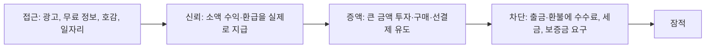

> 금융위원회 「[개정 대부업법 시행 안내](https://www.fsc.go.kr/edu/news/84959)」(2025.07), 금융감독원 소비자경보, 공정거래위원회 [통신판매사업자 조회](https://www.ftc.go.kr/www/selectBizCommList.do?key=253), 카드사의 할부 철회·항변 안내를 바탕으로 종합한 노트다.

## 공통 구조

돈을 노리는 사기는 겉모습이 달라도 같은 순서로 움직인다.

**처음에 실제로 돈을 돌려준다는 점이 핵심이다.** 소액 수익이나 환급을 경험하면 의심이 풀리고, 그 뒤에 넣는 큰돈이 피해액이 된다. 돈을 찾으려는데 돈을 더 내라고 하면 그 시점에서 사기가 확정된 것으로 본다. 추가 입금은 손실만 키운다.

## 투자 사기

| 유형 | 접근 방식 | 위험 신호 |
| --- | --- | --- |
| 유사수신·폰지 | 「매일 투자금의 2%」, 「원금 보장에 연 15%」처럼 확정 고수익을 약속하고, 새 투자자를 데려오면 수당을 준다. 가상자산 예치, 다단계, 협동조합의 모양을 쓴다 | 원금 보장과 고수익은 함께 성립하지 않는다. 뒤에 들어온 돈으로 앞사람 수익을 주는 구조라 모집이 멈추면 무너진다 |
| 불법 리딩방·가짜 거래소 | 급등주 무료 추천, 재테크 강의, 유명인 사칭 광고로 메신저 단체방에 끌어들인 뒤 가짜 거래 앱(HTS)이나 가짜 거래소에 입금하게 한다 | 화면의 수익은 숫자일 뿐이다. 출금하려면 수수료, 세금, 강제 청산 방지금을 내라고 한다 |
| 비상장주식 | 「상장이 임박했다」며 전화나 리딩방에서 비상장주식 매수를 권한다. 소액 수익을 먼저 경험하게 한 뒤 추가 매수를 유도하고 잠적한다 | 금융감독원이 2026년 1월 소비자경보를 「주의」에서 「경고」로 올린 유형이다. 상장 일정은 한국거래소 공시로만 확인한다 |
| 로맨스 스캠 | SNS나 데이팅 앱에서 연인 관계, 결혼 약속으로 신뢰를 쌓은 뒤 해외 가상자산 투자를 권한다 | 온라인에서만 아는 상대가 투자나 송금을 권하면 관계의 깊이와 무관하게 사기로 본다 |
| 손실 보상 | 과거 투자 손실을 코인이나 주식으로 보상해 주겠다며 연락한다 | 피해자 명단을 가지고 다시 접근하는 2차 사기다. 보상 절차에 입금이나 인증을 요구한다 |

### 신뢰 장치는 근거가 아니다

외국 기업의 한국 지사라는 소개, 경찰과 찍은 캠페인 사진, 기부 내역, 방송 뉴스 화면, 정부 부처 홈페이지를 닮은 사이트, 유명 증권사와 같은 상호, 금융당국 명의 문서는 모두 꾸밀 수 있다. 판단 기준은 하나다. **인가·등록을 받은 제도권 금융회사인가.**

- 유사수신은 인가·허가·등록 없이 원금 이상을 돌려주겠다고 약속하며 불특정 다수에게서 돈을 모으는 행위이고, 유사수신행위의 규제에 관한 법률이 금지한다.
- 제도권 금융회사는 단체 채팅방이나 1:1 채팅으로 투자를 권유하지 않는다.
- 불법 업체와의 거래에서 생긴 피해는 금융당국의 분쟁 조정 대상이 아니어서 구제가 어렵다.
- 지인이 권해도 사업의 실체와 수익이 나오는 구조를 직접 확인한다. 권유한 지인도 피해자인 경우가 많다.

## 쇼핑·거래 사기

| 유형 | 수법 | 대응 |
| --- | --- | --- |
| 가짜 쇼핑몰 | 유명 브랜드 사이트를 그대로 베끼고 SNS 광고로 80% 할인 같은 조건을 내건다 | 광고 링크로 들어가지 않고 공식 주소를 직접 입력한다. 도메인 철자를 본다. 신용카드로 결제한다 |
| SNS 공동구매 | 채팅방에서 입금을 받은 뒤 방을 없앤다 | 결제 전에 통신판매업 신고 여부를 확인한다. 계좌 이체만 받는 판매자는 피한다 |
| 체험단·부업 사칭 | 광고대행사를 사칭해 블로그 댓글이나 문자로 접근하고, 외부 메신저로 옮겨 특정 쇼핑몰 가입을 시킨다. 소액 구매를 환급해 준 뒤 「팀 미션」이라며 고액 선결제를 요구한다 | 외부 메신저 이동, 낯선 쇼핑몰의 선결제 후 환급은 사기다. 「간단한 일에 고수익」이 공통 신호다 |
| 대리 구매·노쇼 | 공공기관이나 기업 직원을 사칭해 대량 주문을 넣고, 특정 업체의 물품을 대신 사 달라며 지정 계좌로 입금하게 한다 | 제3의 업체에 선입금하라는 요구가 나오면 그 기관의 대표 번호로 확인한다 |
| 광고대행 계약 | 플랫폼 공식 파트너, 정부 지원사업 선정을 내세우고 매출·검색 상위 노출을 보장한다며 장기 선결제 계약을 맺게 한다 | 공식 대행사인지는 플랫폼 공식 채널에서 확인한다. 보장 문구 자체가 경고 신호다. 약속은 녹취나 문서로 남긴다 |
| 우회 판매 | 재고 없이 주문을 받고 다른 플랫폼에서 같은 상품을 구매자 주소로 주문해 보낸다 | 주문한 곳과 다른 쇼핑몰의 송장·포장으로 오면 의심한다. 이름·주소·연락처가 동의 없이 제3의 판매자에게 넘어간 것이다 |
| 시세보다 싼 금·상품권 | 직거래나 선입금을 조건으로 시세보다 싸게 판다고 한다 | 선입금 거래는 받지 않는다 |
| 이체 화면 위장 | 대면 거래에서 송금 완료 화면을 보여 주지만 실제로는 보내지 않았거나 수취인 표시를 바꾼 것이다 | 상대 화면이 아니라 내 계좌의 입금 내역으로 확인한다 |

### 결제 수단이 구제 수단을 정한다

| 결제 방식 | 문제가 생겼을 때 |
| --- | --- |
| 계좌 이체 | 물품 거래를 가장한 사기는 지급정지 대상이 아니어서 경찰 수사에 기대야 한다. 자세한 내용은 [[voice-phishing-response\|보이스피싱과 스미싱]]에 있다 |
| 신용카드 일시불 | 카드사에 이의 제기를 접수한다. 결제 내역, 광고와 사이트 화면, 판매자와 나눈 대화를 증빙으로 모은다 |
| 신용카드 할부 | 할부 가격이 20만 원 이상이고 3개월 이상 할부면 **할부항변권**으로 남은 할부금의 지급을 거절할 수 있다. 이미 낸 금액에는 적용되지 않으므로 빨리 통지한다 |

- 할부거래법은 **사업자가 상행위를 위해 맺은 거래에는 적용되지 않는다.** 광고대행 계약처럼 사업자끼리 맺은 계약은 할부로 결제해도 항변권을 쓰기 어렵고, 그래서 소상공인을 노린 계약 사기의 피해가 커진다.
- 통신판매업 신고 여부는 공정거래위원회 사업자 정보 공개의 「통신판매사업자 등록현황」에서 상호, 사업자등록번호, 대표자로 조회한다. 도메인, 운영 상태, 신고 일자가 나온다. 폐업 여부는 국세청 홈택스의 사업자등록 상태 조회로 따로 확인한다.

## 불법 사금융

### 위험 신호

- 대출 상담 중에 담당자를 자칭하며 다른 연락처나 다른 업체로 옮겨 가자고 한다.
- 신용 점수나 거래 실적을 올려 준다며 소액 대출을 먼저 받게 하거나, 여러 곳에서 돌려 가며 빌리게 한다.
- 상품권을 사면 한도가 올라간다고 하거나, 빌린 돈을 상품권으로 갚게 한다.
- 문자나 메신저로 저금리 대출을 제안하며 신분증, 통장, 인증 정보를 요구한다.
- 가족과 지인의 연락처를 요구한다. 불법 추심에 쓰인다.

### 금리 한도와 계약의 효력

2025년 7월 22일 시행된 개정 대부업법 기준이다.

| 계약 | 효력 |
| --- | --- |
| 등록 업체, 연 20% 이하 | 유효. 법정 최고금리는 연 20%다 |
| 연 20% 초과 60% 이하 | 20%를 넘는 이자 부분이 무효 |
| 연 60% 초과 | 반사회적 대부계약으로 **원금과 이자 모두 무효** |
| 성착취, 인신매매, 신체 상해, 폭행·협박을 동반한 계약 | 금리와 무관하게 원금과 이자 모두 무효 |
| 미등록 불법 사금융업자와 맺은 계약 | 이자 약정 전부 무효 |

- 무효인 계약은 갚을 의무가 없고, 불법 추심은 신고 대상이다. 금융감독원 불법사금융 피해신고센터(1332)와 경찰(112)에 신고한다.
- 금융감독원 홈페이지의 불법금융 신고 메뉴에서 **채무자대리인과 소송 변호사 무료 지원**을 신청할 수 있다. 채무자대리인이 선임되면 추심 연락이 대리인에게 간다. 대한법률구조공단(132)에서도 상담한다.
- 대부업체는 금융감독원 금융소비자 정보포털 「파인」의 「대부업체 조회」(등록대부업체 통합조회)에서 확인한다.

## 송금 전에 확인하는 곳

| 확인할 것 | 경로 |
| --- | --- |
| 제도권 금융회사인지 | 금융감독원 「파인」의 제도권 금융회사 조회 |
| 등록 대부업체인지 | 「파인」의 「대부업체 조회」(등록대부업체 통합조회) |
| 통신판매업 신고 여부 | 공정거래위원회 통신판매사업자 등록현황 |
| 사업자의 휴·폐업 | 국세청 홈택스 사업자등록 상태 조회 |
| 수상한 전화번호 | 경찰청 통합대응단 「피싱안심SOS」의 전화번호 검색 |

## 정리

- 원금 보장과 고수익을 함께 말하면 사기다. 찾으려는 돈에 수수료를 내라고 하면 더 넣지 않는다.
- 사진, 뉴스 화면, 기관 로고는 근거가 아니다. 인가·등록 여부를 공식 조회로 확인한다.
- 온라인 거래는 신용카드로, 금액이 크면 3개월 이상 할부로 결제해 대응 수단을 남긴다.
- 연 60%를 넘는 대부계약과 미등록 업자의 이자 약정은 무효다. 혼자 갚으려 하지 말고 신고한다.

관련 노트: [[voice-phishing-response|보이스피싱과 스미싱]], [[unknown-deposit-account-freeze|모르는 입금과 통장묶기]], [[sponsored-review-rules|협찬 후기와 원고료]], [[personal-security-after-data-breach|개인정보 유출 뒤 보안 수칙]]
