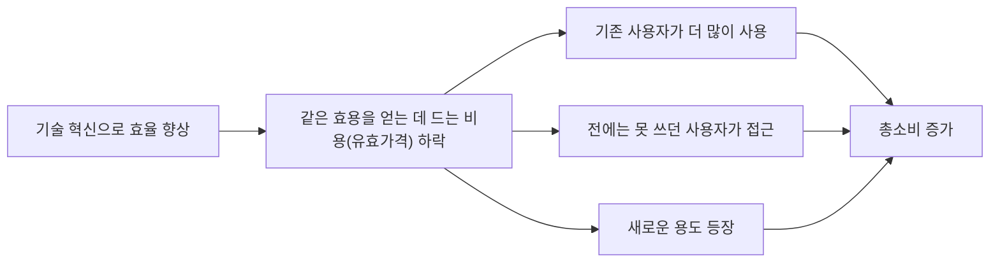

> 윌리엄 스탠리 제번스의 「The Coal Question」(1865)에서 나온 개념을, [제번스의 역설](https://en.wikipedia.org/wiki/Jevons_paradox)과 [리바운드 효과](https://en.wikipedia.org/wiki/Rebound_effect_(conservation))에 대한 정리 자료를 바탕으로 재구성한 노트다.

## 제번스의 역설이란

**자원을 더 효율적으로 쓰게 될수록 그 자원의 총소비가 줄지 않고 오히려 늘어나는 현상**이다. 영국 경제학자 윌리엄 스탠리 제번스가 1865년 「석탄 문제(The Coal Question)」에서 처음 지적했다. 제임스 와트의 개량으로 증기기관의 석탄 효율이 크게 좋아진 뒤 영국의 석탄 소비는 줄지 않고 급증했다. 같은 석탄으로 더 많은 일을 할 수 있게 되자 증기기관을 쓰는 것이 경제적인 분야가 넓어졌기 때문이다.

## 작동 경로

효율 향상은 그 자원이 주는 서비스의 가격을 내리는 것과 같다. 가격이 내려가면 수요가 늘고, 수요가 가격에 민감할수록(가격 탄력성이 클수록) 증가 폭이 커진다.

## 리바운드 효과

**효율 개선으로 기대한 절감량 가운데 수요 증가로 상쇄된 비율**이다. 제번스의 역설은 리바운드 효과가 극단적으로 큰 경우다.

| 리바운드 효과 | 결과 |
| --- | --- |
| 0% | 기대한 만큼 전부 절감된다 |
| 0% 초과 100% 미만 | 절감되지만 기대보다 적다 |
| 100% | 절감분이 전부 상쇄된다 |
| 100% 초과 | 총소비가 늘어난다 (역효과, backfire). 제번스의 역설 |

예를 들어 연비 개선으로 연료 소비가 20% 줄 것으로 기대했는데 주행거리가 늘어 실제로는 15%만 줄었다면, 기대 절감량의 4분의 1이 상쇄된 것이므로 리바운드 효과는 25%다.

### 세 가지 층

| 종류 | 내용 | 예 |
| --- | --- | --- |
| 직접 효과 | 싸진 그 서비스를 더 쓴다 | 연비 좋은 차로 더 멀리, 더 자주 운전한다 |
| 간접 효과 | 아낀 돈을 다른 소비에 쓰고, 그 소비가 다시 자원을 쓴다 | 난방비를 아껴 항공 여행을 간다 |
| 경제 전체 효과 | 효율 향상이 생산성과 성장을 높여 경제 전체의 자원 수요가 늘어난다 | 값싼 에너지가 새 산업을 만든다 |

에너지 효율이 좋아지면 에너지 소비가 늘어나는 경향이 있다는 주장은 1980년대에 대니얼 카줌과 레너드 브룩스가 각각 제기했고, 1992년 해리 손더스가 카줌·브룩스 가설이라는 이름을 붙였다. 리바운드 효과가 실제로 얼마나 큰지, 100%를 넘는 경우가 얼마나 흔한지는 여전히 논쟁 중이다.

## 사례

| 분야 | 효율 향상 | 늘어난 것 |
| --- | --- | --- |
| 증기기관 | 석탄당 출력 증가 | 증기기관 보급과 석탄 총소비 |
| 조명 | 백열등에서 LED로 전환 | 조명을 켜는 장소·시간·밝기 |
| 자동차 | 연비 개선 | 주행거리, 차량 크기 |
| 도로 | 차로 확장으로 통행 속도 개선 | 교통량 (유발 수요) |
| 컴퓨팅 | 연산당 비용 하락 | 연산 사용량과 데이터센터 전력 |

AI에서도 같은 논리가 거론된다. 모델 추론의 효율이 좋아져 단위 비용이 내려가면 쓰임새가 넓어져 연산 장치와 전력의 총수요는 오히려 늘 수 있다는 주장이다. 다만 이는 전망이며, 수요가 실제로 효율 개선 폭을 넘어 늘어나는지는 가격 탄력성에 달려 있다.

## 언제 역설이 강하게 나타나는가

- **수요가 포화되지 않았을 때.** 이미 충분히 쓰고 있는 서비스는 싸져도 더 쓸 여지가 작아 리바운드가 작다. 잠재 수요가 큰 초기 기술일수록 크다.
- **그 자원 비용이 전체 비용에서 큰 비중일 때.** 효율 향상이 가격을 크게 떨어뜨린다.
- **새 용도가 열릴 때.** 기존 용도의 수요 증가보다 전에 없던 용도의 등장이 총소비를 크게 늘린다.

## 정책적 함의

효율 기준과 기술 보급만으로는 총소비 감축이 보장되지 않는다. 효율로 내려간 유효가격을 다시 올리거나 총량을 묶는 장치가 함께 있어야 절감분이 유지된다.

| 수단 | 방식 |
| --- | --- |
| 가격 | 탄소세, 연료세, 혼잡통행료로 사용 비용을 유지한다 |
| 총량 | 배출권 거래제의 배출 상한, 사용량 상한 |
| 수요 관리 | 도로 확장 대신 대중교통과 통행 수요 관리 |

## 정리

- 효율 향상은 가격 인하와 같아서 수요를 늘린다.
- 리바운드 효과는 절감분이 상쇄된 비율이고, 100%를 넘으면 제번스의 역설이다.
- 잠재 수요가 크고 새 용도가 열리는 기술일수록 역설이 강하다.
- 총소비를 줄이려면 효율 정책에 가격·총량 정책을 붙여야 한다.

관련 노트: [[resource-curse-dutch-disease|자원의 저주와 네덜란드병]], [[energy-storage-system|ESS(에너지 저장 시스템)]]
