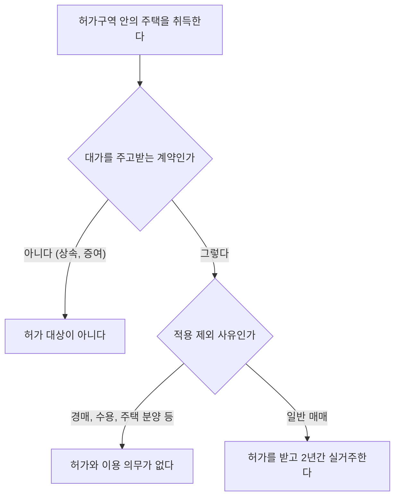

> 「부동산 거래신고 등에 관한 법률」 제11조~제18조·제26조와 시행령, 「도시 및 주거환경정비법」 제39조와 시행령 제37조를 바탕으로 정리한 노트다.

## 토지거래허가구역이란

투기가 우려되는 지역을 정해, 그 안의 토지(주택이라면 주택에 딸린 대지지분)를 **대가를 받고** 넘기는 계약을 맺기 전에 시장·군수·구청장의 허가를 받게 하는 제도다.

- **허가 없이 맺은 계약은 효력이 발생하지 않는다**(부동산거래신고법 제11조). 계약서를 쓰고 돈을 줘도 소유권을 넘겨받을 수 없다.
- 대상은 소유권·지상권을 대가를 받고 이전하거나 설정하는 계약과 그 예약이다.
- 구역의 범위, 지정 기간, 허가가 필요한 면적은 지정 공고마다 다르다. 매수 전에 해당 필지가 구역 안인지, 허가 대상인지를 관할 구청에서 확인한다.

## 허가 기준과 이용 의무

허가는 **실제로 쓸 사람**에게만 나온다. 주택이라면 「자기의 거주용 주택용지로 이용하려는 경우」가 허가 기준이다.

| 항목 | 내용 |
| --- | --- |
| 이용 의무 | 허가받은 목적대로 토지를 이용해야 한다. 기간은 목적에 따라 2년, 4년, 5년이고 자기 거주용은 취득일부터 **2년**이다 |
| 이행강제금 | 목적대로 쓰지 않으면 이행명령을 거쳐 토지 취득가액의 10% 범위에서 이행강제금을 매긴다 |
| 벌칙 | 허가 없이 계약하거나 부정한 방법으로 허가받으면 2년 이하 징역 또는 계약 당시 개별공시지가로 계산한 토지가격의 30% 이하 벌금 |

거주용으로 허가받은 사람은 2년 동안 직접 살아야 하므로, 세입자의 보증금으로 매매대금을 메우는 **전세를 낀 매수(갭투자)가 구조적으로 막힌다.** 허가구역 지정의 실질적인 효과가 이것이다.

## 허가가 필요 없는 취득

| 적용 제외 | 근거 |
| --- | --- |
| 「민사집행법」에 따른 경매 | 법 제14조 제2항 제2호 |
| 공익사업을 위한 토지 수용 | 법 제14조 제2항 제1호 |
| 「주택법」에 따라 주택을 공급(분양)받는 경우 | 시행령 제11조 제3항 |
| 정비사업의 관리처분계획에 따른 분양, 보류지 매각 | 시행령 제11조 제3항 |
| 「건축물의 분양에 관한 법률」에 따른 건축물 분양 | 시행령 제11조 제3항 |

- **경매로 낙찰받으면 허가도, 실거주 의무도 없다.** 그래서 구역이 넓어지면 실거주할 수 없는 수요가 경매로 옮겨 가고, 구역 안 물건의 낙찰가가 감정가를 넘기도 한다. 경매의 절차와 위험은 [[real-estate-auction|부동산 경매 입찰 전 점검]]에 있다.
- 규제는 수요를 없애지 않고 옮긴다. 지정된 구역의 바로 바깥, 허가 대상이 아닌 취득 방식, 막히지 않은 대출 상품 쪽으로 수요가 쏠리는 현상을 풍선효과라고 한다.

## 투기과열지구의 조합원 지위 양도 제한

투기과열지구로 지정된 곳의 정비사업에서는 일정 단계가 지난 뒤 부동산을 산 사람이 **조합원이 될 수 없다**(도시정비법 제39조 제2항).

| 사업 | 이 시점 이후에 산 사람은 조합원이 되지 못한다 |
| --- | --- |
| 재건축 | 조합설립인가 후 |
| 재개발 | 관리처분계획인가 후 |

- 매매뿐 아니라 증여처럼 권리가 바뀌는 모든 행위가 대상이다. 상속과 이혼으로 넘겨받는 경우는 제외된다.
- 조합원이 되지 못한 매수인은 새 아파트를 받지 못하고 **현금으로 청산**받는다(제39조 제3항). 입주권이 나오지 않는 이런 물건을 흔히 물딱지라고 부른다.

### 양도해도 지위가 넘어가는 예외

파는 사람이 아래 사유에 해당하면 산 사람이 조합원 지위를 이어받는다.

| 예외 | 조건 |
| --- | --- |
| 1세대 1주택 장기 보유 | 양도인이 10년 이상 소유하고 5년 이상 거주한 주택 |
| 세대 전원의 이전 | 근무·생업, 1년 이상 치료가 필요한 질병, 취학, 결혼으로 세대원 전부가 다른 시·군으로 옮기는 경우 |
| 상속 주택으로 이전 | 상속받은 주택으로 세대원 전부가 옮기는 경우 |
| 해외 이주 | 세대원 전부가 해외로 이주하거나 2년 이상 체류하는 경우 |
| 사업 지연 | 재건축 조합설립인가일부터 3년 이상 사업시행인가 신청이 없거나, 사업시행계획인가일부터 3년 안에 착공하지 못했거나, 착공일부터 3년 이상 준공되지 않은 경우. 양도인이 3년 이상 계속 소유했어야 한다 |
| 금융기관 채무로 인한 경매·공매 | 국가·지방자치단체·금융기관에 대한 채무를 갚지 못해 경매나 공매에 넘어간 경우 |
| 지정 전 계약 | 투기과열지구 지정 전에 계약하고 지정일부터 60일 안에 부동산 거래신고를 한 경우 |

**재건축 단지를 살 때는 가격보다 먼저 조합원 지위가 넘어오는지를 확인한다.** 사업 단계(조합설립인가일, 사업시행인가일, 착공일)와 매도인의 보유·거주 기간을 조합에 직접 확인하고, 예외 사유를 증빙으로 받아 둔다.

## 조정대상지역

조정대상지역으로 지정되면 세금 요건이 달라진다. 2017년 8월 3일 이후 조정대상지역에서 취득한 주택은 2년 보유에 더해 **2년 이상 거주**해야 1세대 1주택 양도소득세 비과세를 받는다. 자세한 내용은 [[housing-tax-basics|주택 세금의 기준]]에 있다.

## 정리

- 허가구역에서는 허가 없이 맺은 계약이 효력이 없고, 거주용 허가에는 2년 실거주가 따른다.
- 경매, 수용, 주택 분양은 허가 대상이 아니라서 구역 지정 뒤 수요가 그쪽으로 옮겨 간다.
- 투기과열지구의 재건축·재개발 물건은 매수 시점에 따라 조합원 지위가 넘어오지 않고 현금청산될 수 있다.
- 구역 지정 여부와 허가 대상은 공고마다 다르므로 관할 구청에서, 조합원 지위는 조합에서 계약 전에 확인한다.

관련 노트: [[real-estate-auction|부동산 경매 입찰 전 점검]], [[housing-subscription|주택청약]], [[housing-tax-basics|주택 세금의 기준]], [[home-purchase-checks|주택 매매 전 확인]]
