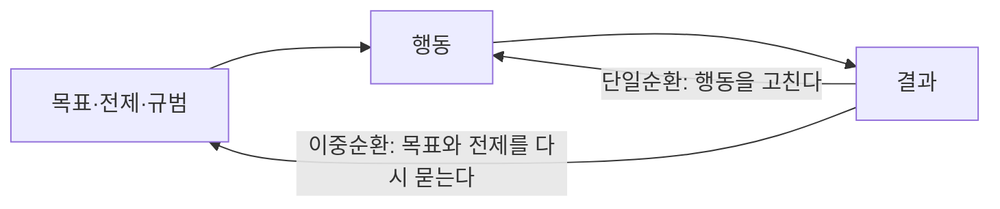

> 인출 연습과 간격 효과 연구, 에릭슨의 의도적 연습과 맥나마라·햄브릭·오즈월드의 2014년 메타분석, 크리스 아지리스의 「[Double Loop Learning in Organizations](https://hbr.org/1977/09/double-loop-learning-in-organizations)」(1977), 하인리히의 사고 삼각형에 대한 후속 검증을 바탕으로 종합한 노트다.

## 네 가지 질문

| 질문 | 답하는 개념 |
| --- | --- |
| 배운 것을 어떻게 오래 남기나 | 인출 연습, 간격 효과 |
| 실력은 어떻게 느나 | 의도적 연습 |
| 숙달은 어떤 순서로 가나 | 수파리, 중용의 다섯 단계 |
| 실패를 어떻게 학습으로 바꾸나 | 이중순환학습, AAR, 블랙박스 사고 |

## 기억을 굳히는 원리

### 인출 연습

**다시 읽는 것보다 떠올리는 것이 기억을 오래 남긴다.** 시험 효과(testing effect) 또는 인출 연습(retrieval practice)이라고 한다. 시험은 기억을 재는 도구이기 전에 기억을 만드는 활동이다.

| 시기 | 연구 | 내용 |
| --- | --- | --- |
| 1909년 | 에드위나 애벗 | 시험 효과를 실험으로 기록한 첫 연구 |
| 2006년 | 로디거와 카픽, 「Test-Enhanced Learning」 | 기억 시험을 치르는 것이 장기 보존을 높인다는 것을 보였다. 이후 인출 연습 연구의 기준점이 됐다 |
| 2014년 이후 | 메타분석들 | 다시 공부하기와 비교한 시험의 이점, 다른 문제로의 전이, 교실 퀴즈의 효과를 종합했다 |

- 읽고 난 직후에는 다시 읽기가 더 잘 아는 느낌을 준다. 그 느낌이 학습량은 아니다.
- 실천: 책을 덮고 방금 읽은 것을 적는다. 빈칸과 질문으로 바꿔 스스로 푼다. 모임이나 수업의 끝에 「오늘 가장 쓸모 있던 것, 새로 안 것, 기억하고 싶은 것」을 각자 말하게 하고, 다음 시간은 「지난번 이후 써 본 것」을 묻는 것으로 시작한다. 답을 스스로 만들게 하는 질문이 인출이다.
- 가림판으로 가리고 떠올리는 구체적인 암기 루틴은 [[memorization|블럭-건물 암기법]]에 있다.

### 간격 효과

같은 시간을 공부해도 **한 번에 몰아서 하는 것보다 간격을 두고 나눠 하는 쪽**이 오래 남는다. 헤르만 에빙하우스가 1885년 저서 『기억에 관하여』에서 처음 보고했다. 언어 회상 연구를 모은 2006년 세페다 등의 종합에서는 271건의 비교 가운데 259건에서 간격을 둔 쪽이 몰아서 한 쪽보다 나았다.

- 잊어버릴 만할 때 다시 떠올리는 것이 가장 효과가 크다. 벼락치기는 내일 시험에는 통해도 한 달 뒤에는 남지 않는다.
- 인출 연습과 간격을 합친 것이 간격 반복(spaced repetition)이다.

### 입력과 생각을 번갈아 한다

읽기와 강의 듣기(입력)만으로는 지식이 내 것이 되지 않고, 혼자 생각하기만 해서는 근거가 빈다. 『논어』 위정편의 「배우기만 하고 생각하지 않으면 얻는 것이 없고, 생각만 하고 배우지 않으면 위태롭다」(學而不思則罔 思而不學則殆)가 이 원칙이다. 경험도 마찬가지다. 겪는 것만으로는 배워지지 않고, 무슨 일이 있었는지 떠올려 정리해야 학습이 된다.

## 의도적 연습과 1만 시간

**의도적 연습**(deliberate practice)은 심리학자 앤더스 에릭슨이 정리한 개념이다. 전문성은 반복 횟수가 아니라 연습의 방식에서 나온다는 것이 요지다.

| 요소 | 내용 |
| --- | --- |
| 쪼갠다 | 기술을 부분으로 나누고 약한 부분을 골라 연습한다 |
| 조금 어렵게 | 지금 수준보다 약간 높은 과제를 잡는다 |
| 즉시 피드백 | 결과를 바로 확인하고 고친다 |
| 난도를 올린다 | 익숙해지면 더 어려운 수준으로 옮긴다 |

### 「1만 시간의 법칙」은 법칙이 아니다

| 통념 | 실제 |
| --- | --- |
| 1만 시간을 채우면 전문가가 된다 | 이 숫자는 말콤 글래드웰이 대중화했다. 에릭슨은 글래드웰이 의도적 연습과 그냥 하는 연습을 구분하지 않았다고 반박했다. 단순히 그 활동을 하는 시간은 의도적 연습보다 효과가 훨씬 작다 |
| 연습량이 실력 차이의 대부분을 설명한다 | 맥나마라, 햄브릭, 오즈월드의 2014년 메타분석에서 의도적 연습이 설명한 성과 차이는 **게임 26%, 음악 21%, 스포츠 18%, 교육 4%, 전문 직업 1% 미만**이었다 |
| 최상위권의 차이도 연습량이다 | 스포츠만 다룬 후속 메타분석에서 전체로는 18%였지만 엘리트 선수 사이에서는 약 1%였다 |

- 이 수치는 사람들 사이의 **성과 차이** 가운데 연습량으로 설명되는 몫이다. 「연습의 효과가 26%뿐」이라는 뜻이 아니고, 나머지가 모두 타고난 재능이라는 뜻도 아니다. 시작 나이, 지도와 환경, 연습의 질, 측정 오차가 나머지에 들어 있다.
- 결론은 「연습은 중요하지만 흔히 말하는 것만큼 전부는 아니다」이다. 개발자에게 옮긴 실천은 [[sustainable-learning-loop|개발자의 지속 가능한 학습 루프]]에 있다.

## 숙달의 단계

### 수파리

**수파리**(守破離, 일본어 슈하리)는 일본 다도와 무도에서 수련의 단계를 가리키는 말이다. 16세기 다인 센노 리큐의 시에서 온 표현으로 설명되고, 후대의 다인 가와카미 후하쿠가 널리 알렸다.

| 단계 | 뜻 | 배우는 사람의 상태 |
| --- | --- | --- |
| 수(守): 지킨다 | 기본기와 형식을 그대로 따른다 | 한 스승, 한 방식을 충실히 따른다 |
| 파(破): 깨뜨린다 | 형식의 예외를 찾고 다른 방식을 시도한다 | 왜 그 형식인지 이해하고 상황에 맞게 바꾼다 |
| 리(離): 떠난다 | 형식에 매이지 않고 자연스럽게 한다 | 형식을 의식하지 않아도 원리에 맞는다 |

- 세 단계는 버리고 넘어가는 계단이 아니라 수가 파 안에, 파가 리 안에 든 동심원이다. 기본기는 끝까지 남는다.
- 형식을 익히기 전에 깨는 것은 파가 아니다. 새 프레임워크와 코딩 컨벤션도 먼저 관례대로 써 본 뒤에 고친다.
- 매뉴얼은 정해진 길만 보여 주고 원칙은 처음 가는 길에서도 방향을 준다. 수 단계에서 매뉴얼을 따르는 목적은 그 뒤의 원칙을 읽어 내는 것이다.

### 중용의 다섯 단계

『중용』 20장은 배움의 과정을 다섯 동사로 적었다(博學之 審問之 愼思之 明辨之 篤行之).

| 단계 | 뜻 | 오늘의 말로 |
| --- | --- | --- |
| 박학(博學) | 널리 배운다 | 입력 |
| 심문(審問) | 자세히 묻는다 | 질문 |
| 신사(愼思) | 신중히 생각한다 | 숙고 |
| 명변(明辨) | 분명히 가린다 | 분별 |
| 독행(篤行) | 꾸준히 실천한다 | 실행 |

앞의 네 단계는 실행을 위한 준비다. 실행에서 얻은 경험이 다시 배움의 재료가 되므로 한 번 지나가는 직선이 아니라 순환이다.

## 실패에서 배우기

### 이중순환학습

크리스 아지리스가 1970년대에 제시한 구분이다. 결과가 기대와 다를 때 **행동만 고치면 단일순환**(single-loop), **그 행동을 낳은 목표와 전제까지 고치면 이중순환**(double-loop)이다.

| | 단일순환 | 이중순환 |
| --- | --- | --- |
| 묻는 것 | 어떻게 하면 제대로 할까 | 이것이 제대로 된 일인가 |
| 온도 조절기 비유 | 설정 온도보다 낮아지면 난방을 켠다 | 왜 그 온도로 설정했는지, 다른 온도가 더 낫지 않은지 묻는다 |
| 예 | 일정이 밀려 야근으로 메운다 | 추정 방식과 범위를 정하는 절차를 바꾼다 |

같은 문제가 되풀이된다면 행동이 아니라 전제가 틀린 것이다. 이중순환이 어려운 이유는 전제를 묻는 일이 그 전제를 세운 사람의 판단을 묻는 일이 되기 때문이다.

### AAR: 의도와 결과를 비교한다

**AAR**(After-Action Review, 사후 검토)은 미 육군에서 시작한 회고 형식이다. 의도한 결과와 실제 결과를 비교하는 데서 시작하고, 참가자 자신의 행동에 초점을 둔다. 책임을 묻거나 질책하는 자리가 아니다. 흔히 네 질문으로 진행한다.

1. 무엇을 하려고 했나(의도한 결과).
2. 실제로 무슨 일이 일어났나.
3. 차이는 왜 생겼나.
4. 다음에는 무엇을 유지하고 무엇을 바꾸나.

3번에서는 내부 요인과 외부 요인을 함께 적는다. 성공은 내 실력, 실패는 운과 남 탓으로 돌리는 **자기 본위 편향**(self-serving bias) 때문에, 실패한 뒤에는 「내가 다르게 할 수 있었던 것」을, 성공한 뒤에는 「도움과 운」을 먼저 적는 편이 균형이 맞는다. 서비스 장애에 적용한 형태는 [[incident-postmortem|장애 대응과 포스트모템]]이다.

### 블랙박스 사고

매슈 사이드의 책 「Black Box Thinking」(2015)의 주제는 **성공은 실패를 대하는 태도에 달려 있다**는 것이다. 책 이름은 사고가 나면 비행 기록 장치를 회수해 원인을 밝히고 업계 전체가 절차를 고치는 항공의 방식에서 왔다.

- 사람과 조직은 실수를 기억에서 지우거나 그럴듯한 이야기로 덮으려 한다. 그래서 실패 기록은 의지가 아니라 **제도**로 남겨야 한다.
- 개선은 큰 아이디어 하나보다 작은 시도와 측정, 수정의 반복에서 나온다.
- 실패한 개인을 벌하는 조직에서는 실패가 보고되지 않고, 보고되지 않은 실패는 반복된다.

### 하인리히 법칙과 그 한계

허버트 하인리히는 1931년 저서 『Industrial Accident Prevention』에서 보험사의 사고 보고서 7만 5천여 건을 분석해 **중상 사고 1건에 경상 사고 29건, 부상 없는 사고 300건**이라는 비율을 제시했다. 큰 사고 전에는 작은 사고와 징후가 여러 번 있으니 작은 것을 고치면 큰 것을 막는다는 뜻으로 쓰인다. 1966년 프랭크 버드는 약 300개 회사의 보고서 170만 건으로 1:10:30:600(중상, 경상, 물적 피해 사고, 아차 사고)을 제시했다.

| 통념 | 실제 |
| --- | --- |
| 1:29:300은 어디에나 맞는 법칙이다 | 원자료가 남아 있지 않아 수치를 검증할 수 없다. 비율은 업종과 작업에 따라 크게 달라진다. 밀폐 공간 작업에서는 중대 사고 1건당 경상이 약 1.2건이었고, 1990년대 중반 영국 통계의 비율도 전혀 달랐다 |
| 작은 사고를 줄이면 큰 사고도 같은 비율로 준다 | 2010년 석유·가스 업계 보고서는 경미한 사고가 줄어드는 동안 사망 사고는 5~8년간 줄지 않았다고 지적했다. 드물지만 치명적인 위험은 원인이 다를 수 있어 따로 관리해야 한다 |
| 사고의 88%는 작업자의 불안전한 행동 때문이다 | 하인리히의 주장이지만, 에드워즈 데밍은 사고 대부분이 개인이 아니라 관리 시스템에서 나온다고 반박했다 |

남는 교훈은 비율이 아니라 방향이다. **작은 이상과 아차 사고를 기록해야 큰 사고의 원인을 미리 볼 수 있다.** 다만 건수 줄이기가 목표가 되면 보고가 숨겨지고, 가장 위험한 드문 사고에서 눈을 떼게 된다.

## 정리

- 다시 읽지 말고 떠올린다. 몰아서 하지 말고 간격을 둔다.
- 시간을 채우는 것이 아니라 약한 부분을 골라 피드백을 받으며 연습한다. 1만 시간과 같은 숫자는 목표가 아니다.
- 형식을 먼저 익히고(수), 이유를 알고 바꾸고(파), 형식 없이도 원리에 맞게 한다(리).
- 실패하면 행동만이 아니라 전제를 묻는다. 의도와 결과의 차이를 비난 없이 적는다.
- 유명한 숫자(1만 시간, 1:29:300)는 원 연구의 조건과 함께 쓴다.

관련 노트: [[memorization|블럭-건물 암기법]], [[sustainable-learning-loop|개발자의 지속 가능한 학습 루프]], [[incident-postmortem|장애 대응과 포스트모템]], [[reading-statistics-and-arguments|통계와 논증을 읽는 법]], [[productivity-techniques|생산성과 습관의 기법]], [[learning-to-code-stages|개발 배우기의 네 단계와 넘는 법]]
