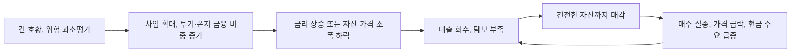

> 한국은행 「[통화정책 효과의 파급](https://www.bok.or.kr/portal/main/contents.do?menuNo=200289)」, 미국 연방준비제도의 [FOMC 안내](https://www.federalreserve.gov/faqs/about_12844.htm), 국가재정법·조세특례제한법 조문, Reinhart와 Sbrancia의 「[The Liquidation of Government Debt](https://www.nber.org/papers/w16893)」(2011), Hyman Minsky의 「[The Financial Instability Hypothesis](https://econpapers.repec.org/RePEc:lev:wrkpap:wp_74)」(1992)를 바탕으로 종합한 노트다.

## 정책시차(Policy Lag)

정책이 필요해진 시점과 그 효과가 실제 경제에 나타나는 시점 사이의 지연이다. 정책을 만드는 쪽에서 생기는 **내부시차**와, 시행된 정책이 경제에 퍼지는 데 걸리는 **외부시차**로 나눈다.

| 구분 | 단계 | 내용 |
| --- | --- | --- |
| 내부시차 | 인식시차 | 경기 변화가 일어난 뒤 통계로 확인해 알아차리기까지 |
| 내부시차 | 결정시차 | 대응이 필요하다고 판단한 뒤 정책을 확정하기까지 (예산 편성, 국회 심의, 회의 의결) |
| 내부시차 | 실행시차 | 확정된 정책을 실제로 집행하기까지 |
| 외부시차 | 효과시차 | 집행된 정책이 소비·투자·물가에 반영되기까지 |

### 통화정책과 재정정책의 차이

| 정책 | 내부시차 | 외부시차 |
| --- | --- | --- |
| 통화정책 | 짧다. 중앙은행이 정기 회의에서 바로 결정하고 즉시 시행한다 | 길다. 기준금리가 시장금리, 자산가격, 신용, 환율, 기대를 차례로 거쳐 총수요와 물가에 닿는다 |
| 재정정책 | 길다. 예산 편성과 입법 절차를 거친다 | 상대적으로 짧다. 정부 지출은 곧바로 수요가 된다 |

- 통화정책의 효과시차는 **길고 가변적**이다. 밀턴 프리드먼은 18번의 경기순환에서 4개월부터 29개월까지의 시차를 확인했고, 어느 시점에 효과가 날지 예측하기 어렵다고 봤다. 연준 인사들의 추정도 9개월~1년에서 18개월~2년까지 엇갈린다.
- 한국은행도 파급 경로가 길고 복잡하며 경제 상황에 따라 달라져, 기준금리 변경의 효과 크기와 시차를 정확히 재기 어렵다고 설명한다.
- **시차가 길면 정책이 경기를 오히려 흔들 수 있다.** 침체에 대응한 부양책이 회복기에 작동하면 과열을 키우고, 과열에 대응한 긴축이 둔화기에 작동하면 침체를 깊게 한다.
- 시차를 줄이는 방법은 속보성 지표로 인식을 앞당기는 것, 조건이 충족되면 자동으로 작동하는 장치(실업급여, 누진세 같은 자동안정장치)를 두는 것, 현재 지표가 아니라 전망을 기준으로 미리 움직이는 것이다.

## FOMC와 미국 기준금리

**FOMC(Federal Open Market Committee, 연방공개시장위원회)**는 미국 연방준비제도의 통화정책을 정하는 회의체다. 한국은행의 금융통화위원회에 해당한다.

| 항목 | 내용 |
| --- | --- |
| 의결권 | 12명. 연준 이사 7명, 뉴욕 연방준비은행 총재, 나머지 11개 지역 연준 총재 가운데 1년씩 돌아가며 맡는 4명 |
| 참석 | 의결권이 없는 지역 연준 총재도 모두 참석해 토론한다 |
| 정기회의 | 1년에 8번, 약 6주 간격. 필요하면 임시회의를 연다 |
| 결정 대상 | 단기 정책금리인 연방기금금리의 목표 범위, 자산 매입·축소 같은 대차대조표 정책 |
| 경제전망 | 분기 마지막 회의(3월, 6월, 9월, 12월)에 참석자들의 경제전망 요약(SEP)을 낸다 |

### 점도표(Dot Plot)

SEP에 실리는 그림으로, 참석자 각자가 적절하다고 보는 연말 정책금리 수준을 점 하나씩으로 찍은 것이다. 의결권이 없는 총재의 점도 들어간다. 시장은 점들의 **중앙값**으로 금리 경로를 읽는다. 점도표는 위원회의 약속이 아니라 그 시점 개인 전망의 모음이라, 지표가 바뀌면 다음 분기에 점도 움직인다.

### 금리 결정에 쓰이는 지표

연준의 목표는 물가 안정과 최대 고용 두 가지다. 그래서 **물가 지표**(소비자물가지수 CPI, 생산자물가지수 PPI, 연준이 2% 목표의 기준으로 삼는 개인소비지출 PCE 물가지수)와 **고용 지표**(비농업 고용, 실업률)가 발표될 때마다 금리 전망이 바뀐다. 고용이나 물가가 예상보다 강하면 인하 기대가 줄어 채권금리가 오른다. 금리가 자산 가격으로 번지는 경로는 [[interest-rate-exchange-rate|금리·환율·물가의 연결]]에 있다.

## 의무지출과 재량지출

| 구분 | 정의 | 예 |
| --- | --- | --- |
| 의무지출 | 법률에 따라 지출 의무가 생기고 법령에 따라 규모가 결정되는 법정지출과 이자지출 (국가재정법 제7조) | 지방교부세, 지방교육재정교부금, 공적연금 급여와 기초연금 같은 법정 복지지출, 국제조약에 따른 분담금, 국채·차입금 이자 |
| 재량지출 | 정부와 국회가 해마다 규모를 정할 수 있는 지출 | 사회간접자본 투자, 연구개발, 국방 전력 사업, 각종 보조 사업 |

- 의무지출을 줄이려면 예산 조정이 아니라 **근거 법률을 고쳐야** 한다. 수급 자격과 지급액이 법에 적혀 있어서 대상자가 늘면 지출이 자동으로 늘어난다.
- 고령화로 연금·복지 지출이 늘고 국가채무가 쌓여 이자가 늘면 의무지출 비중이 커진다. 그만큼 경기 대응이나 신규 투자에 쓸 재량지출 여력이 줄어 재정이 경직된다.
- 정부는 국가재정운용계획에 의무지출과 재량지출의 증가율, 산출 내역을 함께 담아 국회에 낸다.

## 조세지출(Tax Expenditure)

비과세, 소득공제, 세액공제, 우대세율, 과세이연 같은 **조세특례로 세금을 깎아 주는 방식의 재정 지원**이다. 정부가 세금을 걷어 보조금으로 주는 것과 경제적 효과가 같지만 세출 예산에는 잡히지 않아서, 보이지 않는 지출이 된다.

| 관리 장치 | 내용 |
| --- | --- |
| 조세지출예산서 | 직전 연도 실적과 해당 연도·다음 연도 추정액을 기능별·세목별로 분석해 예산안과 함께 국회에 낸다 (조세특례제한법 제142조의2) |
| 국세감면율 한도 | 국세감면율은 국세감면액을 (국세 수입 + 국세감면액)으로 나눈 비율이다. 직전 3년 평균 국세감면율에 0.5%p를 더한 한도 이하로 유지하도록 노력해야 한다 (국가재정법 제88조) |
| 한도 초과 보고 | 국세감면율이 한도를 넘으면 그 내역과 사유를 국회에 제출한다 (2026년 2월 신설) |
| 신규 감면의 재원 대책 | 부처가 새 국세감면을 요청할 때는 기존 감면 축소나 지출 축소 방안을 함께 낸다 |
| 일몰제 | 조세특례에 적용 기한을 두고, 기한이 오면 연장 여부를 다시 심사한다 |

한도는 「노력해야 한다」는 규정이어서 넘더라도 감면이 무효가 되지는 않는다. 일몰 기한이 온 특례가 반복 연장되면 사실상 영구 지출이 된다는 점이 조세지출 관리의 고질적 문제다.

## 금융억압(Financial Repression)

정부가 금리와 자금 흐름을 규제해 **자금을 시장보다 싸게 조달하고 부채 부담을 낮추는 정책 묶음**이다. 1973년 로널드 매키넌과 에드워드 쇼가 개발도상국의 금융 규제를 비판하며 쓴 용어이고, Reinhart와 Sbrancia는 이를 선진국의 전후 부채 축소 과정에 적용했다.

| 수단 | 작동 방식 |
| --- | --- |
| 금리 상한 | 예금·대출 금리나 국채 금리를 명시적 또는 암묵적으로 묶는다 |
| 국채 의무 보유 | 은행, 보험사, 연기금이 규제상 국채를 많이 들도록 해 국내에 고정 수요를 만든다 |
| 자본 이동 통제 | 자금이 더 높은 수익을 찾아 해외로 나가지 못하게 한다 |
| 정부와 금융기관의 밀착 | 국책 금융기관, 정책 대출, 대출 배분 지도 |

### 보이지 않는 세금인 이유

실질금리는 명목금리에서 물가상승률을 뺀 값이다. 명목금리를 낮게 묶어 둔 채 물가가 오르면 실질금리가 마이너스가 된다. 이때 **예금자와 채권 보유자의 구매력이 줄어든 만큼 채무자인 정부의 실질 부채가 줄어든다.** 세법을 고치지 않고 저축자에게서 정부로 부가 옮겨 가므로 세금과 같은 효과다.

- 1945~1980년 선진국의 실질금리는 대략 절반의 기간 동안 마이너스였다. 미국과 영국은 이 방식으로 해마다 GDP의 3~4%에 해당하는 부채를 줄인 것으로 추정된다.
- 물가상승률이 아주 높거나 예상 밖일 필요는 없다. 꾸준한 인플레이션과 낮게 묶인 금리가 오래 이어지면 효과가 누적된다.
- 증세, 지출 삭감, 채무 재조정 없이 부채비율을 낮춘다는 것이 정부에게 장점이다. 비용은 예금과 채권에 의존하는 저축자, 연금 생활자가 지고, 실물자산 보유자와의 격차가 벌어진다. 자금이 수익성이 아니라 규제에 따라 배분되면서 투자 효율도 떨어진다.

## 민스키 모멘트(Minsky Moment)

호황기에 쌓인 부채가 한계에 닿아 **자산 가격이 갑자기 무너지기 시작하는 시점**이다. 용어는 1998년 러시아 채무 위기를 설명하며 자산운용사 PIMCO의 폴 맥컬리가 만들었고, 이름은 금융 불안정성 가설을 세운 경제학자 하이먼 민스키에서 왔다.

### 금융 불안정성 가설

핵심 주장은 **안정이 불안정을 낳는다**는 것이다. 호황이 길어지면 차입자와 대출자 모두 위험을 낮게 보고, 부채 구조가 점점 취약한 쪽으로 옮겨 간다.

| 차입 유형 | 현금흐름으로 갚을 수 있는 범위 | 버티는 조건 |
| --- | --- | --- |
| 헤지(hedge) 금융 | 이자와 원금 모두 | 영업이 유지되면 된다 |
| 투기(speculative) 금융 | 이자만 | 만기마다 원금을 다시 빌릴 수 있어야 한다 |
| 폰지(Ponzi) 금융 | 이자도 못 갚는다 | 자산 가격이 계속 올라 팔거나 더 빌릴 수 있어야 한다 |

투기·폰지 금융의 비중이 커진 상태에서 금리가 오르거나 자산 가격이 조금만 꺾여도 연쇄 반응이 시작된다.

빚을 갚으려고 **팔 수 있는 좋은 자산부터 파는 것**이 특징이다. 그래서 문제 자산과 무관한 자산까지 함께 떨어지고, 가격 하락이 다시 담보 부족과 대출 회수를 부른다. 신용융자가 많이 쌓인 시장에서 급락 때 반대매매가 낙폭을 키우는 것도 같은 구조다.

## 정리

- 정책은 시차를 두고 작동한다. 통화정책은 결정이 빠르지만 효과가 늦고, 재정정책은 결정이 늦지만 효과가 빠르다.
- FOMC는 연 8회 열리고, 점도표는 3·6·9·12월 회의에 나오는 개인 전망의 중앙값으로 읽는다.
- 의무지출은 법을 고쳐야 줄일 수 있고, 조세지출은 예산에 보이지 않는 지출이라 감면율 한도와 일몰제로 관리한다.
- 금융억압은 마이너스 실질금리로 저축자의 부를 채무자인 정부로 옮긴다.
- 민스키 모멘트는 부채 구조가 취약해진 뒤 작은 충격이 투매로 번지는 순간이다.

관련 노트: [[interest-rate-exchange-rate|금리·환율·물가의 연결]], [[asset-pricing-required-return|자산 가격의 형성: 요구수익률, 멀티플, 성장]], [[trade-tariff-law|관세의 종류와 미국 통상법의 관세 근거 조항]]
