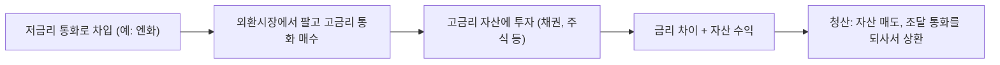
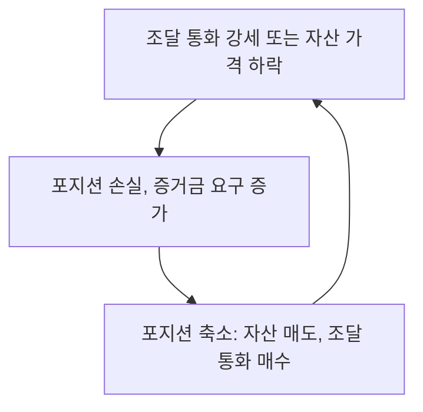

> 환율이 투자 수익률에 들어오는 경로를 정리한 노트다. 캐리 트레이드 청산 사례는 국제결제은행(BIS) Bulletin 90 「[The market turbulence and carry trade unwind of August 2024](https://www.bis.org/publ/bisbull90.htm)」(2024.8)을 참고했다.

## 해외 자산 수익률의 분해

해외 주식이나 해외 ETF를 원화로 평가한 수익률에는 **자산 자체의 수익과 환율 변동이 곱해져 있다.**

```text
원화 수익률 = (1 + 현지 통화 수익률) × (1 + 환율 변동률) - 1

예 1: 미국 주식 +5%, 원/달러 환율 1,300 → 1,430원(+10%)
      1.05 × 1.10 - 1 = +15.5%     이 가운데 주식이 번 것은 5%뿐이다
예 2: 미국 주식 +10%, 원/달러 환율 1,400 → 1,260원(-10%)
      1.10 × 0.90 - 1 = -1%        주식은 올랐는데 원화로는 손실이다
```

### 환율 착시

원화가 약해진 시기에는 해외 자산의 원화 수익률이 실제 투자 성과보다 좋아 보인다. 이 부분은 종목을 잘 골라서 번 것이 아니라 원화 가치가 내려서 생긴 숫자다. 원화가 다시 강해지면 같은 크기로 되돌려진다.

| 확인할 것 | 방법 |
| --- | --- |
| 성과의 출처 | 증권사 앱의 원화 평가손익과 현지 통화 기준 수익률을 따로 본다 |
| 비교 기준 | 같은 기간의 현지 지수 수익률(달러 기준)과 내 종목의 현지 통화 수익률을 견준다 |
| 환전 시점 | 환전한 날의 환율이 매입 원가에 들어간다. 주가와 환율 두 가지 시점 위험을 진다 |

환율은 금리 차이와 자금 흐름에 따라 움직인다. 그 원리는 [[interest-rate-exchange-rate|금리·환율·물가의 연결]]에 있다.

## 환노출과 환헤지

해외 자산에 투자하는 국내 상장 ETF와 펀드는 환율을 다루는 방식에 따라 둘로 나뉜다.

| 구분 | 이름 표기 | 수익률 | 비용 |
| --- | --- | --- | --- |
| 환노출형(UH, unhedged) | 표기 없음 | 자산 수익률 × 환율 변동 | 없음 |
| 환헤지형(H, hedged) | 이름 끝에 (H) | 자산 수익률에 가깝다. 환율 변동을 선물환 등으로 상쇄한다 | 헤지 비용 |

**헤지 비용은 대체로 두 통화의 단기 금리 차이에서 나온다.** 원화 금리가 달러 금리보다 낮으면, 달러를 미리 파는 선물환 가격이 현재 환율보다 낮게 정해져 그 차이만큼 해마다 수익률이 깎인다. 반대로 원화 금리가 더 높으면 헤지에서 이익이 생긴다. 헤지 비용은 보수에 표시되지 않고 순자산가치에 녹아든다.

| 관점 | 근거 |
| --- | --- |
| 환노출을 택한다 | 세계 증시가 급락하는 위험 회피 국면에는 달러가 강해지는 경향이 있어, 달러 자산의 환차익이 주가 하락을 일부 덜어 준다. 헤지 비용도 내지 않는다. 장기 주식 투자에 흔한 선택이다 |
| 환헤지를 택한다 | 채권처럼 자산의 변동성이 작으면 환율 변동이 수익률 대부분을 좌우해 버린다. 투자 기간이 짧거나 환율이 높은 수준이라 내려갈 때의 손실이 걱정될 때도 쓴다 |

환헤지형이 환율 영향을 완전히 없애지는 못한다. 헤지 계약의 규모와 만기를 주기적으로 맞추는 과정에서 오차가 남는다.

## 캐리 트레이드

**캐리 트레이드(carry trade)는 금리가 낮은 통화로 돈을 빌려 금리가 높은 통화의 자산에 투자해 금리 차이를 얻는 거래다.** 빌리는 쪽 통화를 조달 통화라고 한다. 오랫동안 금리가 낮았던 엔화가 대표적이고, 스위스프랑도 쓰인다.



### 수익 구조

```text
캐리 수익 ≈ (투자 자산 수익률 - 조달 금리) - 조달 통화의 절상률
```

금리 차이는 조금씩 꾸준히 쌓이지만 환율은 며칠 만에 그 몇 년 치를 지울 수 있다. 그래서 조달 통화의 조건은 금리가 낮다는 것만이 아니다.

| 조건 | 이유 |
| --- | --- |
| 금리가 낮다 | 조달 비용이 낮아야 금리 차이가 남는다 |
| 통화 가치가 급등하지 않는다 | 갚을 때 조달 통화가 비싸져 있으면 환손실이 금리 수익을 넘는다 |
| 유동성이 풍부하다 | 큰 금액을 빌리고 되사도 환율이 크게 밀리지 않아야 한다 |

스위스프랑은 금리가 낮지만 시장 규모가 엔화보다 작고 안전자산으로 여겨져, 유럽 정세가 불안해지면 가치가 급등한다. 조달 통화로서는 이 점이 약점이다.

### 청산이 시장을 흔드는 이유

캐리 트레이드를 접으려면 투자한 자산을 팔고 조달 통화를 되사야 한다. 청산이 몰리면 두 가지가 동시에 일어난다.

- 조달 통화가 강해진다(엔 캐리라면 엔화 급등).
- 투자 대상이던 자산이 팔린다(주식, 고금리 통화 채권).

청산의 계기는 조달 통화의 금리 인상, 두 나라 금리 차이 축소, 위험 회피 심리 확산이다. 캐리 포지션에는 빌린 돈이 겹겹이 쓰이기 때문에 청산은 스스로를 키운다.



2024년 8월 초의 급락이 이 구조였다. 부진한 미국 경제 지표에 대한 첫 반응을 주식·외환시장의 레버리지 포지션 청산이 증폭시켰고, 외환 캐리 트레이드가 큰 타격을 받았다. BIS는 사건 직전 엔 캐리 트레이드 규모를 대략 40조 엔(약 2,500억 달러)으로 추정하면서, 통계에 잡히지 않는 부분 때문에 실제보다 작게 잡혔을 가능성이 크다고 밝혔다. 시장은 빠르게 안정됐지만, 손실이 나면 포지션을 줄이고 증거금이 오르는 순응적(procyclical) 디레버리징 구조는 그대로 남아 있다.

- 캐리 트레이드의 전체 규모는 정확히 측정되지 않는다. 그래서 청산이 한 번에 끝났는지, 여러 번에 나뉘어 올지 미리 알기 어렵다.
- 조달 통화국의 자금이 많이 들어와 있던 시장일수록 청산 때 자금 이탈이 크다.

## 정리

- 해외 자산의 원화 수익률은 자산 수익률과 환율 변동률의 곱이다. 두 부분을 나눠 봐야 실제 투자 성과가 보인다.
- 환헤지는 환율 변동을 막는 대신 금리 차이만큼의 비용을 낸다. 자산의 변동성과 투자 기간에 따라 고른다.
- 캐리 트레이드는 금리 차이를 조금씩 벌다가 조달 통화가 급등할 때 크게 잃는 구조다.
- 캐리 청산은 조달 통화 강세와 위험자산 매도를 동시에 일으키고, 레버리지 때문에 스스로 커진다.

관련 노트: [[interest-rate-exchange-rate|금리·환율·물가의 연결]], [[etf-basics|ETF의 구조와 선택 기준]], [[investing-arithmetic|투자의 산수]], [[asset-pricing-required-return|자산 가격의 형성]]
