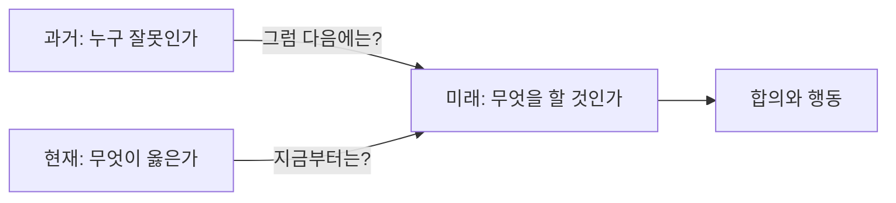

> 제이 하인리히(Jay Heinrichs)의 『Thank You for Arguing』(2007)가 아리스토텔레스 『수사학』을 풀어 쓴 틀, Flynn과 Lake의 논문 「If you need help, just ask」(Journal of Personality and Social Psychology, 2008), 『안자춘추』와 『전국책』의 간언 고사를 종합한 노트다.

## 설득의 세 수단

아리스토텔레스는 설득의 수단을 셋으로 나눴다. 논리만으로는 사람이 움직이지 않고, 셋이 함께 있어야 한다.

| 수단 | 무엇에 기대나 | 듣는 사람의 질문 |
| --- | --- | --- |
| 에토스(ethos) | 말하는 사람의 인품과 신뢰 | 「이 사람 말을 믿어도 되나」 |
| 파토스(pathos) | 듣는 사람의 감정 | 「이 일이 내게 왜 중요한가」 |
| 로고스(logos) | 논리와 근거 | 「말이 되나」 |

에토스는 다시 세 가지 인상으로 이뤄진다.

| 요소 | 청중이 받는 인상 |
| --- | --- |
| 덕(virtue) | 나와 같은 가치를 가진 사람이다 |
| 실천적 지혜(practical wisdom) | 이 일을 잘 알고 해낼 사람이다 |
| 사심 없음(disinterest) | 자기 이익이 아니라 내 이익을 생각한다 |

## 디코럼: 청중의 기대에 맞춘다

**디코럼(decorum)**은 「알맞다, 어울린다」는 뜻의 라틴어에서 온 수사학 개념으로, 말투·옷차림·태도를 청중의 기대에 맞추는 기술이다. 에토스를 얻는 첫 도구다. 사람은 자기와 닮은 사람, 자리에 어울리는 사람의 말을 더 쉽게 받아들인다.

- 기준은 내가 편한 방식이 아니라 **청중이 이 자리에서 내게 기대하는 모습**이다.
- 같은 내용도 상대에 따라 표현을 바꾼다. 가까운 실무 동료에게는 직설적으로, 경영진에게는 결론과 근거를 격식 있게 말한다.
- 발표는 두 갈래로 준비한다. 하나는 무엇을 말할지(콘텐츠), 다른 하나는 참석자가 내게 어떤 태도를 기대하는지(상황)다. 상황 쪽 질문에 먼저 답한다.
- 글도 같다. 이메일과 메모를 보내기 전에 읽는 사람이 기대하는 형식과 어조인지 본다. 형식은 [[business-email|비즈니스 이메일 쓰는 법]]에 있다.
- 무리해서 섞이려는 것은 디코럼이 아니다. 출발점은 상대와 내가 가진 공통점을 찾는 것이다.

## 시제를 바꾸면 논쟁이 바뀐다

아리스토텔레스는 논쟁을 다루는 문제에 따라 셋으로 나눴고, 각각은 시제와 짝을 이룬다.

| 다루는 문제 | 시제 | 수사학의 갈래 | 전형적인 자리 | 끝나는 곳 |
| --- | --- | --- | --- | --- |
| 비난(누구 잘못인가) | 과거 | 법정 수사(forensic) | 재판, 책임 추궁 | 유죄와 처벌 |
| 가치(무엇이 옳고 좋은가) | 현재 | 과시 수사(demonstrative) | 설교, 추도사, 편 가르기 | 같은 편끼리의 결속 |
| 선택(무엇을 할 것인가) | 미래 | 심의 수사(deliberative) | 회의, 협상, 가족의 결정 | 합의와 행동 |

- **합의가 필요하면 대화를 미래 시제로 옮긴다.** 과거 시제로는 범인만 찾고, 현재 시제로는 서로를 규정할 뿐이다. 사람은 신념보다 행동을 더 쉽게 바꾼다.
- 전환하는 말은 단순하다. 「누가 그랬어」가 나오면 「그럼 다음에는 어떻게 할까」로, 「넌 그런 사람이야」가 나오면 「지금부터 뭘 하면 좋을까」로 받는다.
- 과거 시제가 쓸모없다는 뜻은 아니다. 원인을 조사할 때는 과거를 다뤄야 한다. 다만 조사가 끝나면 선택으로 넘어가야 문제가 풀린다. 회의에서 이 구분은 [[effective-meetings|회의 잘하는 법]]의 발산·수렴과 맞닿아 있다.

### 논쟁을 멈출 신호

심의가 성립하려면 고를 수 있는 선택지가 있어야 하고, 양쪽이 설득될 가능성을 열어 둬야 한다. 아래 신호가 보이면 이기려 들지 말고 미래 시제로 한 번 돌려 본 뒤, 그래도 안 되면 멈춘다.

| 신호 | 왜 논쟁이 안 되나 |
| --- | --- |
| 고를 선택지가 없다 | 이미 일어난 일의 옳고 그름이나 신념 자체는 결론이 날 수 없다 |
| 시제가 과거·현재에 붙박였다 | 미래로 가자고 해도 비난과 편 가르기로 되돌아간다 |
| 「원래 그렇게 하는 거야」만 되풀이한다 | 규칙과 전통을 내세워 논의 자체를 막는다 |
| 모욕, 빈정거림, 협박이 나온다 | 목적이 합의가 아니라 상대를 깎아내리는 것이다 |
| 자기 논리의 오류를 알아보지 못한다 | 근거를 주고받을 수 없다 |

여럿이 보는 자리에서 공격을 받으면 같은 수준으로 맞서지 않는다. 설득할 대상은 공격한 사람이 아니라 **지켜보는 청중**이다. 차분함과 유머를 지킨 쪽이 에토스를 얻는다. 낙인을 찍는 말을 들었을 때는 반박하기보다 「그 말이 정확히 어떤 뜻인가요」로 단어의 정의를 되묻는다. 발표나 토론에 앞서 호의적인 청중을 미리 알아 두면 돌발 방해가 생겼을 때 힘이 된다.

## 두괄식으로 말하기

말은 글과 달리 되돌려 읽을 수 없다. 그래서 **결론을 첫 문장에 두고** 근거와 사례를 뒤에 붙인다. 듣는 사람의 집중이 가장 높을 때 핵심이 전달되고, 뒤따르는 말은 그 결론을 기준으로 정리돼 들린다.

- 틀은 PREP(Point, Reason, Example, Point)이다. 보고, 발표, 면접 답변, 바쁜 상사와의 짧은 대화에 맞는다. 단계별 설명과 예문은 [[persuasive-writing|글쓰기 원칙: 구조, 설득, 문장력]]의 PREP 공식에 있다.
- **완충형 두괄식**: 거절, 갈등 중재, 나쁜 소식처럼 감정적 배려가 필요한 자리에서는 공감이나 배경을 **한 줄만** 먼저 말하고 곧바로 결론을 잇는다. 완충이 두 줄을 넘어가면 듣는 사람은 결론을 불안하게 기다리게 된다.

| 상황 | 순서 | 예 |
| --- | --- | --- |
| 보고·발표·면접 | 결론 → 근거 → 사례 → 결론 | 「출시는 한 주 미루는 게 좋겠습니다. 결제 오류가 아직 재현됩니다.」 |
| 거절·나쁜 소식 | 공감 한 줄 → 결론 → 근거 → 대안 | 「급한 사정인 건 압니다. 다만 이번 주에는 어렵습니다. 다음 주 화요일은 가능합니다.」 |

## 직언이 통하지 않을 때: 간접 화법

상대가 윗사람이거나 체면이 걸려 있어 정면 반박이 역효과를 낼 때, 고전의 간언은 **상대가 스스로 깨닫게 하는 길**을 택한다.

| 기법 | 방법 | 고사 |
| --- | --- | --- |
| 대신 꾸짖는 척하기 | 상대 편에 서서 제3자를 꾸짖으며, 그 결정이 부를 평판의 비용을 드러낸다 | 『안자춘추』 내편 간상 25장. 제나라 경공이 아끼던 말이 죽자 말을 돌보던 사람을 죽이려 했다. 안자는 「죄를 알고 죽게 하겠다」며 죄 셋을 꼽았다. 말을 죽게 한 죄, 임금이 가장 아끼는 말을 죽게 한 죄, 그리고 말 한 마리 때문에 임금이 사람을 죽이게 만들어 백성의 원망과 이웃 나라의 업신여김을 사게 한 죄다. 경공은 풀어 주라고 했다 |
| 나쁜 선례와 견주기 | 「성군은 어디서부터 그렇게 했습니까」처럼 물어, 그 행동이 본받을 선례에 없음을 스스로 답하게 한다 | 같은 고사에서 안자는 먼저 요순이 사람의 사지를 자를 때 어디부터 잘랐는지 물었다 |
| 자기 경험에 빗대기 | 내 이야기로 시작해 상대의 처지로 옮긴다. 상대를 직접 겨누지 않아 방어가 올라오지 않는다 | 『전국책』 제책 1. 추기는 아내, 첩, 손님이 모두 자기가 미남 서공보다 잘생겼다고 한 까닭이 편애, 두려움, 바라는 것 때문임을 깨닫고, 제 위왕에게 「왕 주변은 그보다 더하다」고 말했다. 위왕은 면전에서 잘못을 지적하는 사람에게 상을 내렸다 |

현대의 일터로 옮기면 「이 결정은 틀렸습니다」 대신 「이대로 가면 고객사가 어떻게 받아들일지 걱정됩니다」, 「제가 예전에 같은 판단을 했다가 겪은 일이 있습니다」가 된다. 다만 간접 화법은 권력 차이가 큰 관계에서 쓰는 우회로다. 심리적 안전감이 있는 팀에서는 직접 말하는 편이 빠르고 정확하다([[kind-engineering|친절한 엔지니어링]]).

## 부탁은 예상보다 잘 받아들여진다

Flynn과 Lake(2008)는 참가자에게 낯선 사람에게 부탁하게 했다. 부탁은 휴대폰 빌리기, 설문지 작성, 체육관 쪽으로 몇 블록 함께 걸어가 주기였고, 정해진 수의 승낙을 받으려면 몇 명에게 물어야 할지 미리 예상하게 했다.

- **참가자들은 물어야 할 사람 수를 실제보다 약 50% 많게 예상했다.** 모금 자원봉사자를 대상으로 한 현장 연구에서도 같은 크기의 과대 예상이 나왔다.
- 부탁하는 쪽은 **자기가 치를 비용**(거절당할 걱정, 무능해 보일 걱정)에 집중하고 상대의 처지를 놓친다.
- 부탁받는 쪽에게는 **거절하는 비용**이 있다. 눈앞에서 「싫다」고 말하는 것은 불편하고, 협조적인 사람으로 보이고 싶은 압력이 있다. 부탁하는 쪽은 이 압력을 계산에 넣지 않는다.
- 부탁하는 쪽은 눈짓 같은 간접 요청이 더 통할 것이라 여기지만, 부탁받는 쪽은 **직접 말로 요청받을 때** 더 돕겠다고 답했다.

실천은 단순하다. 필요한 것은 직접, 구체적으로 요청한다. 요청하지 않으면 얻을 가능성이 없고, 요청했을 때 일어나는 가장 나쁜 일은 거절이다. 반대로 이 연구는 **부탁받는 사람이 느끼는 압력**도 보여 주므로, 거절하기 어려운 관계에서는 「안 돼도 괜찮다」는 여지를 함께 준다.

## 정리

- 설득은 에토스(신뢰), 파토스(감정), 로고스(논리)가 함께 있어야 한다.
- 디코럼은 청중이 기대하는 말투·차림·태도에 맞춰 에토스를 얻는 기술이다.
- 비난은 과거, 가치는 현재, 선택은 미래 시제다. 합의하려면 미래로 옮긴다.
- 선택지가 없거나 모욕과 협박이 나오면 논쟁을 멈춘다.
- 말은 결론부터 한다. 배려가 필요하면 공감 한 줄을 앞에 둔다.
- 직언이 막힌 자리에서는 상대가 스스로 깨닫게 하는 우회로를 쓴다.
- 부탁은 예상보다 잘 받아들여진다. 직접 말로 요청한다.

관련 노트: [[persuasive-writing|글쓰기 원칙: 구조, 설득, 문장력]], [[listening-and-questions|경청과 질문]], [[conflict-and-apology|갈등과 신뢰를 다루는 말]], [[nonverbal-and-context-communication|메라비언의 법칙과 고맥락·저맥락 문화]], [[business-email|비즈니스 이메일 쓰는 법]]
