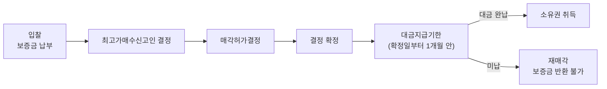

> 「민사집행법」 제138조, 「민사집행규칙」 제63조·제78조, 「집합건물의 소유 및 관리에 관한 법률」 제18조를 바탕으로 정리한 노트다.

## 경매 낙찰은 계약이 아니라 절차다

일반 매매는 계약 뒤에 조건을 조정하거나 잔금일을 미룰 수 있다. 법원 경매는 정해진 기한에 정해진 돈을 내야 하는 절차이고, 어기면 **보증금을 잃는다.** 물건의 하자를 책임질 매도인도 없다. 그래서 확인은 모두 입찰 전에 끝내야 한다.

| 단계 | 규칙 |
| --- | --- |
| 입찰 보증금 | 기일입찰의 매수신청 보증은 **최저매각가격의 10분의 1**이다. 법원이 상당하다고 인정하면 다르게 정할 수 있으므로 매각공고의 보증금액을 확인한다(민사집행규칙 제63조) |
| 대금지급기한 | 매각허가결정이 **확정된 날부터 1개월 안**의 날로 법원이 정한다(민사집행규칙 제78조) |
| 소유권 | 매각대금을 다 낸 때에 넘어온다 |

## 보증금을 잃는 경우

매수인이 대금지급기한까지 대금을 다 내지 못하고 차순위매수신고인도 없으면 법원은 직권으로 재매각을 명한다(민사집행법 제138조).

- 전 매수인은 재매각에 다시 입찰할 수 없고, **보증금 반환을 청구할 수 없다.** 보증금은 배당 재원에 들어간다.
- 재매각기일 3일 전까지 대금, 지연이자, 절차비용을 모두 내면 재매각이 취소되고 물건을 취득할 수 있다. 마지막 구제 수단이다.

대금을 내지 못하는 원인은 대개 둘이다.

| 원인 | 내용 |
| --- | --- |
| 자금 조달 실패 | 낙찰가를 기준으로 대출을 기대했는데 한도가 그만큼 나오지 않는다. 대출 규제가 강한 시기에는 낙찰가가 높을수록 부족분이 커진다 |
| 권리분석 착오 | 매각으로 사라지지 않고 매수인이 떠안는 권리나 부담을 놓쳤다가, 낙찰 뒤에 알고 포기한다 |

## 입찰 전에 확정할 것

| 항목 | 확인 내용 |
| --- | --- |
| 자금 | 내 소득과 규제 기준으로 실제 나오는 대출 한도를 금융기관에서 먼저 확인한다. 한 달 안에 잔금을 치를 수 있어야 한다 |
| 인수되는 권리 | 매각 뒤에도 남아 매수인이 인수하는 권리가 있는지 등기사항증명서와 법원의 매각물건명세서, 현황조사서로 확인한다. 점유자가 누구이고 어떤 권원으로 사는지도 본다 |
| 체납 관리비 | 아파트 같은 집합건물에서 전 소유자가 밀린 관리비 가운데 **공용부분에 관한 것**은 새 소유자에게 청구될 수 있다(집합건물법 제18조). 관리사무소에서 체납액을 확인해 입찰가에 반영한다 |
| 입찰 상한가 | 경쟁이 붙으면 감정가를 넘겨 낙찰되는 일이 흔하다. 시세, 인수 비용, 대출 한도로 계산한 상한가를 정해 두고 현장에서 올리지 않는다 |
| 감정가의 시점 | 감정가는 감정 시점의 가격이다. 입찰일의 시세와 차이가 날 수 있으므로 최근 실거래가로 다시 본다 |

## 규제 지역 물건에서 추가로 볼 것

### 토지거래허가구역

「민사집행법」에 따른 경매는 토지거래허가 대상이 아니다(부동산거래신고법 제14조 제2항). 허가구역 안의 주택도 낙찰받으면 허가와 2년 실거주 의무 없이 취득한다. 이 때문에 구역 안 물건은 경쟁이 몰려 낙찰가가 높아지기 쉽다. 일반 매매보다 싸게 사는 것이 경매의 목적이라면 이 구간에서는 상한가를 더 엄격히 지킨다. 허가 제도는 [[land-transaction-permit|토지거래허가구역과 투기과열지구]]에 있다.

### 재건축·재개발 물건의 조합원 지위

투기과열지구에서 재건축은 조합설립인가 뒤, 재개발은 관리처분계획인가 뒤에 취득한 사람은 원칙적으로 조합원이 되지 못하고 현금청산된다. 경매 취득도 같다.

| 경매의 원인 | 낙찰자의 조합원 지위 |
| --- | --- |
| 국가·지방자치단체·**금융기관**에 대한 채무를 갚지 못해 넘어간 경매·공매 | 승계된다(도시정비법 시행령 제37조 제3항) |
| 그 밖의 채권자가 신청한 경매 | 예외에 해당하지 않아 승계되지 않는다 |

같은 단지, 같은 면적이라도 지위가 넘어오는 물건과 그렇지 않은 물건의 가치는 크게 다르다. 경매를 신청한 채권자가 누구인지 등기사항증명서와 사건 기록으로 확인하고, 조합에 승계 가능 여부를 문의한 뒤 입찰한다.

## 정리

- 보증금은 최저매각가격의 10%, 잔금 기한은 매각허가결정 확정일부터 1개월 안이다.
- 기한 안에 대금을 못 내면 보증금을 돌려받지 못한다. 대출 한도와 인수되는 권리를 입찰 전에 확정한다.
- 공용부분 체납 관리비처럼 감정가에 드러나지 않는 비용을 입찰가에 반영한다.
- 허가구역 물건은 경쟁 과열을, 재건축 물건은 조합원 지위 승계 여부를 따로 확인한다.

관련 노트: [[land-transaction-permit|토지거래허가구역과 투기과열지구]], [[home-purchase-checks|주택 매매 전 확인]], [[jeonse-housing-market|전세와 한국 주택 가격]]
