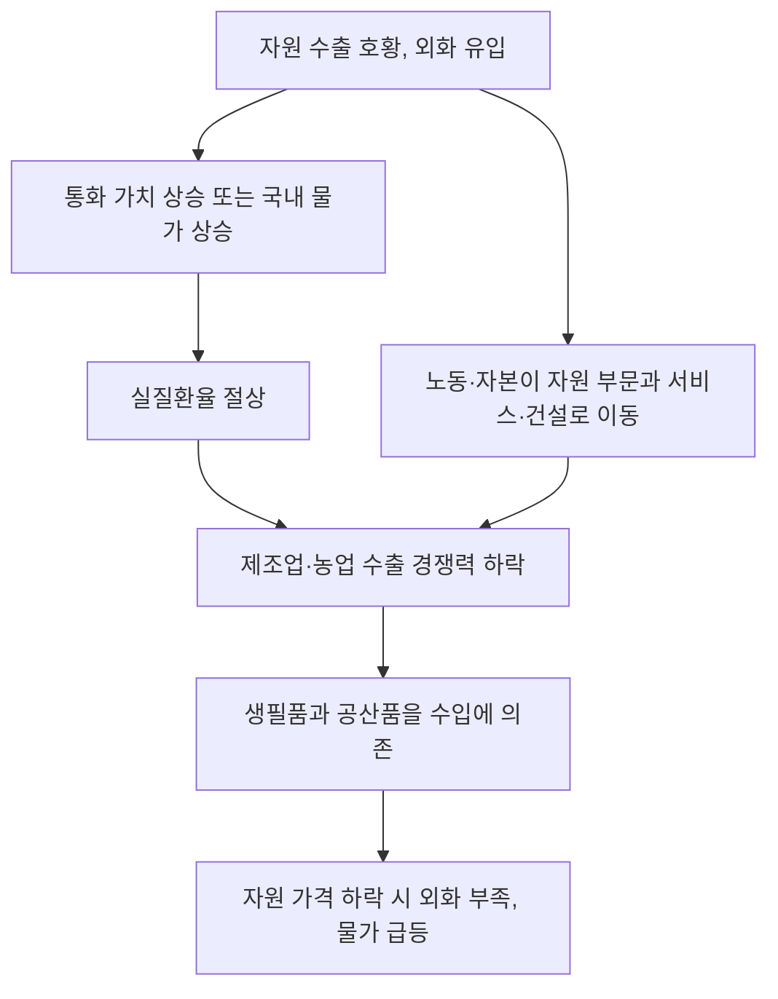

> IMF 「Finance & Development」의 「[Dutch Disease: Wealth Managed Unwisely](https://www.imf.org/en/Publications/FandD/Issues/Series/Back-to-Basics/Dutch-Disease)」, 노르웨이 중앙은행 투자운용(NBIM)의 [기금 소개](https://www.nbim.no/en/about-us/about-the-fund/), 노르웨이 재무부의 [재정 정책 체계 안내](https://www.regjeringen.no/en/topics/the-economy/the-government-pension-fund/the-norwegian-fiscal-policy-framework/id418083/)를 바탕으로 종합한 노트다.

## 자원의 저주란

석유, 가스, 광물 같은 천연자원이 풍부한 나라가 자원이 없는 나라보다 **장기 성장, 산업 구조, 제도, 소득 분배에서 오히려 뒤처지는 현상**이다. 풍요의 역설(paradox of plenty)이라고도 한다. 용어는 리처드 오티가 1993년에 광물 수출국의 부진을 설명하며 썼고, 제프리 삭스와 앤드루 워너의 1995년 연구가 원자재 수출 비중이 높은 나라일수록 장기 성장률이 낮았다는 국가 간 비교로 널리 알렸다.

## 저주가 작동하는 경로

| 경로 | 내용 |
| --- | --- |
| 네덜란드병 | 외화 유입으로 실질환율이 올라 제조업·농업 같은 다른 교역재 산업이 경쟁력을 잃는다 |
| 가격 변동성 | 재정이 자원 가격에 묶여, 가격이 오를 때 늘린 지출을 내릴 때 줄이지 못한다 |
| 지대 추구와 부패 | 자원 수입을 차지하는 것이 생산 활동보다 이익이 커서, 권력이 자원을 독점하고 인재와 자본이 그쪽으로 쏠린다 |
| 제도 약화 | 정부가 세금 대신 자원 수입에 의존하면 납세자에 대한 책임이 약해진다 |
| 재투자 부족 | 설비 유지보수와 기술 인력에 쓸 돈을 다른 지출로 돌리면 생산 능력 자체가 무너진다 |

매장량이 많다는 것과 돈이 된다는 것도 별개다. 초중질유처럼 희석제와 고도화 설비가 있어야 생산·수송·정제를 할 수 있는 자원은 생산비가 높아, 가격이 높을 때만 채산성이 나온다. **자원의 양보다 생산 기술, 재투자, 판로, 산업 다각화가 성패를 가른다.**

## 네덜란드병(Dutch Disease)

### 이름의 유래

1959년 네덜란드 흐로닝언에서 대규모 천연가스전이 발견됐다. 가스 수출이 늘면서 네덜란드 통화(길더)의 가치가 올랐고, 다른 수출 산업의 경쟁력이 떨어져 제조업이 위축됐다. 1977년 영국 주간지 이코노미스트가 이 현상에 「네덜란드병」이라는 이름을 붙였다. 네덜란드는 가스 수입의 상당 부분을 복지 확대에 썼는데, 한 번 늘린 지출은 수입이 줄어든 뒤에도 되돌리기 어려웠다.

### 메커니즘

1982년 맥스 코든과 피터 니어리의 모형은 경제를 호황 부문(자원), 뒤처지는 교역재 부문(제조업·농업), 비교역재 부문(서비스·건설)으로 나누고 두 효과를 구분한다.

| 효과 | 내용 |
| --- | --- |
| 지출 효과 | 벌어들인 외화가 국내에서 쓰이면서 변동환율제에서는 명목환율이, 고정환율제에서는 통화량과 물가가 오른다. 어느 쪽이든 실질환율이 절상된다 |
| 자원 이동 효과 | 노동과 자본이 호황 부문과 비교역재 부문으로 옮겨 가 기존 교역재 부문이 줄어든다 |

- 원인이 자원일 필요는 없다. 원조, 외국인 직접투자, 원자재 가격 급등처럼 **외화가 한꺼번에 많이 들어오는 모든 경우**에 같은 일이 생길 수 있다.
- 제조업은 한 번 무너지면 되살리기 어렵다. 생산하면서 쌓이는 기술과 숙련(learning by doing), 협력업체 집적이 함께 사라지기 때문이다.
- 실질환율 문제 말고도 자원 부국이 제조업을 키우기 어려운 조건이 겹치기도 한다: 인구가 흩어져 내수 규모가 작은 것, 내륙 물류비, 주요 제조·소비 거점과의 거리, 부품 협력업체 클러스터의 부재.

### 병이 아니라는 관점

| 관점 | 근거 |
| --- | --- |
| 정상적인 조정이다 | 늘어난 부가 영구적이라면 자원 부문으로 생산 요소가 옮겨 가는 것은 합리적인 구조 변화다 |
| 실제 손실이다 | 자원은 고갈되거나 가격이 꺾인다. 그때 돌아갈 제조업 기반과 숙련이 남아 있지 않으면 장기 성장이 낮아진다 |

## 저주를 피한 나라의 공통점

### 노르웨이

노르웨이는 석유·가스 수입을 국내에서 바로 쓰지 않고 국부펀드에 쌓는다. 의회는 1990년에 기금 설치법을 통과시켰고 첫 자금은 1996년에 들어갔다.

| 장치 | 효과 |
| --- | --- |
| 해외에만 투자 | 외화 수입을 국내 통화로 바꾸지 않으므로 통화 절상과 국내 물가 상승(지출 효과)을 막는다 |
| 재정 규칙(2001년 도입) | 기금에서 예산으로 넘기는 돈은 장기적으로 기금의 기대 실질수익률을 따른다. 기대 실질수익률은 도입 때 4%였고 2017년에 3%로 낮췄다 |
| 원금 보존 | 수익만 쓰고 원금은 쓰지 않으므로 자원이 고갈된 뒤에도 수입이 남는다 |

### 공통 처방

- **수입의 저축과 평탄화**: 국부펀드나 안정화 기금에 쌓아, 가격이 높을 때의 수입을 낮을 때로 넘긴다.
- **재정 규칙**: 자원 가격이 오른다고 지출을 따라 늘리지 않도록 지출 한도를 법이나 규칙으로 묶는다.
- **투명한 관리**: 수입과 지출을 공개해 지대 추구의 여지를 줄인다. 다이아몬드 수입을 제도적으로 관리한 보츠와나가 개발도상국의 대표적인 반례다.
- **산업 다각화**: 교육, 기반 시설, 금융 제도에 투자하고 비교역재 부문의 생산성을 올려 자원 외 수출 산업을 지킨다.

자원의 저주는 법칙이 아니라 경향이다. 국가 간 실증 연구의 결과는 엇갈리며, 같은 자원을 두고도 제도와 재정 운용에 따라 결과가 갈린다.

## 정리

- 자원의 저주는 자원 수입이 환율, 재정, 정치 제도를 왜곡해 다른 산업의 성장을 막는 현상이다.
- 네덜란드병은 그 가운데 환율 경로다. 외화 유입이 실질환율을 올리고 생산 요소를 끌어가 제조업을 위축시킨다.
- 처방의 핵심은 수입을 국내에서 한꺼번에 쓰지 않는 것이다. 해외에 쌓고, 수익만 쓰고, 지출 규칙을 지킨다.
- 매장량보다 생산 기술, 재투자, 다각화, 제도가 결과를 정한다.

관련 노트: [[interest-rate-exchange-rate|금리·환율·물가의 연결]], [[macro-policy-concepts|거시경제 정책을 읽는 개념]], [[jevons-paradox|제번스의 역설과 리바운드 효과]]
