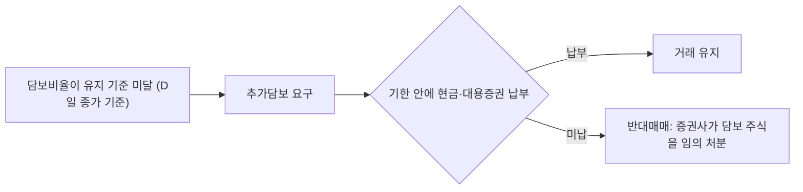

> 한국거래소 규정 안내(매매거래중단, 사이드카, 변동성완화장치), 금융위원회·금융감독원의 「신용공여 담보비율 유지의무 면제조치」(2026.11.9)와 배당절차 개선방안, 한국거래소 애프터마켓 개장(2026.9.14) 보도를 바탕으로 종합한 노트다.

## 결제일: 체결과 소유는 2영업일 차이가 난다

국내 주식과 ETF는 **매매가 체결된 날(T)에서 2영업일 뒤(T+2)에 결제**된다. 그날 주식과 돈이 실제로 오가고 주주명부에 반영된다. 주말과 휴장일은 영업일에서 빠진다.

| 상황 | 결제일 기준으로 생기는 일 |
| --- | --- |
| 매도 대금 출금 | 판 날이 아니라 2영업일 뒤에 출금할 수 있다 |
| 배당·주주총회 권리 | 기준일에 주주명부에 있어야 하므로 **기준일 2영업일 전까지** 사야 한다 |
| 기한이 걸린 제도 | 연말·월말 같은 기준 시점까지 결제가 끝나야 한다. 말일에 팔면 결제가 다음 기간으로 넘어간다 |
| 예탁금 요건 | 주식을 판 돈은 결제일에 현금으로 인정된다 |

### 배당기준일과 배당락

```text
월 (기준일 2영업일 전)   여기까지 사면 배당을 받는다
화 (기준일 1영업일 전)   배당락일: 이날 사면 배당이 없다. 대신 이날 팔아도 배당은 받는다
수 (배당기준일)          주주명부 확정
```

- 배당락일에는 배당받을 권리가 떨어져 나간 만큼 주가가 내려 출발하는 경향이 있다.
- **배당기준일은 회사마다 다르다.** 예전에는 12월 결산 법인의 기준일이 대부분 연말이었고, 배당액은 다음 해 주주총회에서 정해져 금액을 모르는 채 투자해야 했다. 2023년 배당절차 개선으로 의결권 기준일과 배당기준일을 나눌 수 있게 되어, **배당액을 먼저 확정하고 그 뒤의 날을 기준일로 정하는 회사**가 늘었다. 분기배당도 자본시장법 개정으로 같은 순서가 가능하다.
- 그래서 종목마다 공시(「현금·현물배당 결정」, 「주주명부폐쇄(기준일) 결정」)에서 기준일을 확인한다.

## 거래시간과 복수 거래소

2025년 3월 4일 대체거래소(ATS, 다자간매매체결회사) **넥스트레이드(NXT)**가 출범해, 한국거래소(KRX) 한 곳이던 주식시장이 복수 거래소 체제가 됐다. 2026년 9월 14일에는 KRX도 애프터마켓을 열었다.

| 시간대 | KRX | 넥스트레이드 |
| --- | --- | --- |
| 프리마켓 | 없음 | 08:00~08:50 |
| 정규 시간 | 09:00~15:30 | 정규 시간대에도 거래한다 |
| 애프터마켓 | 16:00~20:00, 실시간 접속매매 | 15:40~20:00 |

| 항목 | KRX 애프터마켓 | 넥스트레이드 |
| --- | --- | --- |
| 대상 | 코스피·코스닥 상장주식 대부분. 관리종목, 투자경고·위험 종목 등은 제외 | KRX 상장 종목 가운데 선별한 600여 개 |
| ETF·ETN | 거래하지 않는다 | 거래하지 않는다 |
| 주문 | 지정가, 최우선지정가, 최유리지정가만 가능. 시장가 주문은 안 된다 | - |
| 가격제한폭 | 정규장과 같은 전일 종가 대비 ±30% | - |
| 결제 | 정규장 거래와 같이 T+2 | T+2 |

- KRX 애프터마켓이 생기면서 16~18시에 10분 단위로 체결하던 **시간외단일가매매는 폐지**됐다.
- 정규장에서 체결되지 않은 주문은 애프터마켓으로 넘어가지 않는다. 다시 내야 한다.
- **최선집행의무**: 투자자가 시장을 지정하지 않으면 증권사가 가격, 비용, 체결 가능성을 비교해 유리한 시장으로 주문을 보낸다. 이 자동 배분을 SOR(Smart Order Routing)이라 한다.
- 정규장 밖 시간대는 거래량이 적어 가격이 크게 튈 수 있다. 서킷브레이커와 사이드카는 정규장에서만 작동한다.

### 미국 증시의 한국 시간

뉴욕증권거래소와 나스닥의 정규장은 미국 동부 시간 09:30~16:00이다.

| 기간 | 한국 시간 |
| --- | --- |
| 서머타임(3월 둘째 일요일~11월 첫째 일요일) | 22:30~다음 날 05:00 |
| 그 밖의 기간 | 23:30~다음 날 06:00 |

휴장일은 새해 첫날, 마틴 루터 킹 주니어의 날(1월 셋째 월요일), 워싱턴 탄생일(2월 셋째 월요일), 성금요일, 메모리얼 데이(5월 마지막 월요일), 준틴스(6월 19일), 독립기념일(7월 4일), 노동절(9월 첫째 월요일), 추수감사절(11월 넷째 목요일), 크리스마스다. 일부 휴일 전후에는 동부 시간 13:00에 조기 폐장한다.

## 시장 안전장치

가격이 급변할 때 주문을 잠시 모으거나 멈춰 투자자가 상황을 판단할 시간을 주는 장치다. 범위가 좁은 것부터 넓은 순서로 작동한다.

| 장치 | 대상 | 발동 조건 | 조치 |
| --- | --- | --- | --- |
| 변동성완화장치(VI) | 개별 종목, ETF, ETN | 직전 체결가나 직전 단일가에서 일정 비율 이상 벗어난 가격에 체결되려 할 때 | 2분간 단일가매매 |
| 사이드카 | 프로그램매매 | 선물 가격 급변이 1분간 지속 | 프로그램매매 호가 효력 5분 정지 |
| 서킷브레이커 | 시장 전체 | 지수가 전일 종가보다 8%, 15%, 20% 이상 하락해 1분간 지속 | 20분 매매 중단, 3단계는 장 종료 |

### 변동성완화장치(VI)

| 구분 | 기준가격 | 발동률 |
| --- | --- | --- |
| 동적 VI | 직전 체결가 | 코스피200 구성 종목 3%, 그 밖의 코스피·코스닥 종목 6%. 장 마감 단일가 시간(15:20~15:30)에는 각각 2%, 4% |
| 정적 VI | 직전 단일가(시가 결정 전에는 당일 기준가격) | 10% |

- 동적 VI는 한두 건의 주문이 만드는 순간적인 급변을, 정적 VI는 누적된 큰 변동을 겨냥한다.
- ETF·ETN의 동적 VI는 코스피200 같은 대표 지수형과 인버스·채권형이 3%, **레버리지형, 업종·해외지수형, 원자재형은 6%**다.
- 발동 횟수 제한이 없어 한 종목이 하루에 여러 번 걸릴 수 있다. 신규 상장 종목은 상장 첫날 적용하지 않는다.
- KRX 애프터마켓에도 정규장과 같은 기준을 쓴다. 넥스트레이드도 2026년 9월 14일부터 10% 기준의 정적 VI를 운영한다.

### 사이드카

| 시장 | 발동 조건 |
| --- | --- |
| 유가증권시장(코스피) | 코스피200 선물 가격이 기준가격 대비 5% 이상 오르거나 내려 1분간 지속 |
| 코스닥시장 | 코스닥150 선물 가격이 6% 이상, **그리고** 코스닥150 지수가 3% 이상 오르거나 내려 1분간 지속 |

- 오를 때는 프로그램 매수호가를, 내릴 때는 매도호가를 5분간 멈춘다. 개인의 일반 주문은 그대로 체결된다.
- 하루 한 번만 발동하고, 장 시작 후 5분 이내와 장 종료 40분 전 이후에는 발동하지 않는다.
- 선물시장의 급변이 프로그램매매를 타고 현물시장으로 번지는 것을 막는 장치여서, 서킷브레이커보다 먼저 작동하는 경우가 많다.

### 서킷브레이커

코스피와 코스닥 각각의 지수를 기준으로 **하락할 때만** 발동한다.

| 단계 | 조건(1분간 지속) | 조치 |
| --- | --- | --- |
| 1단계 | 전일 종가 대비 8% 이상 하락 | 시장 전체 매매 20분 중단, 이후 10분간 단일가매매로 재개 |
| 2단계 | 15% 이상 하락하고 1단계 발동 지수보다 1% 이상 추가 하락 | 1단계와 같다 |
| 3단계 | 20% 이상 하락하고 2단계 발동 지수보다 1% 이상 추가 하락 | 그 시점에 당일 장 종료 |

- 단계마다 하루 한 번만 발동한다.
- 1·2단계는 장 종료 40분 전 이후에는 발동하지 않는다. 3단계는 그 뒤에도 발동할 수 있다.
- 중단 중에는 새 주문을 낼 수 없고 기존 주문의 취소만 가능하다. 관련 선물·옵션 시장도 함께 멈춘다.

## 신용거래와 반대매매

### 신용융자와 담보비율

**신용융자는 증권사에서 돈을 빌려 주식을 사는 거래다.** 산 주식과 계좌의 현금·주식이 담보가 된다.

```text
담보비율 = 담보 평가금액 / 융자금액 × 100
예: 자기 돈 450만 원 + 융자 550만 원으로 1,000만 원어치 매수
    처음 담보비율 = 1,000 / 550 ≈ 182%
    주가 -23%   → 770 / 550 = 140%  (유지 기준에 닿는다)
    주가 -30%   → 700 / 550 ≈ 127%  (담보 부족)
```

| 항목 | 기준 |
| --- | --- |
| 신용거래보증금률 | 매수 금액 가운데 자기 돈으로 내야 하는 비율. 증권사가 종목 등급별로 정한다(예: 45~50%) |
| 담보유지비율 | 증권사는 융자금의 **140% 이상** 담보를 확보해야 하고, 통상 140%를 유지 기준으로 쓴다. 종목에 따라 더 높게 정하기도 한다 |
| 융자 기간과 이자 | 증권사 약관으로 정한다. 만기가 있고(예: 120일, 조건을 채우면 연장), 빌린 기간만큼 이자가 붙는다 |

### 반대매매

담보비율이 유지 기준 아래로 내려가면 다음 순서로 진행된다.



- 추가담보 기한은 짧다. 담보 부족이 생긴 다음 영업일까지 채우지 못하면 그다음 영업일(D+2)에 처분하는 식이며, 정확한 일정은 증권사 약관에 있다.
- 처분 수량은 **담보비율을 다시 기준까지 올리는 데 필요한 만큼**이라, 부족한 금액을 현금으로 채울 때보다 훨씬 많은 주식이 팔린다.
- 반대매매는 가격을 가리지 않고 처분하므로 손실이 그 가격에 확정된다. 이후 주가가 반등해도 회복할 주식이 남지 않는다.

### 반대매매가 낙폭을 키우는 구조

신용융자 잔고가 많이 쌓인 시장에서는 하락이 반대매매를 부르고, 반대매매 물량이 다시 주가를 내려 다음 반대매매를 부른다. 빚으로 버티던 투자자들이 부채를 갚으려고 멀쩡한 자산까지 팔면서 자산 가격이 한꺼번에 무너지는 국면을 경제학자 하이먼 민스키의 이름을 따 **민스키 모먼트**(Minsky moment)라고 한다.

이 악순환을 끊기 위해 급락기에는 담보비율 규제를 한시적으로 푼다. **2026년 11월 9일부터 2027년 1월 31일까지** 금융감독원 비조치의견서로 증권사의 신용공여 담보비율 유지의무가 면제됐다. 이 기간에는 증권사가 유지 기준을 스스로 낮추거나(예: 130%) 반대매매를 하루 미룰 수 있다. 융자를 받을 때 담보를 140% 이상 확보하는 규정은 그대로다. 적용 여부와 기준은 증권사마다 다르므로 약관과 공지를 확인한다.

## 정리

- 국내 주식은 T+2 결제다. 배당과 기한이 걸린 제도는 체결일이 아니라 결제일로 따진다.
- 주식은 넥스트레이드와 KRX 애프터마켓으로 08:00~20:00에 거래할 수 있지만 ETF·ETN은 정규장에서만 거래된다.
- 안전장치는 종목(VI), 프로그램매매(사이드카), 시장 전체(서킷브레이커) 순으로 범위가 넓어진다.
- 신용융자는 담보비율이 기준을 밑돌면 며칠 안에 강제 처분된다. 하락장에서 손실을 확정시키고 시장 낙폭을 키운다.

관련 노트: [[etf-basics|ETF의 구조와 선택 기준]], [[leveraged-inverse-etf|레버리지·인버스 ETF]], [[investing-arithmetic|투자의 산수]]
