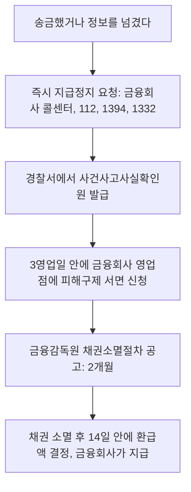

> 금융감독원 「[피해금 환급 안내](https://fss.or.kr/fss/main/contents.do?menuNo=200571)」, 경찰청 전기통신금융사기 통합대응단 「[피싱안심SOS](https://www.counterscam112.go.kr/)」, 한국인터넷진흥원(KISA) 「[스미싱·큐싱 안내](https://www.kisa.or.kr/1020601)」, 금융위원회 보도자료를 바탕으로 종합한 노트다.

## 전기통신금융사기란

전화, 문자, 메신저로 사람을 속여 돈을 보내게 하거나 금융 정보를 빼내는 사기다. 흔히 보이스피싱(전화), 스미싱(문자 속 링크), 큐싱(가짜 QR코드), 메신저 피싱으로 나눠 부르지만 구조는 같다. **급하다고 몰아붙이고, 주변과 상의하지 못하게 하고, 그 자리에서 송금하거나 무언가를 설치하게 만든다.** 이 세 가지가 겹치면 내용이 아무리 그럴듯해도 사기로 본다.

## 유형별 위험 신호

| 유형 | 이렇게 접근한다 | 판별 기준 |
| --- | --- | --- |
| 수사·사법기관 사칭 | 범죄에 연루됐다며 법원 직원, 검사, 금융감독원 직원을 차례로 등장시킨다. 가짜 기관 사이트에서 사건을 조회하게 하고 영장을 읽어 준다 | 수사기관은 전화나 메신저로 영장을 보내지 않고, 송금·현금 전달·자산 이전을 요구하지 않는다 |
| 셀프 감금 | 「조사 중이니 혼자 있어야 한다」며 숙박업소에 머물게 하고 외부 연락을 끊게 한 뒤, 자산 검수 명목으로 현금·카드를 맡기게 하거나 가상자산으로 바꿔 보내게 한다 | 격리와 연락 차단을 요구하는 수사 절차는 없다. 영상 통화에 제복이나 사무실이 보여도 근거가 되지 않는다 |
| 신설 기관 사칭 | 새로 출범한 수사·사법 기관의 직원을 자칭한다 | 기관 이름이 낯설수록 끊고 그 기관의 대표 번호로 다시 건다 |
| 현금·골드바 전달 요구 | 검찰이나 증권사를 사칭해 현금, 골드바, 상품권을 사람에게 직접 건네라고 한다 | 대면 전달 요구는 그 자체로 피싱이다 |
| 화면 공유·원격 제어 | 은행, 항공사, 쇼핑몰 고객센터를 사칭해 메신저 통화의 화면 공유나 휴대전화의 원격 지원 기능을 켜게 한다. 악성 앱을 깔지 않아도 인증 번호와 금융 앱 화면이 그대로 넘어간다 | 모르는 상대의 화면 공유·원격 지원 요청은 거절한다. 금융 앱을 열기 전에 원격 연결이 켜져 있지 않은지 확인한다 |
| 가족·지인 사칭 | 휴대전화가 고장 났다며 메신저로 송금이나 인증을 부탁한다. 합성한 목소리나 울음소리로 자녀가 위험에 처한 것처럼 꾸미기도 한다 | 목소리와 영상만으로는 본인 확인이 되지 않는다. 가족끼리 확인 질문을 미리 정해 두고, 다른 연락 수단으로 직접 확인한다 |
| 미성년자 유인 | 현금을 주겠다며 부모의 휴대전화나 인증을 가져오게 한다 | 돈을 주면서 보호자 기기나 인증을 요구하면 사기라고 미리 알려 둔다 |
| 스미싱 | 택배 배송·반품, 청첩장·부고장, 명절 선물·상품권, 카드 발급, 정보 유출 보상, 지갑 업데이트 안내로 꾸민 문자의 링크를 누르게 해 악성 앱을 설치한다 | 문자 속 링크를 누르지 않고 공식 앱이나 사이트에서 직접 조회한다 |
| 큐싱 | 우편물 도착 안내서, 주차 안내문, 전단지에 가짜 QR코드나 피싱 번호를 넣는다 | 안내서에 적힌 번호와 QR 대신 우체국·기관의 공식 번호로 확인한다 |
| 악성 메일 | 속보, 환불·파손 문의, 배송 안내로 꾸민 메일의 첨부나 외부 링크에 문서 아이콘으로 위장한 실행 파일을 넣는다 | 주문번호와 실제 구매 이력이 있는지, 발신 주소와 링크 도메인이 일치하는지 본다 |
| 검색 광고 | 검색 결과 상단의 광고 링크가 프로그램 설치 페이지처럼 꾸민 악성 사이트로 이어진다 | 프로그램은 광고 링크가 아니라 제작사 공식 사이트나 공식 스토어에서 받는다 |

**010 번호라고 안심할 수 없다.** 해외에서 건 전화를 국내 번호로 바꿔 표시하는 발신번호 변작이 쓰이고, 통합대응단은 변작 번호 신고를 따로 받는다.

### 통장·명의를 빌려 달라는 제안

고액 아르바이트, 용돈, 저금리 대출, 대출 한도 상향을 미끼로 통장·체크카드·계좌 비밀번호를 넘겨 달라는 제안은 **대포통장 모집**이다. 접근매체를 넘기거나 빌려주는 것은 전자금융거래법이 금지하는 행위라서, 속았더라도 명의자가 처벌받고 금융거래가 제한될 수 있다. 정상적인 대출 심사는 통장 양도나 상품권 구매를 요구하지 않는다.

## 악성 앱이 깔리면 벌어지는 일

스미싱으로 설치된 악성 앱은 문자와 연락처를 빼내고, 걸려 오는 전화와 거는 전화를 가로챈다. 피해자가 은행이나 경찰 대표 번호로 확인 전화를 걸어도 사기범이 받는 이유다. 탈취한 신분증 사진과 인증 정보로 피해자 명의의 휴대전화를 개통하거나 비대면 계좌·대출을 여는 데까지 이어진다. 그래서 **감염이 의심되는 휴대전화로는 신고하지 않는다.** 다른 사람의 전화나 PC를 쓴다.

## 피해가 났을 때

| 단계 | 할 일 |
| --- | --- |
| 1. 지급정지 | 돈을 보낸 은행이나 받은 계좌의 은행 콜센터, 경찰(112), 전기통신금융사기 통합대응단(1394), 금융감독원(1332)에 전화해 사기 이용 계좌의 지급정지를 요청한다. 분 단위로 인출되므로 가장 먼저 한다 |
| 2. 내 계좌 잠그기 | 인증 정보가 넘어갔으면 어카운트인포의 본인계좌 일괄지급정지로 내 명의 계좌의 출금을 한꺼번에 막는다 |
| 3. 피해구제 신청 | 경찰서에서 사건사고사실확인원을 받아 지급정지를 요청한 날부터 3영업일 안에 금융회사 영업점에 피해구제 신청서를 낸다 |
| 4. 환급 | 금융회사가 금융감독원에 채권소멸절차 개시 공고를 요청하고, 명의인의 이의 없이 2개월이 지나면 채권이 소멸한다. 금융감독원이 14일 안에 환급액을 정한다 |
| 5. 기기 정리 | 악성 앱을 지우거나 초기화하고, 공동인증서·비밀번호·카드를 새로 발급받는다. 내 번호로 지인에게 스미싱이 나갔을 수 있으니 주변에 알린다 |

- 환급은 **지급정지 시점에 그 계좌에 남아 있던 금액 범위**에서 이뤄진다. 이미 빠져나간 돈은 이 절차로 돌아오지 않고, 같은 계좌에 피해자가 여럿이면 나눠 받는다.
- 계좌 이체가 아니라 현금을 직접 건넨 대면편취형도 2023년 11월 17일부터 피해구제 대상이다.
- 의심 문자는 카카오톡 「보호나라」 채널의 스미싱·큐싱 메뉴에 붙여 넣어 확인하고, KISA 118이나 피싱안심SOS 사이트의 스미싱 문자 신고로 접수한다.

### 지급정지가 되지 않는 사기

전기통신금융사기 피해 방지 및 피해금 환급에 관한 특별법은 **재화의 공급이나 용역의 제공을 가장한 행위를 전기통신금융사기에서 제외**한다(제2조 제2호 단서. 대출의 제공·알선·중개를 가장한 것은 포함한다). 그래서 중고 거래 사기, 가짜 쇼핑몰, 공공기관 직원을 사칭해 물품을 대신 사 달라고 하는 대리 구매 사기는 은행이 지급정지 요청을 받아 주지 않을 수 있다. 이런 피해는 경찰에 사기로 신고해 수사 절차에서 계좌를 추적하게 되므로, 돈을 되찾기가 훨씬 어렵다. 기관 명의 주문이라도 제3의 업체에 먼저 입금하라는 요구가 나오면 그 기관의 대표 번호로 직접 확인하는 것이 유일한 방어다.

## 주변 사람을 지키는 법

- 고령의 가족과 사회 초년생에게 수법을 미리 알려 두는 것이 가장 효과가 크다. 「수사기관은 전화로 돈을 요구하지 않는다」, 「링크는 누르지 않는다」 두 문장이면 대부분을 막는다.
- 가족이 갑자기 연락을 끊고 숙소를 잡거나, 예금을 해지하고 대출을 받거나, 통화 내용을 숨기면 진행 중인 피싱을 의심하고 대신 신고한다.
- 본인 몰래 대출이나 계좌가 열리지 않게 막아 두는 사전 차단 서비스는 [[personal-security-after-data-breach|개인정보 유출 뒤 보안 수칙]]에 정리했다.

## 정리

- 급하게, 혼자서, 지금 송금·설치하라는 요구가 겹치면 사기다. 끊고 공식 대표 번호로 직접 다시 건다.
- 화면 공유, 원격 지원, 앱 설치, 현금 전달, 통장 대여는 어떤 명분으로도 응하지 않는다.
- 송금했다면 지급정지가 먼저다. 그다음 경찰 확인서를 받아 3영업일 안에 피해구제를 신청한다.
- 물품 거래를 가장한 사기는 지급정지 대상이 아니므로 선입금 전에 확인하는 것 말고는 방법이 없다.

관련 노트: [[investment-and-shopping-scams|투자·쇼핑·대출 사기]], [[unknown-deposit-account-freeze|모르는 입금과 통장묶기]], [[personal-security-after-data-breach|개인정보 유출 뒤 보안 수칙]], [[two-factor-totp-passkey|2단계 인증: TOTP와 패스키]]
