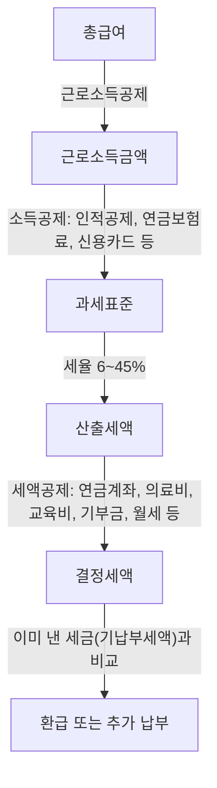

> 국세청의 [연말정산 미리보기 안내](https://www.korea.kr/briefing/policyBriefingView.do?newsId=148974171)(2026.10), [연말정산 종합 안내](https://www.nts.go.kr/nts/cm/cntnts/cntntsView.do?mi=2304&cntntsId=238938), 소득세법(제50조, 제59조의3)을 바탕으로 2026년 기준으로 정리한 노트다.

## 연말정산이란

회사는 매달 월급을 줄 때 간이세액표에 따라 소득세를 미리 뗀다(원천징수). **연말정산은 이렇게 1년 동안 뗀 세금과, 각종 공제를 반영해 계산한 실제 세금(결정세액)의 차이를 다음 해 초에 맞추는 절차다.** 미리 낸 세금이 더 많으면 돌려받고, 적으면 더 낸다.

환급액은 「혜택을 얼마나 받았나」가 아니라 「미리 얼마나 많이 뗐나」에 좌우된다. 볼 숫자는 환급액이 아니라 **결정세액**이다.

## 계산 흐름과 공제의 종류

| 구분 | 줄이는 대상 | 절세 효과 | 대표 항목 |
| --- | --- | --- | --- |
| 소득공제 | 과세표준 | 공제액 × 내 한계세율. 소득이 높을수록 크다 | 인적공제, 신용카드 등 사용액, 주택청약 |
| 세액공제 | 산출세액 | 공제 대상액 × 정해진 공제율. 소득과 무관하게 같은 금액 | 연금계좌, 의료비, 교육비, 기부금, 월세 |
| 환급형 지원 | 세금과 무관하게 지급 | 낼 세금이 없어도 받는다 | 근로장려금, 자녀장려금 |

### 세액공제와 직접 지원의 차이

**세액공제는 낼 세금에서 깎아 주는 방식이라 결정세액이 0원이 되면 거기서 멈춘다.** 남은 공제액을 현금으로 돌려주지 않는다. 그래서 소득이 적어 산출세액이 작은 사람은 공제 한도를 다 쓰지 못한다. 예를 들어 산출세액이 50만 원이면 연금계좌에 900만 원을 넣어도 줄어드는 세금은 최대 50만 원이다.

반대로 근로장려금·자녀장려금은 세금을 낸 적이 없어도 요건을 갖추면 현금으로 지급된다. 이런 방식을 환급형 세액공제(refundable tax credit)라고 부른다. 저소득층에 실제로 닿는 지원은 일반 세액공제보다 환급형 지원이나 직접 재정 지원 쪽이다.

세제 혜택 상품을 고를 때는 **내 결정세액이 공제받을 금액보다 큰지**부터 확인한다. 전년도 근로소득 원천징수영수증의 결정세액 칸에서 볼 수 있다.

## 일정과 도구

| 시기 | 무엇 | 쓰임 |
| --- | --- | --- |
| 10월 말~11월 | **연말정산 미리보기** (홈택스 → 장려금·연말정산·기부금 → 편리한 연말정산) | 올해 예상 급여와 지출을 넣어 예상 세액을 계산한다. 1~9월 카드 사용액이 미리 채워져 있고, 10월 이후 예상액을 넣으면 카드 공제 효과와 항목별 절세 정보를 보여 준다 |
| 12월 31일 | 공제 대상 지출·납입 마감 | 연금계좌 납입, 기부, 카드 사용은 그해 12월 31일분까지만 그해 공제에 들어간다 |
| 다음 해 1월 15일 무렵 | **연말정산 간소화 서비스** 개통 | 의료비, 교육비, 보험료, 카드 사용액 등 공제 증명 자료를 한 번에 내려받는다 |
| 1월 20일 무렵 | 최종 확정 자료 제공 | 개통 직후에는 영수증 발급 기관이 추가·수정 자료를 내는 기간이라 자료가 바뀔 수 있다. 확정 뒤에 내려받는 편이 안전하다 |
| 1~2월 | 회사에 자료 제출 | 2월분 급여에서 환급 또는 추가 징수된다 |

- 2026년 귀속분 미리보기는 10월 28일에 열렸다. 개통일은 해마다 조금씩 달라 국세청 공지를 본다.
- 미리보기의 예상 세액은 확정액이 아니다. 남은 기간에 조정할 수 있는 항목(연금계좌 납입, 카드 종류별 사용 비율, 기부)을 찾는 데 쓴다.
- 성년 자녀를 포함한 부양가족의 자료를 조회하려면 그 가족의 **자료 제공 동의**가 있어야 한다.
- 회사에서 공제를 빠뜨렸다면 5월 종합소득세 신고 기간에 직접 반영하거나, 그 뒤 5년 안에 경정청구로 돌려받을 수 있다.

## 인적공제: 부양가족의 소득 요건

기본공제는 대상자 1명당 150만 원을 소득에서 뺀다. 부양가족을 올리려면 나이 요건과 함께 **그 가족의 연간 소득금액이 100만 원 이하**여야 한다. 근로소득만 있는 가족은 총급여 500만 원 이하면 된다.

- 소득금액은 수입이 아니라 필요경비나 소득공제를 뺀 뒤의 금액이다. 양도소득과 퇴직소득도 포함해서 따진다.
- 요건을 넘는 가족을 올리면 나중에 과소신고로 가산세와 함께 추징된다. 연말정산에서 가장 흔한 오류다.
- 맞벌이 부부가 같은 자녀를, 형제가 같은 부모를 겹쳐 올리는 것도 중복 공제다.

## 연금계좌 세액공제

연금저축과 퇴직연금(IRP, DC형 본인 추가 납입분)에 넣은 돈은 세액공제를 받는다(소득세법 제59조의3).

| 항목 | 내용 |
| --- | --- |
| 공제 대상 납입 한도 | 연금저축만: 연 600만 원. 연금저축 + 퇴직연금 합계: 연 900만 원 |
| 공제율 (지방소득세 포함) | 총급여 5,500만 원 이하(종합소득금액 4,500만 원 이하): 16.5%. 초과: 13.2% |
| 최대 절세액 | 900만 원 × 16.5% = 148만 5천 원, 900만 원 × 13.2% = 118만 8천 원 |
| 인정 시점 | 그해 1월 1일부터 12월 31일까지 실제 납입한 금액 |
| ISA 만기 전환 | 만기 자금을 연금계좌로 옮기면 전환액의 10%(300만 원 한도)가 공제 대상에 추가된다 |

- 연금저축 한도 600만 원은 900만 원 안에 포함된다. 연금저축에 600만 원을 넣었다면 IRP에 300만 원을 더 넣어 채우고, 연금저축이 없으면 IRP만으로 900만 원을 채울 수 있다.
- 근로자뿐 아니라 사업소득자도 5월 종합소득세 신고에서 같은 공제를 받는다.
- 세액공제를 받은 납입액과 운용수익은 55세 이후 연금으로 받을 때 낮은 세율의 연금소득세를 낸다. 중도에 해지하거나 연금 외 형태로 꺼내면 16.5%의 기타소득세가 붙어, 받은 공제를 사실상 돌려주게 된다. 세금을 없애 주는 것이 아니라 뒤로 미루고 세율을 낮추는 제도다. 받을 때의 과세는 [[retirement-pension-and-private-pension|퇴직연금과 개인연금]] 노트에 있다.
- 세액공제는 결정세액 범위 안에서만 효과가 있다. 낼 세금이 적은 해에는 한도를 다 채울 이유가 없다.

## 정리

- 연말정산은 미리 뗀 세금과 실제 세금의 차이를 맞추는 절차이고, 봐야 할 숫자는 결정세액이다.
- 소득공제는 한계세율만큼, 세액공제는 정해진 공제율만큼 세금을 줄인다. 세액공제는 낼 세금이 있어야 효과가 난다.
- 가을에 미리보기로 남은 기간의 지출을 조정하고, 1월에는 확정된 간소화 자료를 쓴다.
- 부양가족은 소득금액 100만 원(근로소득만 있으면 총급여 500만 원) 요건을 먼저 확인한다.
- 연금계좌는 12월 31일까지 넣은 금액만, 연 900만 원까지 공제된다.

관련 노트: [[retirement-pension-and-private-pension|퇴직연금과 개인연금]], [[income-tax-filing|종합소득세 신고]], [[financial-income-tax|금융소득 과세]], [[health-insurance-premium|건강보험료]], [[sponsored-review-rules|협찬 후기와 원고료]]
