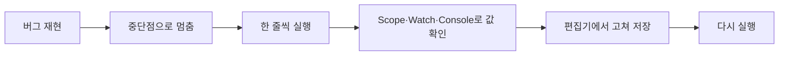

> Chrome for Developers의 「[Chrome DevTools 문서](https://developer.chrome.com/docs/devtools?hl=ko)」를 바탕으로, javascript.info(모던 JavaScript 튜토리얼)의 「개발자 콘솔」, 「Chrome으로 디버깅하기」 글과 「[크롬 개발자 도구를 이용한 자바스크립트 디버깅](https://subicura.com/2018/02/14/javascript-debugging.html)」을 더해 재구성한 노트다.

## 왜 console.log 대신 중단점인가

`console.log`로 디버깅하려면 코드를 찾아 로그를 넣고, 볼 값을 하나하나 적고, 새로고침해야 한다. **중단점은 코드 구조를 몰라도 관련 지점에서 멈추게 하고, 그 순간의 모든 변수를 보여 준다.** 기본 흐름은 이렇다.



Sources 패널은 세 영역으로 나뉜다. 왼쪽 **Page 탭**(페이지가 받은 파일 트리), 가운데 **편집기**, 오른쪽 **디버거**(Breakpoints·Scope·Watch·Call Stack). 명령 메뉴(`Ctrl+Shift+P` / `Cmd+Shift+P`)에서 `sources`로도 연다.

DevTools는 `F12`(macOS `Cmd+Opt+I`, 콘솔로 바로 열기는 `Cmd+Opt+J`)로 연다. 다른 패널을 보는 중에도 `Esc`를 누르면 아래쪽 서랍에 Console이 열려, 멈춘 상태의 값을 바로 평가할 수 있다. 콘솔에서 여러 줄을 입력하려면 `Shift+Enter`로 줄을 바꾼다. 페이지의 스크립트 오류는 사용자에게 보이지 않고 Console에 빨간 메시지와 `파일:줄` 링크로만 남는다. Safari는 설정 → 고급에서 「웹 개발자용 기능 보기」를 켜야 개발 메뉴와 Web Inspector(`Cmd+Opt+C` 콘솔)가 생긴다.

## 중단점 고르기

| 상황 | 중단점 | 거는 곳 |
| --- | --- | --- |
| 멈출 줄을 정확히 안다 | 코드 줄 | 줄 번호 클릭 (파란 표시) |
| 코드에서 바로 멈추고 싶다 | `debugger;` 문 | 소스 코드 |
| 한 줄에 이어진 호출 중 하나 | 인라인(열) | 줄 중단점을 건 뒤 그 줄에 뜨는 화살표 표시 중 원하는 위치를 클릭. `a().then(b).then(c)`나 압축된 한 줄 코드에서 |
| 루프에서 특정 경우만 | 조건부 | 줄 번호 우클릭 → 조건부 중단점 추가 (주황 `?`) |
| 멈추지 않고 값만 남기기 | 로그포인트 | 줄 번호 우클릭 → Logpoint 추가 (분홍 `..`). `"합계 " + sum, obj`처럼 `console.log` 인수 문법 |
| 누가 이 요소를 바꾸나 | DOM 변경 | Elements에서 요소 우클릭 → 중단 → 하위 트리 수정·속성 수정·노드 삭제 |
| 잘못된 URL을 요청하는 코드 찾기 | XHR/fetch | 디버거의 XHR/가져오기 중단점에 URL 일부 입력 |
| 클릭 뒤 무엇이 실행되나 | 이벤트 리스너 | 이벤트 리스너 중단점에서 `click`이나 카테고리 전체 선택. 워커 이벤트에서도 멈춘다 |
| 예외가 던져진 줄 | 예외 | Breakpoints의 「포착되지 않은 / 포착된 예외에서 일시중지」. Promise 거부도 다룬다 |
| 함수가 불릴 때마다 | 함수 | 콘솔에서 `debug(fn)`. 함수가 그 스코프에 보여야 한다 |
| XSS 싱크·정책 위반 | Trusted Types | CSP 위반 중단점 |

- **`debugger` 문은 DevTools가 열려 있을 때만 멈추고, 닫혀 있으면 무시된다.** 그래도 커밋 전에는 지운다.
- 시끄러운 예외나 `debugger`에서 계속 멈추면 그 줄을 우클릭해 **「여기에서 일시중지 안 함」** 을 고른다. 실체는 조건이 `false`인 조건부 중단점이다.
- Breakpoints 영역에서 중단점은 파일별로 묶인다. 체크박스로 켜고 끄고, 우클릭으로 일괄 삭제한다. 툴바의 **중단점 비활성화** 버튼은 모든 중단점을 잠시 무시한다.
- 엉뚱한 줄의 click 리스너에서 멈춘다면 확장 프로그램의 리스너일 가능성이 크다. 시크릿 창에서 확인한다.

## 멈춘 다음: 단계 실행과 값 확인

| 컨트롤 | 동작 |
| --- | --- |
| 재개 (`F8`) | 다음 중단점까지 실행. 길게 누르면 **강제 실행**(모든 중단점 무시) |
| Step over (`F10`) | 현재 줄의 함수 호출을 안으로 들어가지 않고 실행. 내부가 궁금하지 않은 함수에 |
| Step into (`F11`) | 호출되는 함수 안으로 들어간다. `setTimeout` 콜백 같은 비동기 호출도 실행될 때까지 따라 들어간다 |
| Step out (`Shift+F11`) | 현재 함수의 나머지를 실행하고 호출한 곳으로 나온다. 실수로 들어온 함수에서 빠져나올 때 |
| Step (`F9`) | 다음 문장으로 한 걸음. 함수 호출이면 안으로 들어간다. 압축 코드의 `a(),b(),42` 같은 쉼표 식도 하나씩 밟는다 |
| 여기로 계속 | 줄 우클릭. 중단점 없이 그 줄까지 실행 |

| 창 | 쓰는 법 |
| --- | --- |
| 편집기 인라인 값 | 멈춘 함수 안 변수의 현재 값이 선언 옆에 뜬다. 클래스·함수 이름에 마우스를 올리면 속성 미리보기 |
| Scope | Local·Closure·Global 변수. **값을 더블클릭해 바꿀 수 있다** |
| Watch | `typeof sum` 같은 임의의 식을 등록. 단계마다 갱신된다 |
| Console | 멈춘 스코프에서 식을 평가한다. `parseInt(a) + parseInt(b)`처럼 수정안을 먼저 시험한다 |
| 전역 변수로 저장 | Scope·콘솔의 값을 우클릭 → 「Store as global variable」. `temp1` 같은 이름으로 남아 재개한 뒤에도 콘솔에서 계속 만진다 |
| Call Stack | 여기까지 온 호출 경로. 항목을 누르면 그 호출 위치로 간다. 우클릭으로 **프레임 다시 시작**, 「Copy stack trace」 |
| Threads | 웹 워커·서비스 워커 컨텍스트로 전환 |

- 프레임 다시 시작은 실행 위치만 함수 처음으로 되돌린다. 바뀐 값은 되돌리지 않는다. async·generator·WebAssembly 함수는 다시 시작할 수 없다.
- 프레임워크가 지원하면 Call Stack에 **비동기 프레임**이 이어져 보인다. 비동기 실행 순서는 [[event-loop|이벤트 루프]]에 있다.

## 고쳐 보기

- 편집기에서 JS를 고치고 `Ctrl+S` / `Cmd+S`를 누르면 V8에 패치된다. 스크립트 전체를 다시 실행하지는 않으므로 **함수 안의 변경만 효과가 있다.**
- 멈춘 상태에서 **현재 함수를 고쳐 저장하면** 디버거가 그 함수를 다시 시작한다. 콜 스택 맨 위 함수만, 재귀 중이 아닐 때만 된다.
- 압축 파일은 기본으로 보기 좋게 정렬(pretty print)되어 보인다. 편집기 왼쪽 아래 `{}` 버튼으로 원본 한 줄을 볼 수 있다.
- **새로고침하면 모든 수정이 사라진다.** 남기려면 아래의 Workspaces나 로컬 재정의를 쓴다.

### 스니펫

콘솔에 같은 코드를 반복해 붙여 넣는다면 **Sources → Snippets**에 저장한다. 어느 페이지에서든 페이지 컨텍스트로 실행되는 북마클릿 대용이다.

- 실행: 편집기에서 `Ctrl+Enter` / `Cmd+Enter`, 또는 `Ctrl+O` / `Cmd+O` 뒤 `!스니펫이름`.
- 로컬 환경설정에 저장된다. 설정 동기화가 안 되고 파일로 꺼낼 수도 없다.

## 소스 맵: 작성한 코드로 디버깅

번들러·트랜스파일러가 만든 파일 끝의 `//# sourceMappingURL=` 주석이 원본과의 매핑 파일을 가리킨다. 소스 맵이 있으면 브라우저는 압축 코드를 실행하지만 **중단점·로그·오류 위치는 원본 파일 기준**으로 보인다.

1. 빌드 도구(Babel, TypeScript, terser, webpack, Vite, esbuild, Parcel 등)에서 소스 맵 생성을 켜고 서버가 `.map`을 제공하게 한다.
2. 설정 → 환경설정 → 소스의 「JavaScript 소스 맵」(CSS도 따로 있다)이 켜져 있는지 본다.
3. Page 탭 메뉴에서 **Authored/Deployed** 그룹화를 켜고 Authored 쪽 원본에 중단점을 건다.

`eval()`로 만든 코드에는 `//# sourceURL=이름.js` 주석을 달면 그 이름으로 파일 트리에 나타난다. 번들러가 왜 코드를 묶는지는 [[bundlers-and-vite|번들러의 역사와 Vite]]에 있다.

## 무시 목록: 내 코드에만 집중

무시 목록(Ignore list)에 오른 스크립트는 **Call Stack과 콘솔 스택 트레이스에서 접히고, 단계 실행 때 안으로 들어가지 않으며**, 파일 트리와 파일 열기 결과에서 흐리게 처리되거나 숨는다.

| 방법 | 위치 |
| --- | --- |
| 기본 | `/node_modules/`, `/bower_components/`는 처음부터 무시 |
| 소스 맵의 `ignoreList` 필드 | 설정 → 무시 목록의 「알려진 서드 파티 스크립트를 무시 목록에 자동으로 추가」(기본 켬) |
| 확장 프로그램 코드 | 「무시 목록에 콘텐츠 스크립트 추가」 |
| 파일·폴더 하나씩 | 파일 트리·편집기·Call Stack에서 우클릭 → 무시 목록에 추가 |
| 정규식 패턴 | 설정 → 무시 목록 → 맞춤 제외 규칙 |

`ignoreList`(과거 이름 `x_google_ignoreList`)는 소스 맵의 `sources` 배열 중 서드 파티인 항목의 **인덱스 목록**이다. Angular·Nuxt는 이미 채워 주고, Vite·Rollup은 `sourcemapIgnoreList` 빌드 옵션으로 정한다. 숨긴 프레임까지 보려면 Call Stack의 「무시 목록에 있는 프레임 표시」를 켠다.

```json
{ "version": 3, "sources": ["app.js", "Button.ts", "node_modules/.../framework.js"], "ignoreList": [2] }
```

## Workspaces와 로컬 재정의: 수정 남기기

| | Workspaces | 로컬 재정의 (Overrides) |
| --- | --- | --- |
| 하는 일 | DevTools에서 고친 내용을 **내 프로젝트 소스 파일에 저장** | 네트워크 응답을 **로컬 사본으로 바꿔 끼운다** |
| 대상 | 로컬 서버로 띄운 내 사이트 | 아무 사이트. 운영 사이트, 남의 API 응답도 |
| 저장 위치 | 프로젝트 폴더 (소스 맵으로 원본 파일에 매핑) | 따로 고른 재정의 폴더 |
| 쓰는 때 | DevTools를 편집기처럼 쓰고 싶을 때 | 백엔드 수정 전에 응답·헤더를 바꿔 시험할 때 |

**Workspaces 연결**

- 자동: 프로젝트 루트의 `.well-known/appspecific/com.chrome.devtools.json`에 `{"workspace": {"uuid": "<v4 UUID>", "root": "<절대 경로>"}}`를 두고 로컬 서버가 제공하게 한 뒤, Sources → Workspace에서 「연결」을 누른다.
- 수동: Sources → Workspace에서 폴더를 추가하거나 끌어다 놓고 접근을 허용한다.
- 매핑된 파일 옆에 초록 점이 뜬다. CSS는 저장 즉시, HTML·JS는 새로고침이나 개발 서버 재로딩 뒤 반영된다.
- **Elements 패널에서 바꾼 DOM은 저장되지 않는다.** DOM 트리는 HTML에 JS·CSS가 더해진 결과라 되돌려 쓸 파일을 정할 수 없다. HTML은 Sources에서 고친다.
- 제외할 폴더 패턴은 설정 → 작업공간에서 바꾼다.

**로컬 재정의**

1. Network에서 요청을 우클릭 → **콘텐츠 재정의** 또는 **헤더 재정의**. 처음이면 저장 폴더를 고르고 허용한다.
2. 콘텐츠는 Sources 편집기에서, 헤더는 Network → Headers → 응답 헤더에서 고치고 저장한 뒤 새로고침한다.
3. 재정의된 요청은 보라색 점으로 표시된다. 전체 목록은 Sources → Overrides, 변경 내역은 Changes 서랍 탭에서 본다.

- fetch·XHR 응답 JSON을 바꿔 **API 응답을 모의**하거나, `Access-Control-Allow-Origin` 같은 헤더를 추가해 [[cors|CORS]]·Permissions-Policy 수정을 미리 시험한다.
- 여러 요청에 같은 헤더를 붙이려면 `.headers` 파일에 `*`·`?` 와일드카드 규칙을 쓴다.
- 재정의가 켜져 있으면 **캐시가 꺼진다.** 소스 맵으로 매핑된 원본 파일 자체는 재정의할 수 없다.

## 그 밖의 디버깅 도구

| 도구 | 쓰는 법 |
| --- | --- |
| JavaScript 사용 중지 | 명령 메뉴 → 「JavaScript 사용 중지」. DevTools가 열려 있는 동안 그 탭에만 적용된다. JS 없이 페이지가 어떻게 보이는지 확인한다 |
| 백그라운드 서비스 | Application → 백그라운드 서비스에서 백그라운드 가져오기·동기화·알림·푸시 이벤트를 기록한다. DevTools를 닫아도 3일간 기록된다. 자세한 내용은 [[devtools-application\|DevTools Application 패널: 저장소·서비스 워커]] |
| WebAssembly | Emscripten에서 `-g`로 DWARF 디버그 정보를 넣고 「C/C++ DevTools Support (DWARF)」 확장을 설치하면 C/C++ 원본에 중단점을 건다 |

### Recorder: 사용자 흐름 녹화·재생

Recorder 패널(명령 메뉴 → `Recorder`)은 클릭·입력 같은 사용자 흐름을 녹화해 단계 목록으로 만든다.

- **재생**: 요소가 보이고 클릭 가능해질 때까지 기다린다. 느린 네트워크로 재생하거나, 속도를 늦추거나, 단계에 중단점을 걸 수 있다.
- **수정**: 선택자·단계를 고치고, `waitForElement` 같은 어설션 단계를 추가한다. 선택자는 ARIA 선택자를 먼저, 그다음 `data-testid`·`data-test`·`data-cy` 같은 테스트 속성, id 순으로 잡는다. 클래스가 자동 생성되는 프레임워크에서는 테스트 속성을 달아 두면 녹화가 덜 깨진다.
- **성능 측정**: 흐름을 재생하면서 Performance 패널에 트레이스를 남긴다.
- **내보내기**: JSON, `@puppeteer/replay`, Puppeteer 스크립트, Lighthouse 분석이 들어간 Puppeteer 스크립트로 내보내 CI에서 돌린다. E2E 테스트 전반은 [[frontend-test-types|프론트엔드 테스트의 종류와 도구]]에 있다.

## 정리

- 멈출 곳을 모르면 **줄 중단점보다 이벤트 리스너·DOM·XHR·예외 중단점**이 빠르다.
- 로그가 필요하면 코드를 고치지 말고 로그포인트를 건다. 코드에 남긴 `debugger`는 커밋 전에 지운다.
- 멈춘 뒤에는 Scope·Watch로 값을 보고, Console에서 수정안을 먼저 시험한다.
- 빌드된 코드는 소스 맵으로 원본을 보고, 라이브러리는 무시 목록으로 걷어 낸다.
- 고친 것을 남기려면 내 프로젝트는 Workspaces, 남의 응답은 로컬 재정의.

관련 노트: [[devtools-console|DevTools Console 활용]], [[devtools-network|DevTools Network 패널]], [[devtools-performance|DevTools로 성능·메모리 분석하기]], [[devtools-application|DevTools Application 패널: 저장소·서비스 워커]], [[bundlers-and-vite|번들러의 역사와 Vite]], [[event-loop|브라우저에서 JavaScript가 동작하는 원리: 이벤트 루프]], [[vscode|VS Code 설정과 활용]]
