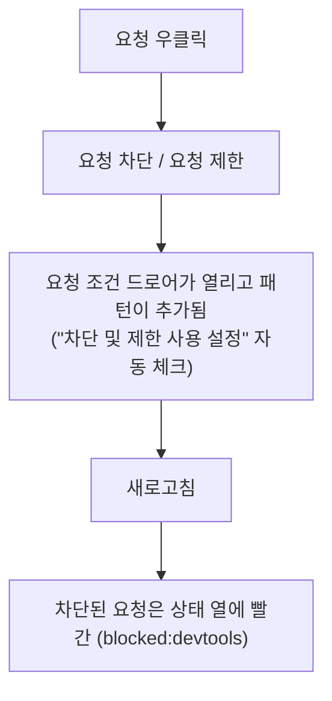

> Chrome for Developers의 「[Chrome DevTools 문서](https://developer.chrome.com/docs/devtools?hl=ko)」를 바탕으로 재구성한 노트다.

## Network 패널이란

Network 패널은 **리소스가 예상대로 업로드·다운로드되는지 확인하는 곳**이다. 요청이 실제로 나갔는지, 헤더·본문·크기가 무엇인지, 어디서 시간이 걸렸는지를 본다. HTTP 메시지·상태 코드 자체는 [[Computer-Science/Network/http|HTTP 프로토콜]]에 있다.

페이지 로드 성능을 개선하려는 목적이라면 Network 패널보다 **Lighthouse**에서 시작한다. 로드 문제 상당수는 네트워크와 무관하다([[web-vitals|웹 성능 지표와 Lighthouse]]).

열기: 상단 **네트워크** 탭, 또는 명령어 메뉴(`Cmd+Shift+P` / `Ctrl+Shift+P`)에서 `Network` → 네트워크 패널 표시.

## 기록

**DevTools가 열려 있는 동안에만 기록한다.** 열기 전에 난 요청은 없으므로 패널을 연 뒤 새로고침한다. 하단 상태 표시줄의 요청 수·전송 크기도 DevTools를 연 뒤의 것만 센다.

| 하고 싶은 것 | 방법 |
| --- | --- |
| 기록 멈추기 | 네트워크 로그 녹화 중지 버튼, 또는 패널 포커스 상태에서 `Cmd+E` / `Ctrl+E` |
| 목록 비우기 | 지우기 버튼 |
| 새로고침·이동 후에도 남기기 | **로그 보존** 체크 |
| 로드 중 화면 보기 | 설정 → 스크린샷 캡처 후 새로고침. 썸네일 클릭은 그 시점 이후 요청만 남긴다 |
| 첫 방문처럼 전부 다시 받기 | 새로고침 버튼 길게 누르기 → **캐시 비우기 및 강제 새로고침** (DevTools가 열려 있을 때만) |

### 요청 표 읽기

| 열 | 보는 것 |
| --- | --- |
| 상태 | HTTP 상태 코드. `CORS error`, `(blocked:origin)`, `(blocked:devtools)`, `(failed)`도 여기 뜬다. 값에 마우스를 올리면 힌트 |
| 유형 | MIME 유형 |
| 시작자(Initiator) | 파서, 리디렉션, 스크립트(소스 줄 링크), 조기 힌트(103), 기타. 마우스를 올리면 요청까지의 **스택 트레이스** |
| 크기 | 응답 헤더 + 본문의 전송 크기. 캐시에서 온 응답은 `(memory cache)`·`(disk cache)`로 표시된다 |
| 시간 | 요청 시작부터 마지막 바이트까지 |
| 폭포식 구조 | 요청별 단계 막대 |

- 헤더를 우클릭해 열을 켠다: 도메인, 메서드, **프로토콜**(h2·h3), 원격 주소, 우선순위, 쿠키·쿠키 설정 수, **렌더링 차단**, 미리 로드됨, 재정의 있음 등. 응답 헤더 → Manage Header Columns로 원하는 헤더를 열로 만든다.
- 설정 → **큰 요청 행**: 크기 열 아래 값이 압축 전 크기, 우선순위 열 아래 값이 초기 우선순위다.
- 설정 → 프레임별로 그룹화: iframe 요청을 접는다.
- `Shift`를 누른 채 요청에 마우스를 올리면 **시작자는 초록, 종속 항목은 빨강**으로 칠해진다.
- `DOMContentLoaded`는 파란 선, `load`는 빨간 선이다.

## 좁히기: 필터·검색

**필터 상자**는 문자열, 정규식(`/.*\.[cj]s+$/`), 제외(`-main.css`), 속성 필터를 받는다. 공백으로 이으면 AND이고 OR는 없다. 반전 체크박스로 뒤집는다.

| 속성 | 쓰임 |
| --- | --- |
| `domain:` | 도메인. `*.com`처럼 와일드카드 가능 |
| `status-code:` · `method:` · `mime-type:` · `resource-type:` | 상태·메서드·유형별 |
| `larger-than:` | `larger-than:1K` 이상. `mime-type:image/gif larger-than:1K`처럼 조합 |
| `has-response-header:` | 특정 응답 헤더가 있는 요청 |
| `scheme:http` · `mixed-content:all` | 평문 요청·혼합 콘텐츠 찾기 |
| `set-cookie-name:` · `cookie-domain:` 등 | 쿠키를 설정하는 요청 |
| `has-overrides:` | 재정의된 요청(content·headers·yes·no) |
| `is:running` | 열린 WebSocket |

- **유형 버튼**: 모두, 가져오기/XHR, JS, CSS, 이미지, 미디어, 글꼴, 문서, WS, Wasm, 매니페스트, 기타. `Cmd`/`Ctrl`+클릭으로 여러 개.
- **필터 더보기**: 데이터 URL 숨기기, 확장 프로그램 URL 숨기기, 차단된 응답 쿠키, 차단된 요청, 서드 파티 요청.
- 개요 타임라인을 드래그하면 그 구간에 활성이던 요청만 남는다.
- **검색**(`Cmd+F` / `Ctrl+F`)은 모든 요청의 **헤더·페이로드·응답 본문**을 뒤진다. 대소문자·정규식 옵션이 있고, 결과를 누르면 해당 요청의 헤더나 응답 탭이 열린다. 예: `Cache-Control`로 캐시 정책을 한 번에 훑는다.

## 요청 상세 탭

요청 이름을 누르면 탭이 열린다.

| 탭 | 볼 것 |
| --- | --- |
| 헤더 | 일반(상태 코드 + 읽기 쉬운 상태 메시지), 응답 헤더, 요청 헤더, Early Hints 헤더. 기본은 알파벳순이고 **소스 보기**로 받은 순서·원문을 본다 |
| 페이로드 | 쿼리 문자열·양식 데이터. 소스 보기, URL 인코딩/디코딩 전환, 바이너리는 Base64·Hex·UTF-8로 디코딩 |
| 미리보기 | 렌더링한 결과. 이미지, HTML로 온 오류 응답을 볼 때 편하다 |
| 응답 | 응답 원문. 축소된 파일은 하단 형식 버튼으로 펼친다 |
| 시작자 | 요청 시작자 체인 트리 |
| 타이밍 | 단계별 시간 (아래) |
| 쿠키 | 요청에 실려 간 쿠키와 응답이 설정한 쿠키. 차단 이유는 정보 아이콘에 마우스를 올린다 |
| 메시지 / EventStream | WebSocket 메시지(최근 100개, 송신 초록·수신 흰색·오류 빨강), SSE·스트리밍 이벤트(정규식 필터) |

**`Provisional headers are shown` 경고**는 요청이 네트워크로 나가지 않고 캐시에서 왔거나, 요청 자체가 실패했거나, 보안상 전체 헤더를 숨길 때 뜬다. 캐시 때문이면 캐시 사용 중지 후 다시 본다.

쿠키 의미는 [[cookie-session|쿠키와 세션]], CORS 오류의 원인과 서버 설정은 [[cors|CORS]]에 있다. 쿠키 값을 고치거나 지우는 일은 [[devtools-application|DevTools Application 패널: 저장소·서비스 워커]]에서 한다.

## 워터폴과 타이밍 단계

폭포식 구조 막대에 마우스를 올리면 타이밍 미리보기가, 타이밍 탭에서는 전체가 보인다. 막대의 밝은 부분은 대기, 어두운 부분은 다운로드다.

| 단계 | 의미 | 길면 의심할 것 |
| --- | --- | --- |
| 현재 재생목록(Queueing) | 연결 전 대기 | 더 높은 우선순위 요청, **HTTP/1.x의 출처당 TCP 6개 한도**, 디스크 캐시 공간 할당 |
| 중단됨(Stalled) | 연결 시작 뒤 같은 이유로 멈춤 | 위와 같음 |
| DNS 조회 | IP 주소 확인 | 새 도메인이 많다 |
| 초기 연결 | TCP 핸드셰이크·재시도, SSL 협상 | 연결 재사용이 안 된다 |
| 프록시 협상 | 프록시와 협상 | 사내 프록시 |
| 요청 전송됨 | 요청 송신 | 큰 업로드 |
| ServiceWorker 준비 / ServiceWorker에 대한 요청 | 서비스 워커 시작·전달 | 워커 기동 비용 |
| **대기 중(TTFB)** | 첫 바이트까지. 왕복 1회 + 서버 처리 시간 | 느린 서버·먼 서버 |
| 콘텐츠 다운로드 | 본문 수신 | 큰 응답, 느린 회선, 바쁜 메인 스레드 |

워터폴 헤더 우클릭 → Waterfall에서 정렬 기준(시작·응답·종료 시간, 총기간, 지연 시간)을 바꾼다. 요청이 줄줄이 이어지는 **워터폴 깊이**가 왜 비싼지는 [[frontend-latency-numbers|프론트엔드 개발자가 알아야 할 지연 시간 숫자]]에 있다.

## 로드 조건 바꾸기

| 하고 싶은 것 | 방법 |
| --- | --- |
| 첫 방문자 흉내 | **캐시 사용 중지** 체크. DevTools가 열려 있을 때만 적용된다 |
| 캐시·쿠키만 비우기 | 요청 표 우클릭 → 브라우저 캐시 지우기 / 브라우저 쿠키 삭제 |
| 느린 회선 | **Throttling** 드롭다운에서 빠른 4G·느린 4G·3G. WebSocket에도 적용된다 |
| 오프라인 | 같은 드롭다운에서 **오프라인**. 서비스 워커 오프라인 동작 테스트용 |
| 내 회선 프로필 | 드롭다운 → 커스텀 → 추가…, 또는 설정 → 제한 → 네트워크 제한 프로필. 다운로드·업로드(Kbps), 지연(ms), 패킷 손실·대기열 길이·재정렬까지 지정한다 |
| 다른 패널에서 작업하며 유지 | **네트워크 조건** 드로어에서 캐시 사용 중지·제한을 켠다. 사용자 에이전트 재정의도 여기서 한다(자동 선택 해제) |

스로틀링이나 오프라인이 켜져 있으면 네트워크 탭 옆에 **경고 아이콘**이 뜬다. 결과가 이상하게 느리면 먼저 이 아이콘을 확인한다. 캐시 여부는 크기 열의 `(memory cache)`·`(disk cache)`와 상태 `304`(재검증 성공)로 판단하고, `Cache-Control` 검색으로 헤더를 훑는다. 헤더의 의미는 [[http-cache|HTTP 캐시]]에 있다.

## 요청 차단·제한 (요청 조건)

일부 리소스가 실패하거나 느릴 때 페이지가 버티는지 본다.

- 직접 열기: 명령어 메뉴에서 `Request conditions` → 요청 조건 표시, 또는 더보기 → 도구 더보기 → 요청 조건.
- 패턴은 와일드카드(`*`)와 URL 패턴 문법을 쓴다. 예: `*://example.com`.
- 규칙마다 차단 대신 **제한 프리셋**(느린 3G 등)을 고를 수 있다. 제한된 요청에는 URL·시간 옆에 금색 아이콘이 붙고, 누르면 해당 규칙으로 간다.
- 여러 패턴에 걸리면 **목록 위쪽 규칙이 이긴다.** 화살표로 순서를 바꾼다.
- DevTools를 닫으면 차단·제한은 꺼지고 패턴만 남는다.

## 내보내기와 다시 보내기

| 하고 싶은 것 | 방법 |
| --- | --- |
| 로그 공유 | 상단 HAR 내보내기, 또는 우클릭 → 복사 → 모두 HAR로 저장. 기본은 **정리됨**: `Cookie`·`Set-Cookie`·`Authorization` 헤더를 뺀다 |
| 민감 정보 포함 HAR | 설정 → 환경설정 → 네트워크 → 민감한 데이터로 HAR 생성 허용을 켠 뒤 내보내기 |
| HAR 다시 보기 | 요청 표에 드래그 앤 드롭, 또는 HAR 가져오기. 시작자 정보도 복원된다 |
| 터미널·코드로 재현 | 우클릭 → 복사 → **cURL로 복사**, 가져오기(fetch)로 복사, fetch로 복사(Node.js), PowerShell로 복사, 미리 로드 요소로 복사 |
| 값만 바꿔 재전송 | 우클릭 → **Edit and resend as fetch**. 원래 매개변수와 실행 컨텍스트가 담긴 `fetch()`가 콘솔에 채워지고, 고쳐서 `Enter` |
| 필터 결과만 | 필터를 건 뒤 "나열된 모든 ~" 복사 항목을 쓴다 |

HAR는 쿠키·토큰을 담을 수 있으므로 **외부에 줄 때는 정리됨 버전만** 쓴다.

응답 본문·헤더를 로컬 값으로 바꿔 서버 수정 없이 실험하는 **재정의(overrides)** 는 [[devtools-debugging|DevTools로 JavaScript 디버깅하기]]에 있다. 헤더 탭의 응답 헤더 값 옆 수정 버튼이 그 입구다.

## 개인 정보 보호 및 보안 패널

명령어 메뉴에서 `privacy` → 개인 정보 보호 및 보안 표시, 또는 더보기 → 도구 더보기 → 개인 정보 보호 및 보안.

| 섹션 | 확인하는 것 |
| --- | --- |
| 보안 > 개요 | **이 페이지는 안전하지 않습니다**(HTTP로 연 페이지), 만료·무효 인증서 같은 손상된 HTTPS. **인증서 보기**로 기본 출처 인증서를 연다 |
| 보안 > 출처 목록 | 출처별 연결·인증서 정보, 인증서 투명성 |
| 보안 > 안전하지 않은 출처 | **혼합 콘텐츠**. Network 패널에서 요청 보기를 누르면 안전하지 않은 리소스만 필터된다 |
| 개인 정보 보호 | 서드 파티 쿠키 일시적으로 제한(유예 기간·휴리스틱 예외 선택) 후 새로고침해 동작 확인, 허용·차단된 서드 파티 쿠키 표 |

TLS·인증서 개념은 [[https|HTTPS와 TLS]], 혼합 콘텐츠 제거와 리디렉트 순서는 [[https-migration|HTTPS 전환: 인증서 고르기부터 리다이렉트까지]]에 있다.

## 정리

- DevTools를 **연 뒤** 새로고침해야 기록된다. 이동이 끼면 로그 보존을 켠다.
- 필터 속성과 `Cmd/Ctrl+F` 검색으로 수백 개 요청을 몇 개로 줄인다.
- 느린 요청은 타이밍 탭에서 **대기(TTFB)인지, 대기열인지, 다운로드인지**부터 가른다.
- 캐시 끄기·스로틀링·오프라인·요청 차단은 DevTools가 열려 있을 때만 유효하다. 경고 아이콘이 켜져 있는지 늘 확인한다.
- 재현은 cURL·fetch 복사나 Edit and resend, 공유는 정리된 HAR로 한다.

관련 노트: [[devtools-debugging|DevTools로 JavaScript 디버깅하기]], [[devtools-application|DevTools Application 패널: 저장소·서비스 워커]], [[devtools-performance|DevTools로 성능·메모리 분석하기]], [[Computer-Science/Network/http|HTTP 프로토콜]], [[http-cache|HTTP 캐시]], [[https|HTTPS와 TLS]], [[cors|CORS]]
