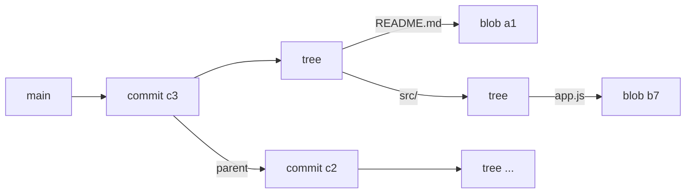
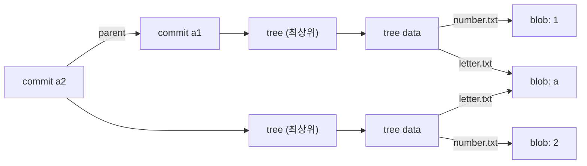
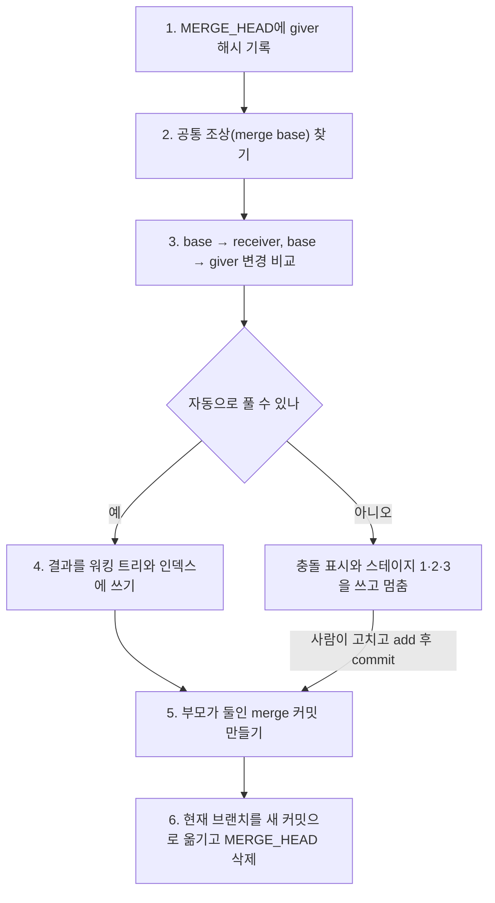
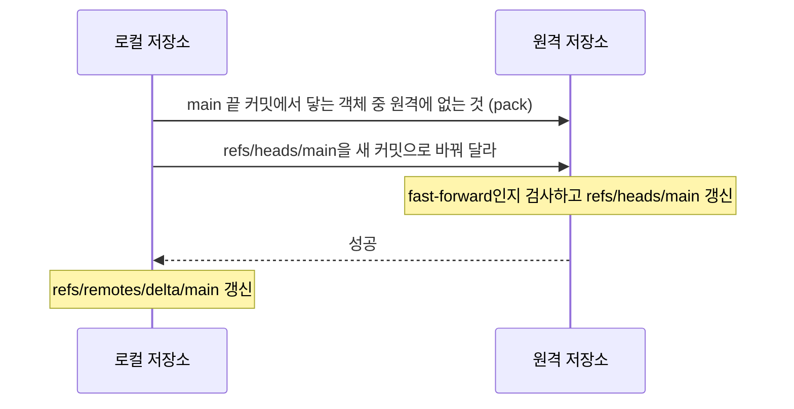

> 팔만코딩경(42Seoul 커뮤니티 위키)의 「그림으로 Git의 내부구조 파악하기」를 바탕으로 재구성한 노트다. 바탕 자료는 『팀 개발을 위한 Git, GitHub 시작하기』(한빛미디어)와 Pro Git의 「Git의 내부」 장이다. 「직접 들여다보기」의 일부 명령은 mingrammer의 「[Git Tips](https://github.com/mingrammer/git-tips)」를 바탕으로 보강했다.
> 「객체 파일의 위치」, 「직접 객체 만들어 보기」, 「커밋 그래프와 참조」는 「[.git - 쩜깃의 이해](https://jusths.tistory.com/64)」와 「[git tutorial](https://johngrib.github.io/wiki/git-tutorial/)」을 바탕으로 보강했다.
> 「그래프의 성질」과 「명령은 그래프를 어떻게 바꾸나」는 Mary Rose Cook의 「[Git from the inside out](https://maryrosecook.com/blog/post/git-from-the-inside-out)」(2015)을 바탕으로 보강했다. 예제 출력은 Git 2.56으로 다시 확인했다.

## 왜 내부를 알아야 하나

`add`, `commit`만 쓸 때는 몰라도 되지만, reset·rebase·복구처럼 이력을 다루는 명령은 내부 구조를 알면 훨씬 덜 무섭다. Git이 하는 일은 단순하다. **내용을 해시로 이름 붙인 객체를 쌓아 두고, 그 객체를 가리키는 포인터를 옮긴다.**

객체와 포인터는 서로를 가리키며 **그래프**를 이루고, Git 명령 대부분은 이 그래프에 객체를 더하거나 포인터를 옮기는 일이다. 그래서 명령과 작업 흐름을 하나씩 외우기보다 그래프의 성질을 익히면 처음 보는 명령의 동작도 예측할 수 있다.

## 작업 폴더의 세 부분

```text
my-project/                    ← 작업 폴더
├─ .git/                       ← Git 저장소(로컬 저장소). 모든 이력이 여기에
│  ├─ objects/                 ← 객체 보관소 (blob, tree, commit, tag)
│  ├─ index                    ← 스테이지(Staging Area)의 실체
│  ├─ refs/heads/main          ← 브랜치: 커밋 해시 하나를 적은 파일
│  ├─ refs/remotes/origin/main ← 원격 추적 브랜치: 마지막 fetch 때 원격 브랜치의 위치
│  ├─ HEAD                     ← 지금 체크아웃한 브랜치를 가리킴
│  ├─ config                   ← 저장소 설정. 원격 주소도 여기에
│  └─ MERGE_HEAD, FETCH_HEAD … ← 명령이 잠시 남기는 참조
└─ src/, README.md ...         ← 워킹 트리: .git을 뺀 나머지 작업 공간
```

- `git init`은 이 `.git` 폴더를 만드는 일이다. 이미 파일이 있는 폴더에서 해도 기존 파일은 건드리지 않는다. `ls -a`로 확인한다.
- 흔히 작업 폴더 전체를 "로컬 저장소"라고 부르지만, 정확히는 `.git`이 저장소이고 나머지는 **워킹 트리**다. `.git`은 Git이 관리하는 영역이고, 워킹 트리는 사람이 고치는 영역이다.
- 파일 상태와 세 영역의 흐름은 [[git-basics|Git 기본 명령과 파일 상태]]에 있다.

## 인덱스: 스테이지의 정체

"파일을 스테이지에 올린다"고 하지만 파일이 어디로 이동하는 것은 아니다. `.git/index`는 **다음 커밋에 들어갈 파일 목록표**다. 경로마다 그 순간 내용의 blob 해시가 적혀 있다. 처음 `git add`할 때 생기고, `add`할 때마다 해당 줄이 새 해시로 갱신된다.

```bash
$ git ls-files --stage
100644 2e65efe2a145dda7ee51d1741299f848e5bf752e 0	data/letter.txt
100644 56a6051ca2b02b04ef92d5150c9ef600403cb1de 0	data/number.txt
```

- 줄마다 모드, blob 해시, **스테이지 번호**, 경로다. 스테이지 번호는 평소 0이고, 충돌이 났을 때만 1·2·3이 생긴다. merge뿐 아니라 rebase, cherry-pick, `stash pop`의 충돌도 같다(아래 「충돌은 인덱스에 기록된다」).
- 인덱스에는 **파일만** 들어간다. `data/letter.txt`처럼 경로째 적히고 `data/` 디렉터리 자체의 항목은 없다. 디렉터리는 커밋할 때 tree 객체로 만들어진다. (예외로 서브모듈은 커밋 해시를 가리키는 항목으로 들어가고, 희소 인덱스는 펼치지 않은 디렉터리를 한 항목으로 둔다.)
- 같은 경로를 다시 `add`하면 blob이 하나 더 생기고 인덱스 줄만 새 해시로 바뀐다. 앞의 blob은 아무도 가리키지 않은 채 `objects/`에 남는다.

## 객체 네 가지

`.git/objects`에는 모든 데이터가 객체로 저장된다. 객체의 이름은 내용을 해시한 값이다.

| 객체 | 언제 생기나 | 담는 것 |
| --- | --- | --- |
| **blob** | `git add` 할 때 파일마다 | 파일 **내용만**. 파일 이름은 없다 |
| **tree** | `git commit` 할 때 디렉터리마다 | 이름 → blob/하위 tree 해시 목록. 폴더 구조의 사진 |
| **commit** | `git commit` 할 때 | 최상위 tree 해시, 부모 커밋 해시, 작성자·커미터, 시각, 메시지 |
| tag | `git tag -a` 할 때 | 특정 커밋을 가리키는 주석 달린 이름표 |

`git commit`은 인덱스를 바탕으로 tree를 만들고, 그 tree를 가리키는 commit 객체를 만든 다음, 현재 브랜치 파일(`refs/heads/main`)의 해시를 새 커밋으로 바꾼다.



### tree와 commit 객체의 내용

```bash
$ git cat-file -p HEAD^{tree}        # 최상위 tree
040000 tree 0eed1217a2947f4930583229987d90fe5e8e0b74	data
$ git cat-file -p HEAD:data          # data 디렉터리의 tree
100644 blob 2e65efe2a145dda7ee51d1741299f848e5bf752e	letter.txt
100644 blob 56a6051ca2b02b04ef92d5150c9ef600403cb1de	number.txt
```

tree 한 줄은 `모드 종류 해시<탭>이름`이다. 모드는 유닉스 권한을 그대로 담지 않고 아래 값만 쓴다.

| 모드 | 뜻 |
| --- | --- |
| `100644` | 일반 파일 |
| `100755` | 실행 파일 |
| `120000` | 심볼릭 링크 |
| `040000` | 하위 디렉터리(tree) |
| `160000` | 서브모듈(다른 저장소의 커밋을 가리킨다) |

```bash
$ git cat-file -p HEAD
tree ce72afb5ff229a39f6cce47b00d1b0ed60fe3556
parent 4c2c28bc84e39bf9fb169666f3e117def3e4e753
author Kim <kim@example.com> 1795842204 +0900
committer Kim <kim@example.com> 1795842204 +0900

a2
```

커밋 객체는 최상위 tree 하나, 부모 커밋(첫 커밋은 없고 merge 커밋은 둘 이상), 작성자·커미터의 이름·이메일·유닉스 시각·시간대, 빈 줄, 메시지로 된 텍스트다. blob과 tree의 해시는 내용이 같으면 누구의 컴퓨터에서든 같지만, 커밋 해시는 이름과 시각이 들어가므로 같은 작업을 해도 사람마다 다르다.

### 객체 파일의 위치

객체는 해시 앞 두 글자를 폴더 이름, 나머지를 파일 이름으로 해서 `.git/objects/ab/cdef…`에 zlib으로 압축해 저장된다. 수많은 객체가 한 폴더에 몰리지 않게 나눈 것이다. 시간이 지나 `git gc`가 돌면 이 낱개 객체들이 `.git/objects/pack/`의 pack 파일로 묶인다.

### 직접 객체 만들어 보기

Git은 결국 **내용을 넣으면 해시를 돌려주는 키-값 저장소**다. 빈 저장소에서 확인할 수 있다.

```bash
echo "hello" | git hash-object -w --stdin   # 저장하고 해시를 받는다 (-w가 없으면 계산만)
git cat-file -p <해시>                       # 해시로 내용을 꺼낸다 → hello
git cat-file -p HEAD                         # 커밋 객체: tree, parent, author, committer, 메시지
```

해시는 내용 앞에 `종류 크기\0` 머리말을 붙여 계산한다. 그래서 `a` 한 글자짜리 파일의 blob 해시는 어느 저장소에서나 같다.

```bash
$ printf 'a' | git hash-object --stdin
2e65efe2a145dda7ee51d1741299f848e5bf752e
$ printf 'blob 1\0a' | shasum
2e65efe2a145dda7ee51d1741299f848e5bf752e  -
```

서명한 커밋이면 커밋 객체 안에 `gpgsig` 헤더로 서명이 함께 들어 있다.

## 체크섬: 내용으로 이름 짓기

`78981922613b2afb...` 같은 40자 16진수는 객체 내용의 **SHA-1 해시(체크섬)** 다. Git은 무엇이든 저장하기 전에 해시를 구하고, 그 해시를 키로 모든 데이터를 찾는다.

- 해시는 파일 이름·시각이 아니라 **내용만으로** 결정된다. 내용이 같은 파일 세 개는 blob 하나를 공유하고, 바뀌지 않은 파일은 다음 커밋에서도 같은 blob을 다시 가리킨다.
- 내용이 1비트라도 바뀌면 해시가 달라지므로, 저장된 데이터가 손상되거나 몰래 바뀌면 바로 드러난다.
- 커밋 해시는 부모 해시를 포함해 계산되므로, 과거 커밋 하나를 고치면 그 뒤 모든 커밋의 해시가 바뀐다. rebase가 "커밋을 새로 만든다"고 하는 이유다.
- Git은 SHA-256 저장소도 지원하며, 다음 메이저 버전인 Git 3.0부터 새 저장소의 기본값을 SHA-256으로 바꿀 예정이다. 2026년 11월 기준 최신 버전은 2.56이고 3.0의 출시일은 정해지지 않았다([Git BreakingChanges](https://git-scm.com/docs/BreakingChanges)). GitHub 등 호스팅 서비스의 SHA-256 저장소 지원도 아직 제한적이라 실무 저장소는 SHA-1이다.

## 변경분이 아니라 스냅숏

Git은 커밋마다 "이전 대비 바뀐 줄"을 저장하지 않고, **그 시점 전체 파일 구조의 스냅숏(tree)** 을 가리킨다. 바뀌지 않은 파일과 디렉터리는 같은 blob·tree를 재사용하므로 공간을 낭비하지 않는다. 덕분에 열 커밋 전 상태도 변경분을 하나씩 거슬러 적용할 필요 없이 그 커밋의 tree를 바로 펼치면 된다. (용량을 줄이려고 나중에 pack 파일로 묶을 때는 내부적으로 델타 압축을 쓰지만, 이는 저장 최적화일 뿐 모델은 스냅숏이다.)

예를 들어 두 번째 커밋에서 `data/number.txt`만 `1`에서 `2`로 바꾸면 새로 생기는 객체는 그 파일의 blob, 그 파일을 담은 `data` tree, 최상위 tree, 커밋 하나씩이다. `letter.txt`는 첫 커밋과 같은 blob을 가리킨다.



## 커밋 그래프와 참조

커밋은 부모만 가리키고 자식은 모른다. 그래서 이력 전체는 **방향 비순환 그래프(DAG)** 가 된다. 일반 커밋은 부모가 하나, merge 커밋은 둘 이상이다.

| 참조 | 파일 | 움직이나 |
| --- | --- | --- |
| 브랜치 | `.git/refs/heads/<이름>` | 그 브랜치에서 커밋할 때마다 새 커밋으로 |
| 태그 | `.git/refs/tags/<이름>` | 움직이지 않는다 |
| 원격 추적 브랜치 | `.git/refs/remotes/origin/<이름>` | fetch·push할 때 |
| HEAD | `.git/HEAD` | 보통 `ref: refs/heads/main`처럼 브랜치를 가리키고, 커밋을 직접 가리키면 detached HEAD |

각 참조가 지나온 위치는 `.git/logs/`의 reflog에 남는다. 이것이 잘못된 reset·rebase 뒤에도 커밋을 되찾을 수 있는 이유다([[git-undo-and-rewrite|되돌리기와 이력 다루기]]).

명령이 일하는 동안 `.git` 바로 아래에 잠시 남기는 참조도 있다. 브랜치 이름 자리에 그대로 쓸 수 있다(`git rev-parse MERGE_HEAD`, `git merge FETCH_HEAD`).

| 참조 | 언제 생기나 | 가리키는 것 |
| --- | --- | --- |
| `MERGE_HEAD` | merge가 진행 중일 때. 충돌로 멈춘 동안 남아 있다 | 합쳐 넣는 쪽 커밋. merge 커밋을 만들면 지워진다 |
| `FETCH_HEAD` | fetch할 때마다 | 방금 받아 온 원격 브랜치의 커밋 |
| `ORIG_HEAD` | merge·rebase·reset처럼 HEAD를 크게 옮기기 직전 | 옮기기 전의 HEAD. 방금 한 작업을 통째로 되돌릴 때 쓴다 |

참조가 늘 낱개 파일인 것은 아니다. clone 직후나 `git gc` 뒤에는 여러 참조가 `.git/packed-refs` 한 파일에 모여 있어서 `refs/heads/`에 파일이 없어도 브랜치는 있을 수 있다. Git 3.0부터는 새 저장소의 기본 참조 저장 방식이 파일 대신 reftable로 바뀔 예정이다(지금도 `git init --ref-format=reftable`로 쓸 수 있다). 그러니 참조는 파일을 직접 읽지 말고 `git rev-parse`로 푼다.

## 그래프의 성질

| 성질 | 그래서 |
| --- | --- |
| 객체는 내용으로 이름 붙고 **바뀌지 않는다** | 파일을 고치면 객체가 바뀌는 게 아니라 새 객체가 생긴다. 한 번 `add`·`commit`한 내용은 `git gc`가 도달할 수 없는 객체를 지울 때까지 `objects/`에 남는다 |
| 참조는 **바뀐다** | `main`이 가리키는 커밋은 커밋·merge·reset 때마다 달라진다. 브랜치 이동, reset, rebase는 모두 참조를 옮기는 일이다 |
| 커밋은 부모를 가리킨다 | 이력이 생긴다. 부모가 둘 이상이면 갈라진 계보를 잇는 merge 커밋이다 |
| 여러 커밋이 같은 부모를 가질 수 있다 | 계보가 갈라진다. 두 브랜치가 같은 커밋에서 각자 커밋하면 생긴다 |
| 두 커밋의 공통 조상을 찾을 수 있다 | 한쪽만 바꾼 파일은 사람 손 없이 병합된다 |
| 객체는 다른 저장소로 복사할 수 있다 | 저장소끼리 이력을 나눌 수 있다. fetch·push·clone은 없는 객체를 복사하고 참조를 맞추는 일이다 |
| 참조는 이력으로 들어가는 입구다 | 커밋에 `fix-login-timeout` 같은 이름을 붙여 찾는다. 어떤 참조에서도 닿지 않는 커밋은 해시를 알아야만 찾는다 |

### 얼마나 쉽게 되찾을 수 있나

Git의 기억은 위치에 따라 단단함이 다르다. 손이 닿기 쉬운 곳일수록 금방 바뀐다.

| 위치 | 찾는 방법 | 얼마나 오래 남나 |
| --- | --- | --- |
| 워킹 트리의 저장 안 한 변경 | 바로 보인다 | 가장 짧다. 덮어쓰면 끝이다. 한 번이라도 `add`했다면 blob이 남아 `git fsck --lost-found`로 찾을 수 있다 |
| HEAD 커밋 | `HEAD` | 커밋할 때마다 바뀐다 |
| 브랜치 끝 커밋 | 브랜치 이름 | 그 브랜치에 커밋하거나 브랜치를 옮길 때만 바뀐다 |
| 어떤 참조도 가리키지 않는 커밋 | 해시, 또는 reflog | reflog 항목이 만료되면(현재 끝에서 닿지 않는 항목은 기본 30일, 나머지는 90일) 어디서도 닿지 않게 되고, 그 뒤 `git gc`가 유예 기간(`gc.pruneExpire`, 기본 2주)이 지난 객체부터 지운다 |

워킹 트리의 변경을 잠시 단단한 곳으로 옮기는 방법이 stash다. 변경을 커밋 객체로 만들어 `refs/stash`에 걸어 둔다([[stash-worktree-clean|작업 중인 변경 다루기]]).

## 명령은 그래프를 어떻게 바꾸나

예시 저장소는 `data/letter.txt`(내용 `a`)와 `data/number.txt`(내용 `1`) 두 파일로 시작한다. 각 명령이 워킹 트리, 인덱스, objects, 참조 중 무엇을 바꾸는지 보면 동작이 정리된다.

| 명령 | 워킹 트리 | 인덱스 | objects | 참조 |
| --- | --- | --- | --- | --- |
| `add` | - | 경로의 blob 해시를 갱신 | blob 추가 | - |
| `commit` | - | - | tree, commit 추가 | 현재 브랜치(detached면 HEAD)를 새 커밋으로 |
| `rm` | 파일 삭제 | 항목 삭제 | - | - |
| `branch <이름>` | - | - | - | `refs/heads/<이름>` 생성 |
| `switch`(`checkout`) | 대상 커밋의 tree로 | 대상 커밋의 tree로 | - | HEAD를 대상 브랜치(또는 커밋 해시)로 |
| `merge` (fast-forward) | 합칠 커밋의 tree로 | 합칠 커밋의 tree로 | - | 현재 브랜치를 합칠 커밋으로 |
| `merge` (3-way) | 병합 결과 | 병합 결과 | tree, merge commit 추가 | `MERGE_HEAD`를 거쳐 현재 브랜치를 새 커밋으로 |
| `fetch` | - | - | 원격에서 없는 객체 복사 | `refs/remotes/<원격>/<브랜치>`, `FETCH_HEAD` |
| `push` | - | - | 원격에 없는 객체 복사 | 원격의 `refs/heads/<브랜치>`, 내 `refs/remotes/<원격>/<브랜치>` |

`pull`은 `fetch` 뒤 `merge`(설정에 따라 rebase)이고, `clone`은 `init`, `remote add`, `fetch`, 체크아웃을 이어 붙인 것이다(아래 「원격」).

### 1. commit: 인덱스로 tree를 만들고 브랜치를 옮긴다


1. 인덱스의 경로를 디렉터리별로 묶어 tree를 만든다. 하위 디렉터리부터 만들어 위로 올라간다. 내용이 이전과 같은 tree는 같은 해시가 나오므로 새로 저장되지 않는다.
2. 최상위 tree를 가리키는 commit 객체를 만든다. 부모는 HEAD를 따라가 찾은 현재 브랜치의 커밋이다.
3. HEAD가 가리키는 브랜치 파일에 새 커밋 해시를 쓴다. `git init` 직후의 HEAD는 아직 없는 브랜치(`ref: refs/heads/main`)를 가리키고, 첫 커밋이 그 브랜치를 만든다.

`git rm`은 워킹 트리의 파일과 인덱스 항목을 함께 지운다. 다음 커밋의 tree에는 그 경로가 빠지지만, 이전 커밋들이 가리키는 blob은 그대로 남는다.

### 2. switch: HEAD를 옮기고 tree를 펼친다

`git switch <브랜치>`(예전 형식은 `git checkout <브랜치>`)는 네 단계다.

1. 대상 브랜치가 가리키는 커밋과 그 tree를 찾는다.
2. tree의 파일을 워킹 트리에 쓴다.
3. tree의 항목으로 인덱스를 다시 쓴다.
4. `HEAD`에 `ref: refs/heads/<브랜치>`를 쓴다.

#### detached HEAD

브랜치가 아니라 커밋을 직접 체크아웃하면 4단계에서 HEAD에 브랜치 이름 대신 **커밋 해시**가 적힌다. 이것이 detached HEAD다.

```bash
$ git switch --detach e31d5bd       # git checkout e31d5bd 와 같다
$ cat .git/HEAD
e31d5bd6c6d46c4ae16561c7c446bfe02c2ec8da
$ git commit -m "a3"
[detached HEAD 4c7d32e] a3
```

- `git switch`는 실수를 막으려고 `--detach` 없이 커밋 해시를 주면 거부한다(`fatal: a branch is expected, got commit`).
- 이 상태에서 커밋하면 브랜치가 아니라 **HEAD 자체가** 새 커밋으로 옮겨 간다. 다른 브랜치로 떠나면 그 커밋을 가리키는 참조가 하나도 남지 않아 reflog로만 찾을 수 있다. Git도 떠날 때 어느 브랜치에도 연결되지 않은 커밋을 두고 간다고 경고한다.
- 남기려면 떠나기 전에 `git branch <이름>`(또는 `git switch -c <이름>`)으로 이름을 붙인다. 브랜치는 커밋 해시 한 줄을 적은 참조라서 만드는 비용이 거의 없다.

#### 로컬 변경이 있으면 멈춘다

워킹 트리에서 고친 파일이 현재 커밋과 대상 커밋에서도 서로 다르면 세 버전(HEAD, 대상, 워킹 트리)이 생긴다. 2단계에서 대상 tree를 펼치면 내 변경이 사라지므로 Git은 전환을 거부한다.

```text
error: Your local changes to the following files would be overwritten by checkout:
	data/number.txt
Please commit your changes or stash them before you switch branches.
Aborting
```

그 파일이 두 커밋에서 같다면 덮어쓸 일이 없으므로 변경을 그대로 들고 이동한다. 멈췄을 때는 커밋하거나, stash로 치워 두거나, `git switch -m <브랜치>`로 내 변경을 대상 커밋 위에 3-way 병합하며 이동한다.

### 3. merge: 받는 쪽과 주는 쪽

`git merge <브랜치>`에서 결과를 받는 쪽(receiver)은 HEAD가 가리키는 커밋이고, 합쳐 넣는 쪽(giver)은 인자로 준 커밋이다. 두 커밋의 관계에 따라 할 일이 정해진다.

| 관계 | 출력 | 하는 일 |
| --- | --- | --- |
| giver가 receiver의 조상 | `Already up to date.` | 아무것도 하지 않는다. giver의 변경은 이미 들어 있다 |
| giver가 receiver의 자손 | `Fast-forward` | giver의 tree를 워킹 트리·인덱스에 쓰고 현재 브랜치를 giver로 옮긴다. 이미 있는 커밋들이 변경을 설명하므로 새 커밋을 만들지 않는다 |
| 서로 다른 계보 | `Merge made by the 'ort' strategy.` | 아래 3-way 병합 |

#### 3-way 병합 절차



공통 조상은 두 커밋 모두에서 거슬러 닿는 가장 가까운 커밋이다(`git merge-base main deputy`로 볼 수 있다). 3단계는 파일마다 base에서 각 쪽이 어떻게 바뀌었는지 본다.

| base → receiver | base → giver | 결과 |
| --- | --- | --- |
| 그대로 | 바뀜 | giver 쪽 내용 |
| 바뀜 | 그대로 | receiver 쪽 내용 |
| 똑같이 바뀜 | 똑같이 바뀜 | 그 내용 |
| 다르게 바뀜 | 다르게 바뀜 | 파일 안에서 줄 단위로 다시 3-way 병합한다. 바뀐 부분이 겹치지 않으면 자동, 겹치면 충돌 |

merge 커밋의 첫 번째 부모는 receiver, 두 번째 부모는 giver다. 부모 순서가 왜 중요한지는 [[merge|브랜치 병합]]의 「Merge Commit의 함정」에 있다. 병합 직전의 HEAD는 `ORIG_HEAD`에 남으므로 방금 한 병합은 `git reset --hard ORIG_HEAD`로 통째로 되돌릴 수 있다.

#### 충돌은 인덱스에 기록된다

자동으로 풀 수 없는 파일은 인덱스에서 스테이지 0 항목이 빠지고, 같은 경로가 세 줄로 들어간다.

```bash
$ git ls-files --stage
100644 63d8dbd40c23542e740659a7168a0ce3138ea748 0	data/letter.txt
100644 bf0d87ab1b2b0ec1a11a3973d2845b42413d9767 1	data/number.txt
100644 62f9457511f879886bb7728c986fe10b0ece6bcb 2	data/number.txt
100644 7813681f5b41c028345ca62a2be376bae70b7f61 3	data/number.txt
```

| 스테이지 | 버전 | 꺼내 보기 |
| --- | --- | --- |
| 0 | 충돌 없는 보통 항목 | `git show :data/number.txt` |
| 1 | 공통 조상(base) | `git show :1:data/number.txt` |
| 2 | receiver (HEAD, ours) | `git show :2:data/number.txt` |
| 3 | giver (MERGE_HEAD, theirs) | `git show :3:data/number.txt` |

- rebase·cherry-pick의 충돌에서도 2는 HEAD, 3은 옮겨 오는 커밋이다. 다만 rebase 중의 HEAD는 기준 브랜치 쪽이라 ours·theirs가 직관과 반대가 된다.
- 워킹 트리의 파일에는 `<<<<<<< HEAD`, `=======`, `>>>>>>> deputy` 충돌 표시가 들어간다. 병합은 여기서 멈추고 커밋과 브랜치 이동 단계는 미뤄진다. `git status`의 "unmerged paths"는 인덱스에 스테이지 0이 아닌 항목이 있다는 뜻이다(`git ls-files -u`로 그것만 볼 수 있다).
- 파일을 고쳐 `git add`하면 스테이지 1·2·3이 지워지고 새 blob을 가리키는 스테이지 0 한 줄이 된다.
- 충돌 항목이 하나도 없을 때 `git commit`하면 Git은 `MERGE_HEAD`를 보고 부모가 둘인 merge 커밋을 만든 뒤 `MERGE_HEAD`를 지운다.
- 충돌을 푸는 순서와 도구(`restore --ours`, `mergetool`, `rerere`, `zdiff3`)는 [[merge|브랜치 병합]]에 있다.

### 4. 원격: 객체를 복사하고 참조를 맞춘다

원격 저장소도 같은 구조의 저장소일 뿐이다. 원격 명령은 두 저장소 사이에서 **없는 객체를 복사하고 참조를 맞추는 일**이다. 원격이 GitHub든 옆 폴더(`../bravo`)든 같다.

#### remote add와 fetch

```bash
$ git remote add bravo ../bravo
$ tail -3 .git/config
[remote "bravo"]
	url = ../bravo
	fetch = +refs/heads/*:refs/remotes/bravo/*
```

`git remote add`는 `config`에 원격 이름과 주소를 적을 뿐이다. `fetch` 줄(refspec)은 원격의 `refs/heads/*`를 내 `refs/remotes/bravo/*`로 받는다는 규칙이고, 앞의 `+`는 fast-forward가 아니어도(원격에서 force push가 있었어도) 덮어쓴다는 뜻이다.

`git fetch bravo main`은 네 단계다.

1. 원격 `main`이 가리키는 커밋 해시를 받는다.
2. 그 커밋에서 닿는 객체(커밋, tree, blob, 조상 커밋들) 중 내 저장소에 없는 것만 골라 받아 `objects/`에 넣는다. 전송은 pack 파일로 묶어서 한다.
3. `refs/remotes/bravo/main`을 그 커밋으로 맞춘다.
4. `FETCH_HEAD`에 받아 온 커밋을 적는다.

```bash
$ git fetch bravo main
From ../bravo
 * branch            main       -> FETCH_HEAD
 * [new branch]      main       -> bravo/main
$ cat .git/FETCH_HEAD
365dfa297159e19445396145232a9e69231cf4ce		branch 'main' of ../bravo
```

- 원격 추적 브랜치는 **마지막으로 통신한 순간** 원격 브랜치가 어디 있었는지 적은 기록이다. 원격에서 브랜치가 움직여도 다시 fetch하기 전에는 그대로다.
- fetch는 워킹 트리와 내 브랜치를 건드리지 않는다. 받은 커밋을 반영하는 것은 `git merge FETCH_HEAD`(또는 `git merge bravo/main`)이고, `git pull`이 이 두 단계를 한 번에 한다. 통합 방식을 rebase로 정하는 설정은 [[remote-github|원격 저장소와 GitHub]]에 있다.

#### clone

`git clone`은 새 폴더에 `init`을 하고, 원본을 `origin`이라는 원격으로 등록하고, fetch한 뒤 기본 브랜치를 체크아웃하는 일이다. 원격의 브랜치는 모두 `refs/remotes/origin/*`로 들어오고 로컬 브랜치는 기본 브랜치 하나만 생긴다. 다른 브랜치는 `git switch <이름>`을 하면 같은 이름의 원격 추적 브랜치에서 만들어진다.

#### push

`git push delta main`은 fetch를 반대 방향으로 한다.



원격 브랜치는 기본으로 fast-forward일 때만 바뀐다. 원격에 내가 모르는 커밋이 있으면 거부되고, 덮어쓰려면 강제 push가 필요하다([[remote-github|원격 저장소와 GitHub]]의 「안전한 강제 push」).

#### 체크아웃된 브랜치에는 push할 수 없다: bare 저장소

원격이 워킹 트리가 있는 보통 저장소이고, push하려는 브랜치가 거기서 체크아웃돼 있으면 push가 거부된다.

```text
 ! [remote rejected] main -> main (branch is currently checked out)
error: failed to push some refs to '../charlie'
```

push는 원격의 브랜치 참조만 바꾸고 원격의 인덱스와 워킹 트리는 그대로 둔다. 이를 받아들이면 원격에서 작업하던 사람의 HEAD와 워킹 트리가 어긋난다. 원격의 `receive.denyCurrentBranch` 기본값이 `refuse`인 이유다. `updateInstead`로 바꾸면 원격 워킹 트리가 깨끗할 때 함께 갱신하는데, 서버의 폴더에 바로 배포하는 용도로 쓴다.

그래서 여러 사람이 push하는 중앙 저장소는 워킹 트리가 없는 **bare 저장소**로 만든다. GitHub 같은 호스팅 서비스가 서버에 두는 저장소도 bare다.

```bash
$ git init --bare project.git      # 새로 만들기
$ git clone --bare alpha delta     # 기존 저장소에서 만들기
$ ls delta
HEAD  config  description  hooks  info  objects  packed-refs  refs
```

- 보통 저장소의 `.git` 안에 있던 것이 폴더 최상위에 바로 있고, `config`에 `bare = true`가 적힌다. 관례로 폴더 이름 끝에 `.git`을 붙인다.
- `git clone --mirror`는 모든 참조까지 그대로 옮기는 bare 클론이다([[remote-github|원격 저장소와 GitHub]]의 미러링).

## 직접 들여다보기

```bash
git cat-file -t <hash>      # 객체 종류 (blob, tree, commit, tag)
git cat-file -p <hash>      # 객체 내용 출력
git cat-file -p HEAD^{tree} # 현재 커밋의 최상위 tree
git ls-files --stage        # 인덱스에 적힌 경로, blob 해시, 스테이지 번호
git hash-object README.md   # 이 파일이 blob이 되면 받을 해시
git ls-tree -r --name-only HEAD   # 이 커밋의 tree에 든 모든 파일 경로
git rev-parse HEAD          # 참조(브랜치·태그·HEAD~2 등)를 커밋 해시로 풀기
git rev-parse --abbrev-ref HEAD   # 현재 브랜치 이름
git rev-parse --show-toplevel     # 저장소 최상위 폴더 경로 (스크립트에서 유용)
git merge-base A B          # 두 커밋의 공통 조상
git fsck --lost-found       # 참조·reflog 어디서도 닿지 않는(dangling) 객체를 .git/lost-found에 모으기
git count-objects -vH       # 느슨한 객체·pack 개수와 디스크 사용량
git gc                      # 느슨한 객체를 pack으로 묶고 도달할 수 없는 객체 정리
```

`git gc`는 보통 Git이 알아서(`gc --auto`) 돌린다. 직접 `git gc --prune=now`를 돌리면 reflog에도 없는 객체가 즉시 사라져 복구할 길이 없어지므로, 이력을 지운 직후가 아니면 손으로 돌릴 일은 드물다.

`.git` 안을 직접 보며 배우는 것이 가장 빠르다. 빈 폴더에서 `git init` 후 명령을 하나 실행할 때마다 `.git`의 파일과 `git ls-files --stage`, `git cat-file -p`가 어떻게 바뀌는지 확인하면 위 표의 동작을 그대로 볼 수 있다.

## 정리

- `.git`이 저장소이고, 그 밖은 워킹 트리다. 스테이지의 실체는 `.git/index` 파일이다.
- add는 blob을, commit은 tree와 commit 객체를 만들고 브랜치 포인터를 옮긴다. 모든 객체는 내용의 해시로 이름 붙고 같은 내용은 한 번만 저장된다.
- 객체는 바뀌지 않고 참조는 바뀐다. switch·merge·reset·rebase는 참조를 옮기는 일이고, 참조에서 닿지 않는 커밋은 reflog가 만료되면 사라진다.
- merge는 공통 조상과 양쪽을 비교하는 3-way 병합이고, 충돌은 인덱스의 스테이지 1·2·3으로 기록된다.
- fetch·push·clone은 저장소 사이에 없는 객체를 복사하고 참조를 맞추는 일이다. 여러 사람이 push하는 저장소는 bare로 만든다.

관련 노트: [[git-basics|Git 기본 명령과 파일 상태]], [[branch|Git 브랜치]], [[merge|Git 브랜치 병합]], [[remote-github|원격 저장소와 GitHub]], [[git-undo-and-rewrite|되돌리기와 이력 다루기]], [[missing-semester|The Missing Semester: CS 교육에서 빠진 도구 학기]]
