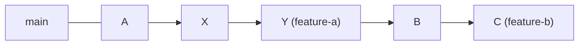
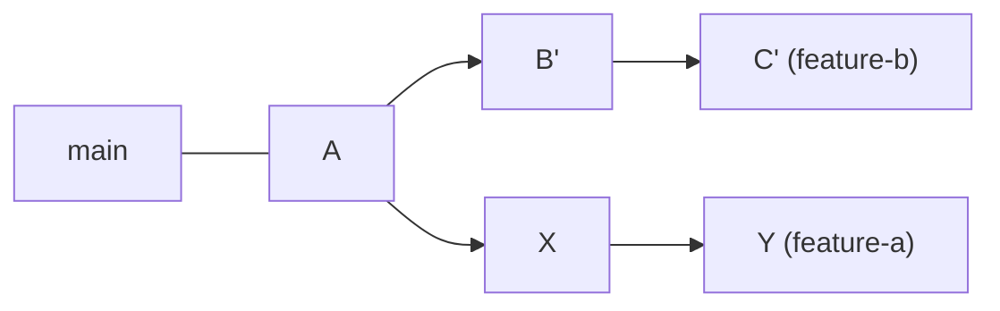

> riverkim.kr에 쓴 글들을 다시 정리한 노트다.
> 「이미 푸시한 이력에서 지워야 할 때」는 팔만코딩경(42Seoul 커뮤니티 위키)의 「깃허브에서 잘못 올린 PR 완전히 삭제하기 (2) - 커밋」, 「GitHub 이메일 교체 시 잔디가 사라지는 현상」을 바탕으로 보강했다.
> 「상황별 복구 레시피」는 Katie Sylor-Miller의 「[Oh Shit, Git!?!](https://ohshitgit.com/)」([한국어판](https://ohshitgit.com/ko))을 바탕으로 지금의 `switch`·`restore` 명령으로 고쳐 썼다.
> `reset --keep`, 지운 파일 되살리기, 작성자 고치기, `rebase --onto`, merge 커밋 되돌리기는 arslanbilal의 「[Git and Git Flow Cheat Sheet](https://github.com/arslanbilal/git-cheat-sheet)」와 mingrammer의 「[Git Tips](https://github.com/mingrammer/git-tips)」를 바탕으로 보강했다.
> `ORIG_HEAD`, 지운 브랜치 되살리기, 커밋에서 파일 하나 빼기, 브랜치 전체를 커밋 하나로 합치기는 「[Git Flight Rules](https://github.com/k88hudson/git-flight-rules/blob/master/README_kr.md)」(한국어판)와 「[Git 사용 중 자주 만나는 이슈 정리](https://parksb.github.io/article/28.html)」를 바탕으로 보강했다.

Git을 쓰다 보면 커밋을 되돌리거나, 다른 브랜치의 이력을 내 브랜치로 옮겨야 할 때가 생긴다. 기본 흐름(`add` → `commit` → `push`)은 [[git-basics|Git 기본 명령과 파일 상태]]와 [[remote-github|원격 저장소와 GitHub]]에 있고, 이 노트는 **이미 만든 이력을 고치는 명령**만 모았다.

## 한눈에 보기

| 하고 싶은 일 | 명령 | 이력을 바꾸는가 |
| --- | --- | --- |
| 특정 커밋으로 브랜치를 되감기 | `git reset <옵션> <커밋>` | 바꾼다 (커밋이 사라진 것처럼 보인다) |
| 특정 커밋을 취소하는 새 커밋 만들기 | `git revert <커밋>` | 바꾸지 않는다 (커밋이 하나 늘어난다) |
| 내 브랜치 시작점을 최신 기준 브랜치로 옮기기 | `git rebase <브랜치>` ([[merge-squash-rebase\|merge·squash·rebase 언제 쓰나]]) | 바꾼다 (내 커밋이 새로 만들어진다) |
| 다른 브랜치의 커밋 하나만 가져오기 | `git cherry-pick <커밋>` | 내 브랜치에 새 커밋이 추가된다 |
| 진행 중인 병합·리베이스 취소 | `git merge --abort`, `git rebase --abort` | 명령 전 상태로 돌아간다 |

## reset: 브랜치를 과거 커밋으로 되감기

`git reset`은 현재 브랜치가 가리키는 커밋을 지정한 커밋으로 옮긴다. 그 뒤의 커밋들은 브랜치에서 빠진다. 옵션은 **되감은 뒤 변경 내용을 어디에 남기느냐**의 차이다.

| 옵션 | 커밋 이력 | 변경 내용 | 쓰는 때 |
| --- | --- | --- | --- |
| `--soft` | 되감는다 | 남기고, **staged** 상태 | 커밋 몇 개를 하나로 다시 묶을 때 |
| `--mixed` (기본값) | 되감는다 | 남기고, **unstaged** 상태 | 커밋을 다시 나눠 담을 때 |
| `--hard` | 되감는다 | **모두 버린다** | 그 커밋 이후 작업을 완전히 지울 때 |
| `--keep` | 되감는다 | 커밋 안 한 로컬 수정은 **지키고**, 되감기와 겹치는 파일이 있으면 멈춘다 | `--hard`처럼 되감되 작업 중인 수정은 잃고 싶지 않을 때 |

```bash
git reset --soft HEAD~1   # 마지막 커밋만 취소, 변경은 스테이징에 그대로
git reset --hard a1b2c3d  # a1b2c3d 시점으로 완전히 되돌림
```

force push로 원격 브랜치가 덮어써진 경우에도 **내 로컬에는 이전 커밋이 남아 있으므로** `reset`으로 그 시점에 돌아간 뒤 다시 올릴 수 있다. 되감은 커밋의 해시를 잊었다면 `git reflog`로 HEAD가 지나온 기록을 찾는다.

## revert: 취소 커밋을 새로 쌓기

`git revert <커밋>`은 그 커밋의 변경을 반대로 적용한 **새 커밋**을 만든다. 이력은 그대로 남고 "되돌렸다"는 기록이 더해진다.

- **이미 push해서 다른 사람이 받아 간 커밋**은 revert로 되돌린다. reset 후 force push하면 동료의 로컬 이력과 어긋난다.
- 아직 나만 가진 로컬 커밋이면 reset이 더 간단하다.
- **merge 커밋**을 되돌릴 때는 어느 부모를 기준으로 남길지 `-m`으로 정한다. `git revert -m 1 <merge 커밋>`은 첫 부모(합쳐 받은 쪽, 보통 `main`) 기준으로 PR 전체를 취소한다. 같은 브랜치를 나중에 다시 합치려면 그 revert 커밋을 먼저 revert해야 한다.

## cherry-pick: 커밋 하나만 가져오기

```bash
git cherry-pick a1b2c3d
```

동료의 커밋이나 다른 브랜치에 있는 내 예전 커밋 **하나만** 현재 브랜치로 복사한다. 브랜치 전체를 합치지 않고 특정 수정만 필요할 때 쓴다.

## --abort: 진행 중인 작업 취소

merge나 rebase 도중 충돌이 너무 많거나 잘못된 쪽 코드를 골랐다면, 하나씩 고치기보다 **처음부터 다시 하는 편이 빠를 때**가 있다.

```bash
git merge --abort    # (MERGING) 상태에서 빠져나와 merge 전으로
git rebase --abort   # rebase 시작 전으로
```

명령을 치기 전 상태로 완전히 돌아간다. 이미 merge·rebase를 끝내고 push까지 했다면 abort로는 되돌릴 수 없고, reset이나 revert를 써야 한다.

## 상황별 복구 레시피

### 뭘 했는지 모르겠지만 망가졌다: reflog

`git reflog`는 HEAD가 지나온 **모든 상태**를 브랜치와 상관없이 기록한다. 지운 브랜치, 잘못된 merge·rebase·reset 직전으로도 돌아갈 수 있는 타임머신이다.

```bash
git reflog                  # HEAD@{0}, HEAD@{1} … 망가지기 직전 항목을 찾는다
git reset --hard HEAD@{5}   # 그 시점으로 되감는다
```

reflog는 로컬에만 있고 기본 90일(도달할 수 없는 항목은 30일) 뒤 정리된다.

### 커밋하자마자 고칠 게 생겼다

```bash
git add .
git commit --amend --no-edit   # 마지막 커밋에 합치고 메시지는 그대로
git commit --amend             # 메시지만 고칠 때
```

amend는 커밋을 새로 만든다. **이미 푸시한 공유 브랜치의 커밋은 amend하지 않는다.**

### 다른 브랜치에 커밋해 버렸다

| 상황 | 방법 |
| --- | --- |
| `main`에 커밋했는데 **새 브랜치**에 있어야 했다 | `git branch new-feature` → `git reset --hard HEAD~` → `git switch new-feature`. 커밋은 새 브랜치에 남고 `main`에서만 빠진다 |
| **이미 있는 다른 브랜치**에 있어야 했다 | `git reset --soft HEAD~` → `git stash` → `git switch right-branch` → `git stash pop` → 다시 커밋. 또는 `git switch right-branch` → `git cherry-pick main` → `main`으로 돌아와 `git reset --hard HEAD~` |

둘 다 아직 푸시하지 않았을 때의 방법이다. 푸시했다면 revert로 되돌린다.

### diff가 비어 있다

`git add`로 스테이징한 변경은 `git diff`에 나오지 않는다. `git diff --staged`로 본다.

### 파일 하나만 예전 상태로

```bash
git log -- path/to/file                         # 바뀌기 전 커밋 해시를 찾는다
git restore --source=a1b2c3d -- path/to/file    # 그 시점 내용으로 되돌린다
```

과거에는 `git checkout a1b2c3d -- path/to/file`을 썼다. Git 2.23부터 `checkout`의 두 역할이 브랜치 이동(`switch`)과 파일 복원(`restore`)으로 나뉘었다. 몇 커밋 전의 커밋 하나를 통째로 되돌리는 것은 `git revert <해시>`다.

### 방금 한 merge·rebase·reset을 통째로 취소: ORIG_HEAD

merge, rebase, reset처럼 HEAD를 크게 옮기는 명령은 옮기기 직전 위치를 `ORIG_HEAD`에 적어 둔다. 끝난 직후라면 reflog를 뒤질 필요 없이 바로 돌아간다.

```bash
git reset --hard ORIG_HEAD
```

다른 명령을 더 실행하면 `ORIG_HEAD`가 덮어써지므로 그때는 reflog를 쓴다.

### 지운 브랜치 되살리기

브랜치를 지워도 커밋은 한동안 남는다. reflog에서 그 브랜치의 마지막 커밋을 찾아 브랜치를 다시 만든다.

```bash
git reflog                          # "checkout: moving from deleted-branch" 근처의 해시
git branch deleted-branch <해시>
```

### 마지막 커밋에서 파일 하나 빼기

```bash
git rm --cached path/to/file        # 작업 트리의 파일은 남기고
git commit --amend --no-edit        # 커밋에서만 뺀다
```

### 브랜치의 커밋 전체를 하나로

```bash
git reset --soft main               # main 이후의 변경을 모두 스테이징 상태로 남기고
git commit -m "Add payment flow"    # 커밋 하나로 다시 만든다
```

인터랙티브 rebase로 `squash`를 여러 줄 고치는 것보다 빠르다. 아직 push하지 않은 커밋만 다듬으려면 `git rebase -i @{u}`로 범위를 업스트림 이후로 한정한다.

### 지운 파일 되살리기

```bash
git log --diff-filter=D --oneline -- path/to/file    # 이 파일을 지운 커밋 찾기
git restore --source=<지운 커밋>^ -- path/to/file      # 그 직전(^) 커밋의 내용으로 복원
```

### 커밋 작성자 고치기 (최근 커밋)

```bash
git commit --amend --author="Name <me@example.com>" --no-edit   # 작성자만 바꾸기
git commit --amend --reset-author --no-edit                     # 지금 user.name·email로 다시 찍기
```

여러 커밋이면 `git rebase -i`에서 해당 커밋을 `edit`으로 멈추고 위 명령을 반복하거나, 이력 전체라면 아래의 `filter-repo --mailmap`을 쓴다.

### 브랜치의 뿌리를 옮기기: rebase --onto

`feature-b`를 `feature-a` 위에서 땄는데 `feature-a`가 아직 머지되지 않았고, `feature-b`만 `main`으로 옮기고 싶을 때다.

전:



후:



```bash
git rebase --onto main feature-a feature-b   # feature-a 이후의 커밋(B, C)만 main 위로
```

형식은 `git rebase --onto <새 뿌리> <옛 뿌리> [브랜치]`이고, 옛 뿌리 **이후의** 커밋만 옮긴다.

### 다 포기하고 원격 상태로 초기화

```bash
git fetch origin
git switch main
git reset --hard origin/main   # 로컬 커밋과 변경을 원격과 똑같이
git clean -d --force           # 추적하지 않는 파일·폴더까지 삭제
```

**되돌릴 수 없는 명령이다.** `git clean`은 먼저 `-n`(dry run)으로 무엇이 지워지는지 확인한다(옵션별 범위는 [[stash-worktree-clean|stash, worktree, clean]]). 폴더를 지우고 다시 clone하는 것과 결과가 같지만 설정과 다른 브랜치는 남는다.

## 이미 푸시한 이력에서 지워야 할 때

### 민감 정보(토큰·비밀번호)를 푸시했다면

**가장 먼저 그 비밀 값을 폐기하고 새로 발급한다.** 공개 저장소에 올라간 순간 이미 수집됐다고 가정해야 하고, 이력에서 지우는 일은 그다음이다. 키를 교체할 수 있다면 이력 정리 없이 교체만으로 끝내도 된다.

이력에서도 없애야 한다면 순서는 다음과 같다.

1. `git filter-repo`로 해당 파일이나 문자열을 모든 커밋에서 지운다(`--invert-paths --path <파일>`, `--replace-text`). 과거의 `git filter-branch`는 느리고 실수하기 쉬워 공식 문서도 filter-repo를 권한다.
2. 모든 브랜치·태그를 force push한다.
3. 그래도 GitHub에는 흔적이 남는다. **커밋 해시 URL로 직접 접근**하면 브랜치에서 떨어진 커밋도 열리고, 그 커밋을 포함한 PR(닫힌 PR 포함)에서도 보인다. 이 캐시된 화면과 PR 참조는 저장소 주인이 지울 수 없어서 [GitHub Support](https://support.github.com/request)에 저장소 이름, 영향받은 PR 수, 처음 바뀐 커밋을 알려 제거를 요청한다. Support는 키 교체로 위험을 해소할 수 없는 경우에만 처리해 준다.
4. 다른 사람의 clone과 fork는 지울 수 없다. 협업자에게 새로 clone하라고 안내한다.

### 커밋 작성자 이름·이메일 일괄 변경

잘못된 이메일로 커밋해 GitHub 기여 그래프에 집계되지 않을 때처럼 작성자를 바꿔야 하면 `.mailmap` 파일에 대응을 적고 filter-repo로 이력 전체에 적용한다.

```bash
# .mailmap: "새 이름 <새 이메일> <옛 이메일>"
New Name <new@example.com> <old@example.com>
```

```bash
git filter-repo --mailmap .mailmap
git push --force origin main
```

filter-repo는 안전장치로 실행 뒤 `origin` 원격을 지우므로 `git remote add`로 다시 등록하고 push한다. 모든 커밋 해시가 바뀌므로 공유 저장소라면 팀과 먼저 맞춘다.

## 정리

- 길을 잃으면 `git reflog`로 망가지기 전 상태를 찾는다.
- 공유된 이력은 **revert**, 나만 가진 이력은 **reset**. 푸시한 커밋은 amend하지 않는다.
- reset 옵션은 변경 내용을 staged(`--soft`)·unstaged(`--mixed`)로 남기거나 버린다(`--hard`).
- 비밀 값을 푸시했으면 이력 정리보다 **키 교체가 먼저**다. GitHub의 캐시·PR 흔적은 Support에 요청해야 지워진다.
- 꼬였으면 `--abort`로 처음부터. 그래도 가장 확실한 백업은 자주 commit·push 해 두는 것이다.

## 참고 자료

- [git 이전 commit으로 돌아가기](https://medium.com/@kwoncharles/git-%EC%9D%B4%EC%A0%84-commit%EC%9C%BC%EB%A1%9C-%EB%8F%8C%EC%95%84%EA%B0%80%EA%B8%B0-cf6caed43ed5)
- [Git 특정 버전으로 되돌렸다가 돌아오기](https://mintaku.tistory.com/12)
- [진행중이던 merge 작업 취소하기](https://nochoco-lee.tistory.com/83)

관련 노트: [[merge|Git 브랜치 병합]], [[merge-squash-rebase|merge·squash·rebase 언제 쓰나]], [[branch|Git 브랜치]], [[remote-github|원격 저장소와 GitHub]], [[stash-worktree-clean|작업 중인 변경 다루기: stash, worktree, clean]], [[git-history-search|Git 이력 검색]]
