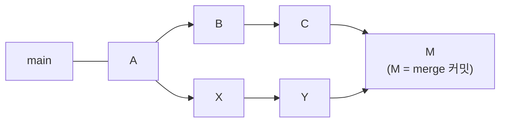
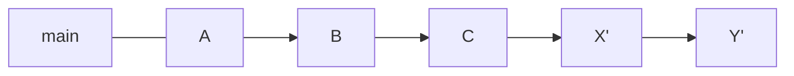

> Mitchell Hashimoto가 gist에 올린 것으로 알려진 merge·squash·rebase에 대한 글을 바탕으로 재구성한 노트다. 팀마다 기본 전략이 다를 수 있는 실무 기준이다. rebase의 황금률은 ByteByteGo의 System Design 101 가이드 「[Git Merge vs. Git Rebase](https://bytebytego.com/guides/git-merge-vs-git-rebate)」를 바탕으로 보강했다. 인터랙티브 rebase 명령표는 arslanbilal의 「[Git and Git Flow Cheat Sheet](https://github.com/arslanbilal/git-cheat-sheet)」와 mingrammer의 「[Git Tips](https://github.com/mingrammer/git-tips)」를 바탕으로 보강했다.
> 「호스팅 서비스의 병합 버튼」은 「[merge, squash, rebase 전략과 커밋 히스토리](https://evan-moon.github.io/2019/08/30/commit-history-merge-strategy)」를 바탕으로 보강했다.

## 정답은 하나가 아니다

merge, squash, rebase는 모두 장점이 있고 **상황에 따라** 고른다. 어느 하나가 언제나 옳다는 주장은 틀렸다. 다만 무엇을 언제 쓸지에는 꽤 넓은 허용 범위가 있다.

| 상황 | 선택 |
| --- | --- |
| 대부분의 PR | **merge 커밋** |
| diff는 작은데 "WIP" 커밋이 잔뜩 있고 목표가 하나 | **squash** + 커밋 메시지 새로 쓰기 |
| diff도 크고 "WIP" 커밋도 많음 | **인터랙티브 rebase**로 골라서 합치고 순서 정리 → merge |

## 기본은 merge 커밋

- **진짜 이력**을 가장 잘 남긴다. 어디서 합쳤는지, 개발자가 거친 중간 커밋이 다 보인다.
- **통째로 되돌리기 쉽다.** `git revert -m 1 <merge 커밋>`이면 PR 전체가 취소된다(`-m`은 기준이 될 부모 번호).
- **`git bisect`가 잘 된다.** 커밋이 잘게 쪼개져 있을수록 버그를 넣은 지점을 좁게 찾는다.

```text
squash 한 덩어리: +2000/-500  → bisect가 여기서 멈추면 사실상 쓸모없음
merge 안의 커밋:  +50/-50      → "아, 여기다" 하고 바로 찾음 (최악이어도 +500/-500 이내)
```

+50/-50짜리 커밋 1,000개가 든 merge가 squash 한 덩어리보다 디버깅에 유리하다. **squash는 이 정보를 없앤다.**

전제가 있다. **모든 커밋이 빌드돼야 한다.** 빌드 안 되는 커밋이 섞이면 bisect가 엉뚱한 곳에서 멈춘다. 팀에는 이 위생을 규칙으로 요구하고, 오픈소스 기여처럼 통제할 수 없을 땐 merge 전에 인터랙티브 rebase로 직접 고친다.

## squash를 쓰는 경우

"WIP", "WIP", "WIP"처럼 의미 없는 커밋이 많지만 **목표가 하나이고 diff가 작은** PR이다. 쪼개 둬도 bisect에 도움이 안 되니 합친다.

이때 **커밋 메시지를 새로 쓴다.** Git·GitHub의 기본 squash 메시지는 합쳐진 커밋 메시지를 이어 붙일 뿐이라 대개 "WIP"의 나열이 된다.

## rebase: 내 브랜치를 최신 기준 위로 옮기기

`git rebase main`은 내 브랜치가 **마치 최신 main에서 시작한 것처럼** 시작점을 옮긴다. merge가 기준 브랜치의 변경을 merge 커밋 하나로 합치는 것과 달리, rebase는 내 커밋들을 최신 main 뒤에 하나씩 다시 쌓는다.

merge:



rebase:



(X, Y가 새 커밋 X', Y'로 다시 만들어짐)

| 장점 | 주의 |
| --- | --- |
| 이력이 일직선이 되어 PR의 변경 범위가 잘 보이고 리뷰가 편하다 | 커밋이 새로 만들어지므로 이미 push한 브랜치라면 force push가 필요하다(`--force` 대신 `--force-with-lease`, [[remote-github\|원격 저장소와 GitHub]]). 여러 사람이 함께 쓰는 브랜치에서는 팀 규칙을 먼저 정한다 |

merge는 **비파괴적**이다. 기존 커밋을 하나도 바꾸지 않고 두 이력을 잇는 커밋 하나를 더할 뿐이다. rebase는 기존 커밋을 버리고 내용이 같은 **새 커밋**(새 해시)을 만든다. 그래서 rebase에는 지켜야 할 황금률이 있다.

> **공개 브랜치는 rebase하지 않는다.** 다른 사람이 이미 받아 간 커밋(main, 함께 쓰는 브랜치)을 rebase하면 그 사람의 이력과 내 이력이 갈라져, 같은 변경이 두 번 들어가거나 충돌이 꼬인다. rebase는 아직 나만 쓰는 브랜치를 정리할 때만 쓴다.

## 인터랙티브 rebase를 쓰는 경우

diff가 크고 WIP도 많으면 squash하면 bisect 정보를 잃고, 그대로 merge하면 쓸모없는 커밋이 남는다. `git rebase -i`로 **관련 커밋끼리 골라서 합치고 순서를 바꿔** 의미 있는 단위로 정리한 다음 merge한다.

```bash
git rebase -i HEAD~4        # 최근 4개 커밋 다듬기
git rebase -i main          # main에서 갈라진 뒤의 내 커밋 전부
```

편집기에 커밋 목록이 **오래된 것부터** 나오고, 줄 앞의 명령을 바꾸거나 줄 순서를 옮겨 저장하면 그대로 다시 쌓는다.

| 명령 | 동작 |
| --- | --- |
| `pick` | 그대로 둔다 |
| `reword` | 내용은 두고 메시지만 고친다 |
| `edit` | 그 커밋에서 멈춘다. 고치고 `git commit --amend` → `git rebase --continue` |
| `squash` | 바로 위 커밋에 합치고 두 메시지를 합쳐 편집한다 |
| `fixup` | 바로 위 커밋에 합치고 이 커밋의 메시지는 버린다 |
| `drop` (또는 줄 삭제) | 커밋을 뺀다 |

고칠 커밋을 미리 알면 `git commit --fixup <커밋>`으로 만들어 두고 `git rebase -i --autosquash main`으로 자동 배치한다([[git-config-options|자주 쓰는 Git 설정 옵션]]의 `rebase.autosquash`). 중간에 꼬이면 `git rebase --abort`로 시작 전으로 돌아간다.

- 개발자가 스스로 커밋을 다듬을 줄 알기를 기대하지만, Git에 익숙하지 않은 사람이 많아 오픈소스에서는 메인테이너가 대신 하기도 한다.
- 커밋이 50개를 넘고 변경 줄이 많은 큰 rebase는 GUI 클라이언트(Tower, Fork, GitKraken 등)를 쓰면 편하다. CLI에 익숙해도 커밋을 끌어다 놓으며 순서를 바꾸는 일은 GUI가 빠르다.

## 호스팅 서비스의 병합 버튼

GitHub의 PR 병합 버튼 세 개가 위 세 전략에 대응한다. 저장소 설정에서 허용할 버튼만 켜 두면 팀 규칙이 강제된다.

| GitHub | Bitbucket | 이력 모양 | 남는 것 | 잃는 것 |
| --- | --- | --- | --- | --- |
| Create a merge commit | Merge commit | 브랜치 + merge 커밋 | 언제 어느 브랜치가 들어왔나, 모든 중간 커밋 | 작은 커밋이 많으면 그래프가 복잡하다 |
| Squash and merge | Squash | PR당 커밋 하나 | PR 단위의 깔끔한 목록 | 커밋별 변경 맥락과 bisect 해상도 |
| Rebase and merge | Fast forward(rebase) | 일직선, merge 커밋 없음 | 개별 커밋 | **합친 시점의 표시**. 릴리스·병합 지점은 태그로 남긴다 |

브랜치 종류별로 다르게 쓰기도 한다. Git Flow라면 `feature` → `develop`은 squash로 기능당 커밋 하나를 남기고, `develop` → `main`은 merge 커밋으로 출시 지점을 남기는 식이다([[branching-strategies|브랜치 전략]]).

## 정리

- 기본은 merge 커밋. 이력이 정확하고, 한 번에 되돌릴 수 있고, bisect가 잘게 찍힌다.
- merge 전략은 **커밋마다 빌드되는** 위생이 받쳐 줘야 한다.
- 작은 diff + WIP 범벅 → squash, 메시지는 다시 쓴다.
- 큰 diff + WIP 범벅 → 인터랙티브 rebase로 정리한 뒤 merge.
- rebase는 이력을 일직선으로 만들지만 커밋을 새로 만든다. 이미 push한 브랜치면 force push가 따라온다.
- 황금률: 남과 함께 쓰는 공개 브랜치는 rebase하지 않는다.

관련 노트: [[merge|Git 브랜치 병합]], [[git-undo-and-rewrite|Git 되돌리기와 이력 다루기]], [[commit-convention|커밋 컨벤션과 자동 검사]], [[github-collaboration|GitHub 협업 저장소 설정]], [[branching-strategies|브랜치 전략]], [[git-history-search|Git 이력 검색]]
