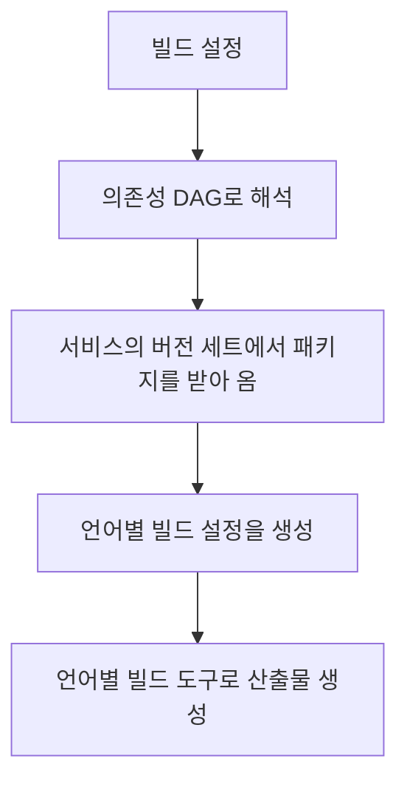
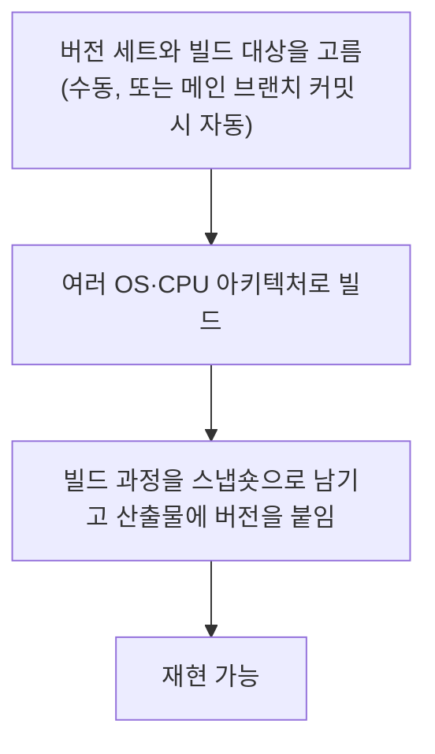

> ByteByteGo의 System Design 101 가이드 「[Monorepo vs. Microrepo](https://bytebytego.com/guides/monorepo-vs)」, 「[Amazon's Build System: Brazil](https://bytebytego.com/guides/how-does-amazon-build-system-work)」를 바탕으로 재구성한 노트다.

## 두 가지 저장소 전략

| 전략 | 뜻 | 대표 사례 |
| --- | --- | --- |
| 모노레포(monorepo) | 회사·조직의 거의 모든 코드를 **저장소 하나**에 둔다. 서비스는 폴더 하나다 | Google, Meta. 리눅스 커널·Windows도 한 저장소에서 개발되었다 |
| 폴리레포(polyrepo, microrepo) | 서비스·라이브러리마다 **저장소를 따로** 둔다 | Amazon, Netflix처럼 마이크로서비스와 팀 자율을 강조하는 조직 |

모노레포는 모놀리스와 다르다. 한 저장소 안에서도 서비스는 따로 빌드·배포될 수 있다. 저장소 전략은 **코드를 어디에 두고 어떻게 함께 바꾸나**의 문제이고, 배포 단위와는 별개다.

## 비교

| 기준 | 모노레포 | 폴리레포 |
| --- | --- | --- |
| 구조 | 서비스마다 폴더. 폴더마다 빌드 설정(`BUILD`)과 소유자 파일(`OWNERS`·`CODEOWNERS`)을 두고 그 폴더를 맡은 팀이 책임진다 | 서비스마다 저장소. 빌드 설정과 권한은 저장소 단위로 정한다 |
| 의존성 버전 | 저장소 전체가 한 버전을 쓴다. 라이브러리를 올리면 모두가 함께 올라간다 | 저장소마다 따로 정한다. 팀이 자기 일정에 맞춰 올린다 |
| 여러 서비스에 걸친 변경 | 커밋 하나(원자적 변경)로 라이브러리와 모든 호출부를 같이 고친다 | 저장소마다 PR을 따로 내고 순서를 맞춰 배포한다 |
| 코드 품질 기준 | 하나의 리뷰·린트·테스트 기준을 모든 코드에 강제하기 쉽다 | 저장소마다 기준이 달라지기 쉽다. 공용 템플릿과 공통 CI로 맞춘다 |
| 확장 | 저장소가 커지면 clone·빌드·CI가 느려진다. 전용 빌드 도구와 Git 최적화가 필요하다 | 저장소가 작아 빨리 시작한다. 대신 저장소가 늘어날수록 거버넌스가 어려워진다 |
| 코드 탐색·재사용 | 모든 코드를 한 번에 검색하고 바로 가져다 쓴다 | 다른 팀 코드를 찾으려면 어느 저장소인지부터 알아야 한다 |

**모노레포는 일관성을, 폴리레포는 팀 자율과 빠른 출발을 산다.** 모노레포는 규모가 커지면 전용 도구에 투자해야 하고, 폴리레포는 규모가 커지면 의존성 버전과 기준이 흩어지는 비용을 치른다.

## 도구

| 전략 | 도구 | 하는 일 |
| --- | --- | --- |
| 모노레포 | Bazel, Buck2 | 변경된 대상만 증분·병렬로 빌드하고 원격 캐시를 공유한다. [[java-build-tools\|Java 빌드 도구와 IntelliJ 실행 오류]] |
| | Nx, Turborepo, pnpm workspaces | 자바스크립트 모노레포에서 패키지 간 의존 그래프를 보고 영향받은 것만 빌드·테스트한다. [[package-managers\|자바스크립트 패키지 매니저]] |
| 폴리레포 | Maven·Gradle, npm, CMake 등 언어별 패키지 관리자 | 저장소마다 의존성을 선언하고 패키지 저장소에서 받아 온다 |

저장소가 커질 때 clone·checkout을 빠르게 하는 Git 기능(부분 클론, 희소 체크아웃)은 [[large-repo-git-performance|대형 저장소에서 Git 빠르게 쓰기]]에 있다.

## 폴리레포에서 버전 맞추기: 버전 세트

폴리레포의 약점은 **수많은 저장소가 서로 다른 의존성 버전을 쓰다 충돌하는 것**이다. Amazon의 빌드 시스템 Brazil은 이 문제를 **버전 세트(version set)** 로 푼다.

| 개념 | 뜻 |
| --- | --- |
| 빌드 설정 파일 | 패키지마다 언어, 버전, 의존성, 메이저 버전, 버전 충돌 해결 규칙만 간단히 적는다 |
| 버전 세트 | 패키지와 그 의존성들의 **버전 조합을 고정한 사적 공간**. 서비스마다 하나씩 가진다. 새 의존성을 쓰려면 먼저 이 세트에 병합해야 한다 |
| live 버전 세트 | 누구나 어떤 버전이든 올릴 수 있는 공용 공간. 각 서비스는 여기서 필요한 버전을 골라 자기 세트로 가져온다 |

로컬 빌드

원격 빌드 (패키지 빌더 서비스)

버전 세트는 **의존성 버전 조합을 서비스별로 명시적으로 고정하고, 그 조합으로만 빌드한다.** 같은 버전 세트로 빌드하면 언제 어디서든 같은 결과가 나온다(재현 가능한 빌드). 자바스크립트의 lock 파일이 저장소 하나 안에서 하는 일을, 버전 세트는 저장소 여러 개에 걸쳐 한다.

## 고르는 기준

- 팀이 작고 서비스끼리 코드를 많이 공유하면 **모노레포**가 대개 편하다. 원자적 변경과 일관된 기준을 바로 얻는다.
- 팀이 독립적으로 배포하고 기술 스택이 서로 다르면 **폴리레포**가 자연스럽다. 대신 공통 템플릿·CI·의존성 관리 체계를 일찍 만든다.
- 어느 쪽이든 규모가 커지면 도구에 투자해야 한다. 모노레포는 빌드 시스템과 Git 최적화, 폴리레포는 버전 관리와 거버넌스.

## 정리

- 모노레포는 코드 하나에 기준 하나, 폴리레포는 서비스마다 저장소와 결정권을 준다.
- 모노레포는 원자적 변경과 일관성을 얻고, 규모가 커지면 Bazel·Nx 같은 전용 도구가 필요하다.
- 폴리레포는 빠르게 출발하지만 의존성 버전과 품질 기준이 흩어진다. 버전 세트 같은 장치로 조합을 고정한다.
- 저장소 전략과 배포 단위(모놀리스·마이크로서비스)는 별개의 결정이다.

관련 노트: [[large-repo-git-performance|대형 저장소에서 Git 빠르게 쓰기]], [[java-build-tools|Java 빌드 도구와 IntelliJ 실행 오류]], [[package-managers|자바스크립트 패키지 매니저: npm, yarn, pnpm]], [[github-collaboration|GitHub 협업 저장소 설정]], [[ci-cd|CI/CD]]
