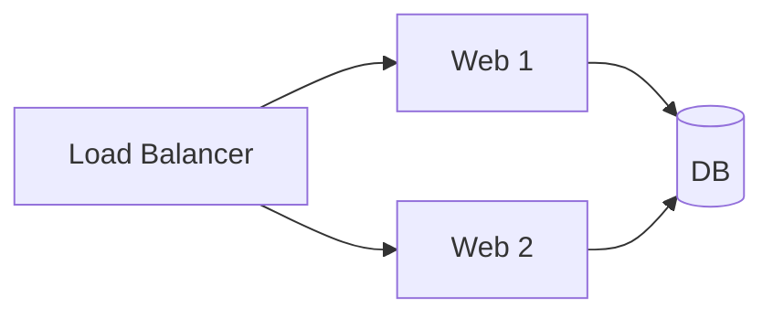

> ByteByteGo의 System Design 101 가이드 「[Diagram as Code](https://bytebytego.com/guides/diagram-as-code)」, 「[Top 6 Tools to Turn Code into Beautiful Diagrams](https://bytebytego.com/guides/top-6-tools-to-turn-code-into-beautiful-diagrams)」, 「[JSON Crack: Visualize JSON Files](https://bytebytego.com/guides/json-files)」를 바탕으로, 각 도구의 공식 문서로 확인해 재구성한 노트다.

## 다이어그램 코드란

**다이어그램 코드(diagram as code)는 그림을 마우스로 그리지 않고 텍스트로 선언해 도구가 렌더링하게 하는 방식이다.** 코드형 인프라(IaC)가 인프라를 코드로 다루듯, 다이어그램을 코드와 같은 저장소에서 관리한다.

| 그림 도구로 그릴 때 | 코드로 그릴 때 |
| --- | --- |
| 바이너리·전용 파일이라 변경 내역을 비교하기 어렵다 | 텍스트 diff로 무엇이 바뀌었는지 리뷰한다 |
| 코드가 바뀌어도 그림은 그대로 낡는다 | 코드와 같은 PR에서 함께 고친다 |
| 배치는 자유롭지만 손이 많이 간다 | 배치는 도구가 자동으로 해서 빠르지만 세밀한 조정은 어렵다 |
| 디자인 도구 계정이 필요하다 | 편집기와 렌더러만 있으면 된다 |

## 도구별 쓰임

| 도구 | 입력 | 잘 그리는 것 | 특징 |
| --- | --- | --- | --- |
| Diagrams | 파이썬 | 클라우드 아키텍처 | AWS·Azure·GCP·쿠버네티스 등 공식 아이콘 노드를 제공한다. 주피터 노트북 안에서도 렌더링된다 |
| Go Diagrams | Go | 클라우드 아키텍처 | Diagrams를 Go로 옮긴 것. Graphviz DOT 파일을 만든다 |
| Mermaid | 마크다운 비슷한 문법 | 흐름도, 시퀀스, 클래스, ER, 간트, 상태 다이어그램 | GitHub·GitLab·여러 문서 도구가 코드 블록을 바로 렌더링한다([[markdown\|Markdown 문법]]) |
| PlantUML | 전용 텍스트 문법 | UML 전반(시퀀스, 유스케이스, 컴포넌트, 배포) | 가장 오래되고 표현력이 넓다. 렌더링에 서버나 자바가 필요하다 |
| ASCII 다이어그램 | 일반 텍스트 | 간단한 흐름, 트리 | 어디서나 보이고 코드 주석에도 넣을 수 있다. 손으로 그리거나 ASCII 편집기를 쓴다 |
| Markmap | 마크다운 제목·목록 | 마인드맵 | 이미 쓴 마크다운 개요를 그대로 접고 펴는 마인드맵으로 바꾼다 |
| JSON Crack | JSON·YAML 등 데이터 | 깊게 중첩된 데이터 구조 | 중첩 객체를 노드 그래프로 펼쳐 읽기 어려운 API 응답·설정 파일을 훑게 해 준다 |

## 예시

Diagrams로 그린 웹 서비스 구성이다. 연산자 `>>`가 화살표다.

```python
from diagrams import Diagram
from diagrams.aws.compute import EC2
from diagrams.aws.database import RDS
from diagrams.aws.network import ELB

with Diagram("Web Service", show=False):
    ELB("lb") >> [EC2("web1"), EC2("web2")] >> RDS("db")
```

같은 흐름을 Mermaid로 쓰면 문서 안에서 바로 보인다.



## 고르는 기준

```text
문서(README, 위키) 안에 바로 보여야 한다       → Mermaid
UML을 정식으로 그려야 한다                    → PlantUML
클라우드 아이콘이 들어간 아키텍처 그림이 필요하다 → Diagrams (Python) / Go Diagrams
코드 주석, 터미널, 어디서나 보여야 한다        → ASCII
개요를 구조로 보고 싶다                       → Markmap
데이터 구조를 이해하고 싶다                    → JSON Crack
```

## 한계

- 자동 배치라서 노드가 많아지면 선이 엉키고, 원하는 위치를 정확히 지정하기 어렵다. 그림 하나에 담는 범위를 줄이는 편이 낫다.
- 발표용처럼 시각적 완성도가 중요한 그림은 여전히 그림 도구(Excalidraw, draw.io, Figma)가 낫다.

## 정리

- 다이어그램을 코드로 두면 리뷰·버전 관리·재생성이 가능하고, 코드와 함께 고칠 수 있다.
- 문서 안 렌더링은 Mermaid, UML은 PlantUML, 클라우드 아키텍처는 Diagrams가 기본 선택이다.
- 배치를 세밀하게 통제해야 하면 그림 도구로 돌아간다.

관련 노트: [[markdown|Markdown 문법]], [[use-case-diagram|유스케이스 다이어그램]], [[terraform-workflow|Terraform: 코드로 클라우드 인프라 만들기]], [[dev-tool-landscape|개발 도구 지형도와 세상을 바꾼 오픈소스]]
